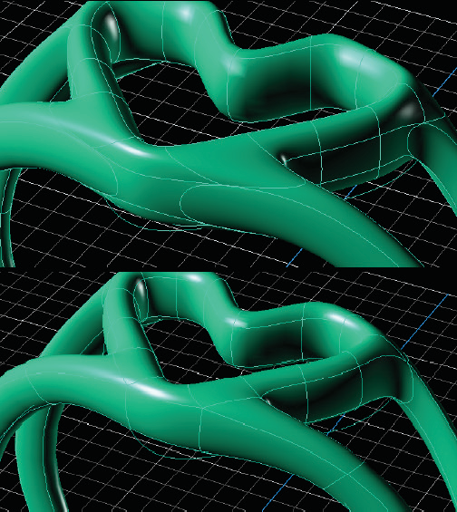

# T-Spline Box 

- Source PDF: Matrix 8 Instruction Manual Book 2 (matrix_8_book_2.pdf)
- Page range: 65-66
- Section title: T-Spline Box 
- Section id: m8book2-085-t-spline-box
- Note: boundary page(s) are shared with a neighbouring section (two-column layout); text/images may include neighbour content.

---
<!-- section m8book2-085-t-spline-box | T-Spline Box  | m8book2 pages 65-66 -->

<!-- page 65 -->

## Make Uniform
‘tsMakeUniform’
This important command is used to align and
relax the surface, making it more uniform. Use the
Make Uniform command anytime you make major
changes to the topology of a model such as after
extruding or inserting edges.
Steps:
• Select T-Spline object to Make Uniform.
• Click on the Make Uniform command in the
T-Spline menu.
T-Splines Primitives consist of the following
commands and are explained in detail next:
• Box
• Sphere
• Quadball
• Cylinder
• Cone
• Torus
• Plane
## T-Spline Box
‘tsBox’
Draws T-Spline Box primitive. You can set the
density of the box in the Command Line. The
density is the number of control points (vertex
grips) that describe the box.
Where is this Command:
Access this command from T-Spline Menu>Box
Steps:
The surface above top demonstrates a model prior
to using the Make Uniform command. The surface
bottom shows the result of running the Make Uniform
command.
• Select Box from the T-Spline menu.
• Draw the base rectangle of the box. Select the
first corner location of the base by clicking in the
viewport.
• Select the location of the other corner of the base
or length by clicking again in the viewport.
• Pick the height of the box by clicking in the
viewport or press Enter to use the width.
## T-Spline Primitives
Begin designing in T-Splines with a geometric
shape to create a ring, bracelet, pendant or
earrings.
Each command can be accessed from the Main
Menu>T-Splines menu or the top drop down
T-Splines menu.
Box complete and selecting the height of the Box.

<!-- page 66 -->

### Options:
ZSymmetry: Option is only available when
AxialSymmetry is set to ‘Yes’. Adds Symmetry
along the Z axis.
3Point: Draws the base rectangle using two
adjacent corner locations and a location on the
opposite side.
## T-Spline Sphere
3Point steps:
• Pick the start of an edge.
• Pick the end of the edge
• Pick or type the width.
‘tsSphere’
Creates a T-Spline sphere. T-Spline Sphere has
similar options to the Rhino Sphere command.
The T-Spline Sphere command is not an exact
sphere; it’s a degree 3 approximation of a sphere.
Vertical: Draws the base rectangle so that it is
perpendicular to the Construction plane.
Vertical steps:
Where is this Command:
Access this command from T-Spline>Sphere
Steps:
• Pick the start of the edge.
• Pick the end of the edge.
• Pick or type a width.
Center: Draws the base rectangle around a
center point.
Center steps:
• Pick the center for the base rectangle.
• Pick the other corner or type a length.
• Select Sphere from the T-Spline menu.
• Pick the center of the Sphere  location in the
viewport.
• Select the Radius for the base circle by dragging
your mouse away from the center point to
increase the size. Click to set the value or enter a
Radius value in the Command Line.
OutputType = Smooth: This is the default
mode for T-Splines primitives.
OutputType = Box: Setting the output to box
will allow for faster editing of the model.
XFaces: Sets the number of control points on the
X axis direction of the box.
YFaces: Sets the number of control points on the
Y axis direction of the box.
Setting the value of the Radius of the Sphere (left)
and Sphere complete (right).
ZFaces: Sets the number of control points on the
Z axis direction of the box.
### Options:
AxialSymmetry: Adds symmetry across an axis,
when set to ‘yes’ you can add symmetry in the X,
Y, or Z axes.
Radius (default): Define the base circle for the
Sphere from a center point and the Radius of a
circle. You can set the Radius by clicking a point or
typing a value in the Command Line.
XSymmetry: Option is only available when
AxialSymmetry is set to ‘Yes’. Adds Symmetry
along the X axis.
Diameter: Define the base circle for the Sphere
from a center point and the Diameter of a circle.
Set the Diameter by clicking a point or typing a
value in the Command Line.
YSymmetry: Option is only available when
AxialSymmetry is set to ‘Yes’. Adds Symmetry
along the Y axis.

---

## Images

-  page 65 (shared page)
-  page 65 (shared page)
-  page 65 (shared page)
-  page 66 (shared page)
