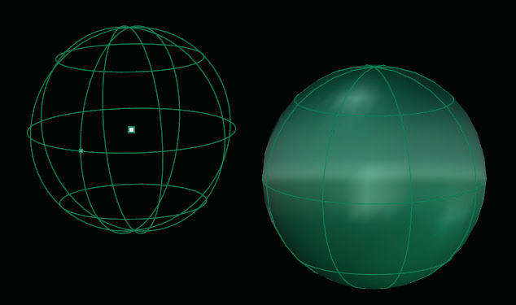
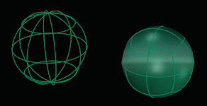

# T-Spline Sphere 

- Source PDF: Matrix 8 Instruction Manual Book 2 (matrix_8_book_2.pdf)
- Page range: 66-68
- Section title: T-Spline Sphere 
- Section id: m8book2-086-t-spline-sphere
- Note: boundary page(s) are shared with a neighbouring section (two-column layout); text/images may include neighbour content.

---
<!-- section m8book2-086-t-spline-sphere | T-Spline Sphere  | m8book2 pages 66-68 -->

<!-- page 66 -->

### Options:
ZSymmetry: Option is only available when
AxialSymmetry is set to ‘Yes’. Adds Symmetry
along the Z axis.
3Point: Draws the base rectangle using two
adjacent corner locations and a location on the
opposite side.
## T-Spline Sphere
3Point steps:
• Pick the start of an edge.
• Pick the end of the edge
• Pick or type the width.
‘tsSphere’
Creates a T-Spline sphere. T-Spline Sphere has
similar options to the Rhino Sphere command.
The T-Spline Sphere command is not an exact
sphere; it’s a degree 3 approximation of a sphere.
Vertical: Draws the base rectangle so that it is
perpendicular to the Construction plane.
Vertical steps:
Where is this Command:
Access this command from T-Spline>Sphere
Steps:
• Pick the start of the edge.
• Pick the end of the edge.
• Pick or type a width.
Center: Draws the base rectangle around a
center point.
Center steps:
• Pick the center for the base rectangle.
• Pick the other corner or type a length.
• Select Sphere from the T-Spline menu.
• Pick the center of the Sphere  location in the
viewport.
• Select the Radius for the base circle by dragging
your mouse away from the center point to
increase the size. Click to set the value or enter a
Radius value in the Command Line.
OutputType = Smooth: This is the default
mode for T-Splines primitives.
OutputType = Box: Setting the output to box
will allow for faster editing of the model.
XFaces: Sets the number of control points on the
X axis direction of the box.
YFaces: Sets the number of control points on the
Y axis direction of the box.
Setting the value of the Radius of the Sphere (left)
and Sphere complete (right).
ZFaces: Sets the number of control points on the
Z axis direction of the box.
### Options:
AxialSymmetry: Adds symmetry across an axis,
when set to ‘yes’ you can add symmetry in the X,
Y, or Z axes.
Radius (default): Define the base circle for the
Sphere from a center point and the Radius of a
circle. You can set the Radius by clicking a point or
typing a value in the Command Line.
XSymmetry: Option is only available when
AxialSymmetry is set to ‘Yes’. Adds Symmetry
along the X axis.
Diameter: Define the base circle for the Sphere
from a center point and the Diameter of a circle.
Set the Diameter by clicking a point or typing a
value in the Command Line.
YSymmetry: Option is only available when
AxialSymmetry is set to ‘Yes’. Adds Symmetry
along the Y axis.

<!-- page 67 -->

4Point steps:
Orientation: Set the plane normal for the base
circle of the Sphere. From the center point pick a
second point to set the orientation of the plane.
• Pick three points, or two points and a Radius to
define a circle that will lie on the Sphere.
• If no Radius is specified, pick a fourth point to
specify the Sphere’s location. The fourth point
sets the size of a Sphere constrained by the circle.
Circumference: Define the base circle for the
Sphere from a center point and the circumference
of a circle. You can set the circumference by
clicking a point or typing a value in the Command
Line.
FitPoints: Draws a circle by fitting to selected
point objects, curve and surface control points,
and mesh vertices.
Steps:
Area: Define the Sphere by setting its area. You
can set the area by clicking a point or typing a
value in the Command Line.
• Select point objects or control points.
• A minimum of three points or control points is
required.
### Other Sphere Options:
### T-Spline Options:
2Point: Draws the Circle from the two ends of its
diameter.
Steps:
These options are the same regardless of the
circle option used to defined the sphere.
• Pick the start Diameter.
• Pick the end Diameter.
OutputType:
3Point: Draws a circle through three points on
the Circumference.
Smooth: This is the default mode for T-Splines
Primitives.
Steps:
• Pick three points that define the Circumference.
Box: Setting the output to Box will allow for faster
editing of the model.
3Point Options:
Radius: Specifies the Radius and orientation for
the base circle after two points have been picked.
VerticalFaces: Set the amount of control points
in the vertical direction of the Sphere.
Steps:
AroundFaces: Set the amount of control points
in the horizontal direction of the Sphere.
• Pick a location or type a Radius value.
• Pick a direction to orient the circle.
Tangent: Draws a circle tangent to curves.
Steps:
Symmetry: When set to ‘Yes’ options for Axial
symmetry and Radial Symmetry appear in the
Command Line.
• Pick the first tangent location on the first curve.
AroundCurve: Draws a circle perpendicular to a
curve.
Steps:
AxialSymmetry: Adds Symmetry across an
axis, when set to ‘Yes’ you can add Symmetry
in the X, Y, or Z axes. XSymmetry: Option is only
available when AxialSymmetry is set to ‘Yes’. Adds
Symmetry along the X axis.
• Select a curve and pick the center of the circle on
the curve and a Radius or Diameter.
YSymmetry: Option is only available when
AxialSymmetry is set to ‘Yes’. Adds Symmetry
along the Y axis.
4Point: Draws the Sphere based on three
points that define a circumference and a point to
establish the location

<!-- page 68 -->

ZSymmetry: Option is only available when
AxialSymmetry is set to ‘Yes’. Adds Symmetry
along the Z axis.
Diameter: Define the base circle for the Sphere
from a center point and the Diameter of a circle.
set the Diameter by clicking a point or typing a
value in the Command Line.
Radial Symmetry: Adds Radial Symmetry when
set to ‘Yes’.
Orientation: Set the plane normal for the base
circle of the Sphere. From the center point pick a
second point to set the orientation of the plane.
SymmetrySegments: When Radial Symmetry
is set to ‘Yes’ this option becomes available. Select
how many Symmetry segments or ‘pie pieces’ the
Sphere is broken into.
Circumference: Define the base circle for the
Sphere from a center point and the Circumference
of a circle. You can set the Circumference by
clicking a point or typing a value in the Command
Line.
FacesPerSegment: When Radial Symmetry is
set to ‘Yes’ this option becomes available. Select
how many faces appear in each Symmetry.
## T-Spline Quadball
Area: Define the Sphere by setting its area. You
can set the area by clicking a point or typing a
value in the Command Line.
### T-Spline Options:
‘tsQuadBall’
This command makes a T-Splines Quadball.
Quadballs are spherical shapes with a box-like
topology.
These options are the same regardless of the
Circle Option used to defined the Sphere.
Where is this Command:
Access this command from T-Spline>Quadball
Steps:
OutputType:
Smooth: This is the default mode for T-Splines
primitives.
Box: Setting the output to box will allow for faster
editing of the model.
NumEdgeSegments: Set the number of faces
per “side” of the Quadball.
• Select Quadball from the T-Spline menu.
• Pick the center of the Sphere  location in the
viewport.
• Select the Radius for the base circle by dragging
your mouse away from the center point to
increase the size. Click to set the value or enter a
Radius value in the Command Line.
AxialSymmetry: Adds Symmetry across an
axis, when set to ‘Yes’ you can add Symmetry
in the X, Y, or Z axes. XSymmetry: Option is only
available when AxialSymmetry is set to ‘Yes’. Adds
Symmetry along the X axis.
YSymmetry: Option is only available when
AxialSymmetry is set to ‘Yes’. Adds Symmetry
along the Y axis.
Selecting a value for the Sphere (left) and Quadball
complete (right).
ZSymmetry: Option is only available when
AxialSymmetry is set to ‘Yes’. Adds Symmetry
along the Z axis.
Radius: Define the base circle for the Sphere
from a center point and the Radius of a circle. You
can set the radius by clicking a point or typing a
value in the Command Line.

---

## Images

-  page 66 (shared page)
-  page 68
