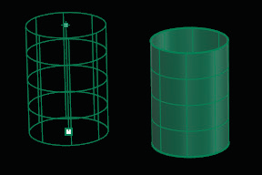

# T-Spline Cylinder 

- Source PDF: Matrix 8 Instruction Manual Book 2 (matrix_8_book_2.pdf)
- Page range: 69-71
- Section title: T-Spline Cylinder 
- Section id: m8book2-087-t-spline-cylinder
- Note: boundary page(s) are shared with a neighbouring section (two-column layout); text/images may include neighbour content.

---
<!-- section m8book2-087-t-spline-cylinder | T-Spline Cylinder  | m8book2 pages 69-71 -->

<!-- page 69 -->

## T-Spline Cylinder
### Circle (of Quadball Sphere) Options
### Continued:
‘tsCylinder’
Creates a T-Spline Cylinder primitive.
2Point: Draws the Quadball from the two ends of
its Diameter.
Steps:
Where is this Command:
Access this command from T-Spline>Cylinder
• Pick the start Diameter.
• Pick the end Diameter.
Center Steps:
3Point: Draws a Quadball through three points
on the circumference.
Steps:
• Pick three points that define the Circumference.
• Select Cylinder from the T-Spline menu.
• Pick the center for the base of the Cylinder by
clicking once in the viewport.
• Select the Radius for the base circle by dragging
the mouse away from center to increase it or type
a value in the Command Line.
• Set the End or Height of the Cylinder by clicking in
the viewport or typing a value.
3Point options:
Radius: Specifies the Radius and orientation for
the Quadball after two points have been picked.
Steps:
• Pick a location or type a Radius value.
• Pick a Direction to orient the circle.
Tangent: Draws a Quadball tangent to curves.
Steps:
• Pick the first tangent location on the first curve.
AroundCurve: Draws a Quadball perpendicular
to a curve.
Selecting the Height of the Cylinder (left) and
Cylinder complete (right).
Around Curve Steps:
### Circle Options:
•  Select a curve and pick the center of the circle on
the curve and a Radius or Diameter.
The default mode for creating the base circle
for the Cylinder from the center point to select a
Radius.
4Point: Draws the Quadball based on three
points that define a circumference and a point to
establish the location
4Point steps:
Radius (default): Define the base circle for the
Cylinder from a center point and the Radius of a
circle. Set the Radius by clicking a point or typing
a value in the Command Line.
• Pick three points, or two points and a Radius to
define a circle that will lie on the Sphere.
• If ‘No’ Radius is specified, pick a fourth point to
specify the sphere’s location. The fourth point
sets the size of a Sphere constrained by the circle.
Diameter: Define the base circle for the Cylinder
from a center point and the Diameter of a circle.
Set the Diameter by clicking a point or typing a
value in the Command Line.
FitPoints: Draws a Quadball by fitting to
selected point objects, curve and surface control
points, and mesh vertices.
Fit Point Steps:
• Select point objects or control points. A minimum
of three points or control points is required
Circumference: Define the base circle for
the Cylinder from a center point and the
Circumference of a circle. You can set the
Circumference by clicking a point or typing a
value in the Command Line.

<!-- page 70 -->

### Cylinder Options:
Area: Define the Cylinder by setting its area. You
can set the area by clicking a point or typing a
value in the Command Line.
DirectionConstraint:
None: No direction constraint.
### T-Spline Options:
Vertical: Constrains the Height of the Cylinder
perpendicular to the Construction plane.
These options are the same regardless of the
option used to defined the Cylinder.
AroundCurve: Makes the initial circle
perpendicular to a curve point. Select an existing
curve when prompted.
OutputType:
Smooth: This is the default mode for T-Splines
primitives.
Solid: Defaults to ‘No’ creating a open T-Spline
surface. Toggle to ‘Yes’ to create a closed Cylinder.
Box: Setting the output to box will allow for faster
editing of the model.
2Point: Draws the Circle for the Cylinder base
from the two ends of its Diameter.
2Point Steps:
VerticalFaces: Set the amount of control points
in the vertical direction of the sphere.
• Pick the start and end diameter.
AroundFaces: Set the amount of control points
in the horizontal direction of the sphere.
3Point: Draws a circle for the Cylinder base
through three points on the Circumference.
3Point Steps:
• Pick three points that define the Circumference.
Symmetry: When set to ‘Yes’ options for Axial
Symmetry and Radial Symmetry appear in the
Command Line.
3Point options:
Radius: Specifies the Radius and orientation for
the circle for the Cylinder base after two points
have been picked.
AxialSymmetry: Adds Symmetry across an
axis, when set to ‘Yes’ you can add Symmetry
in the X, Y, or Z axes. XSymmetry: Option is only
available when AxialSymmetry is set to ‘Yes’. Adds
Symmetry along the X axis.
Radius Steps:
• Pick a location or type a Radius value.
• Pick a direction to orient the circle for the Cylinder
base.
YSymmetry: Option is only available when
AxialSymmetry is set to ‘Yes’. Adds Symmetry
along the Y axis.
Tangent: Draws a circle tangent to curves.
Tangent Steps:
ZSymmetry: Option is only available when
AxialSymmetry is set to ‘Yes’. Adds Symmetry
along the Z axis.
Radial Symmetry: Adds Radial Symmetry when
set to ‘Yes’.
• Pick the first tangent location on the first curve.
• Pick the second tangent curve or enter a Radius
amount.
• Pick a third point (Point). Press Enter to draw circle
from first two points.
FitPoints: Draws a circle by fitting to selected
point objects, curve and surface control points,
and mesh vertices.
SymmetrySegments: When Radial Symmetry
is set to ‘Yes’ this option becomes available. Select
how many Symmetry segments or ‘pie pieces’ the
Cylinder is broken into.
FitPoints Steps:
• Select point objects or control points to build a
circle from. A minimum of three points or control
points is required.
FacesPerSegment: When Radial Symmetry is
set to ‘Yes’ this option becomes available. Select
how many faces appear in each Symmetry.

<!-- page 71 -->

### T-Spline Options:
## T-Spline Cone
These options are the same regardless of the
circle option used to defined the Cone.
‘tsCone’
Creates a T-Spline Cone primitive.
Where is this Command:
Access this command from T-Spline>Cone
OutputType:
Smooth: This is the default mode for T-Splines
primitives.
Center Steps:
Box: Setting the output to box will allow for faster
editing of the model.
VerticalFaces: Set the amount of control points
in the vertical direction of the Cone.
AroundFaces: Set the amount of control points
in the horizontal direction of the Cone.
• Select Cone from the T-Spline menu.
• Pick the center for the base of the Cone by clicking
once in the viewport.
• Select the Radius for the base circle by dragging
the mouse away from center to increase it or type
a value in the Command Line.
• Set the End or Height of the Cone by clicking in
the viewport or typing a value
### Base Circle Options:
Symmetry: When set to ‘Yes’ options for Axial
Symmetry and Radial Symmetry appear in the
Command Line.
Radius (default): Define the base circle for the
Cone from a center point and the Radius of a
circle. You can set the Radius by clicking a point or
typing a value in the Command Line.
AxialSymmetry: Adds Symmetry across an
axis, when set to ‘Yes’ you can add Symmetry
in the X, Y, or Z axes. XSymmetry: Option is only
available when AxialSymmetry is set to ‘Yes’. Adds
Symmetry along the X axis.
Diameter: Define the base circle for the Cone
from a center point and the Diameter of a circle.
Set the Diameter by clicking a point or typing a
value in the Command Line.
YSymmetry: Option is only available when
AxialSymmetry is set to ‘Yes’. Adds Symmetry
along the Y axis.
Circumference: Define the base circle for the
Cone from a center point and the Circumference
of a circle. Set the Circumference by clicking a
point or typing a value in the Command Line.
ZSymmetry: Option is only available when
AxialSymmetry is set to ‘Yes’. Adds Symmetry
along the Z axis.
Radial Symmetry: Adds Radial Symmetry when
set to ‘Yes’.
Area: Define the Cone by setting its area. Set the
area by dragging the mouse and clicking a point
or typing a value in the Command Line.
SymmetrySegments: When Radial Symmetry
is set to ‘Yes’ this option becomes available. Select
how many Symmetry segments or ‘pie pieces’ the
Cone is broken into.
FacesPerSegment: When Radial Symmetry is set
to ‘Yes’ this option becomes available. Select how
many faces appear in each Symmetry.
Selecting a Cone Height (left) and Cone complete
(right).

---

## Images

-  page 69
-  page 71 (shared page)
