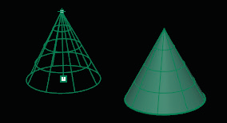
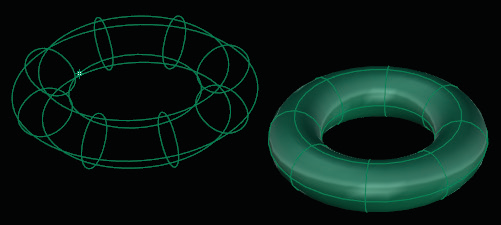

# T-Spline Cone 

- Source PDF: Matrix 8 Instruction Manual Book 2 (matrix_8_book_2.pdf)
- Page range: 71-72
- Section title: T-Spline Cone 
- Section id: m8book2-088-t-spline-cone
- Note: boundary page(s) are shared with a neighbouring section (two-column layout); text/images may include neighbour content.

---
<!-- section m8book2-088-t-spline-cone | T-Spline Cone  | m8book2 pages 71-72 -->

<!-- page 71 -->

### T-Spline Options:
## T-Spline Cone
These options are the same regardless of the
circle option used to defined the Cone.
‘tsCone’
Creates a T-Spline Cone primitive.
Where is this Command:
Access this command from T-Spline>Cone
OutputType:
Smooth: This is the default mode for T-Splines
primitives.
Center Steps:
Box: Setting the output to box will allow for faster
editing of the model.
VerticalFaces: Set the amount of control points
in the vertical direction of the Cone.
AroundFaces: Set the amount of control points
in the horizontal direction of the Cone.
• Select Cone from the T-Spline menu.
• Pick the center for the base of the Cone by clicking
once in the viewport.
• Select the Radius for the base circle by dragging
the mouse away from center to increase it or type
a value in the Command Line.
• Set the End or Height of the Cone by clicking in
the viewport or typing a value
### Base Circle Options:
Symmetry: When set to ‘Yes’ options for Axial
Symmetry and Radial Symmetry appear in the
Command Line.
Radius (default): Define the base circle for the
Cone from a center point and the Radius of a
circle. You can set the Radius by clicking a point or
typing a value in the Command Line.
AxialSymmetry: Adds Symmetry across an
axis, when set to ‘Yes’ you can add Symmetry
in the X, Y, or Z axes. XSymmetry: Option is only
available when AxialSymmetry is set to ‘Yes’. Adds
Symmetry along the X axis.
Diameter: Define the base circle for the Cone
from a center point and the Diameter of a circle.
Set the Diameter by clicking a point or typing a
value in the Command Line.
YSymmetry: Option is only available when
AxialSymmetry is set to ‘Yes’. Adds Symmetry
along the Y axis.
Circumference: Define the base circle for the
Cone from a center point and the Circumference
of a circle. Set the Circumference by clicking a
point or typing a value in the Command Line.
ZSymmetry: Option is only available when
AxialSymmetry is set to ‘Yes’. Adds Symmetry
along the Z axis.
Radial Symmetry: Adds Radial Symmetry when
set to ‘Yes’.
Area: Define the Cone by setting its area. Set the
area by dragging the mouse and clicking a point
or typing a value in the Command Line.
SymmetrySegments: When Radial Symmetry
is set to ‘Yes’ this option becomes available. Select
how many Symmetry segments or ‘pie pieces’ the
Cone is broken into.
FacesPerSegment: When Radial Symmetry is set
to ‘Yes’ this option becomes available. Select how
many faces appear in each Symmetry.
Selecting a Cone Height (left) and Cone complete
(right).

<!-- page 72 -->

### Cone Options:
Where is this Command:
Access this command from T-Spline>Torus
DirectionConstraint:
None: No direction constraint.
Steps:
Vertical: Constrains the Height of the Cone
perpendicular to the Construction plane.
AroundCurve: Makes the initial circle
perpendicular to a curve point.
Solid: Defaults to ‘No’ creating a open T-Spline
surface. Toggle to ‘Yes’ to create a closed Cone.
• Select Torus from the T-Spline menu.
• Pick the center or circle for the base by clicking
once in the viewport.
• Select the Radius for the base circle by dragging
the mouse away from center to increase it or type
a value in the Command Line.
• Set the second Radius of the Torus which equals
the height, by clicking in the viewport or typing a
value
2Point: Draws the Circle from the two ends of its
Diameter.
### Base Circle Options (Center):
Steps:
Radius (default): Define the base circle for the
Torus from a center point and the Radius of a
circle. You can set the Radius by clicking a point or
typing a value in the Command Line.
• Pick the start and end diameter.
3Point: Draws a circle through three points on
the circumference.
Steps:
• Pick three points that define the circumference.
Diameter: Define the base circle for the Torus
from a center point and the Diameter of a circle.
Set the diameter by clicking a point or typing a
value in the Command Line.
3Point options:
Radius: Specifies the radius and orientation for
the circle after two points have been picked.
Steps:
Circumference: Define the base circle for the
Torus from a center point and the Circumference
of a circle. Set the Circumference by clicking a
point or typing a value in the Command Line.
• Pick a location or type a radius value.
• Pick a direction to orient the circle.
Tangent: Draws a circle tangent to curves.
Area: Define the Torus by setting its area. Set the
area by clicking a point or typing a value in the
Command Line.
Steps:
• Pick the first tangent location on the first curve.
FitPoints: Draws a circle by fitting to selected
point objects, curve and surface control points,
and mesh vertices.
Fit Point Steps:
• Select point objects or control points. A minimum
of three points or control points is required.
Selecting a second Radius for the Torus Height (left)
and Torus complete (right).
## T-Spline Torus
‘tsTorus’
Creates a T-Spline Torus which is doughnut
shaped. .

---

## Images

-  page 71 (shared page)
-  page 72 (shared page)
