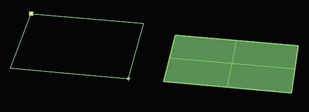
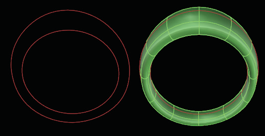
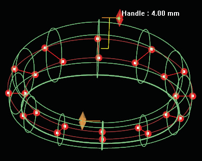
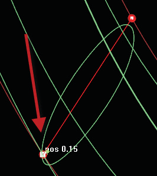
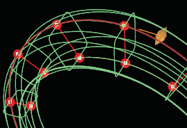
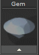
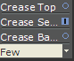

# T-Splines Tube from Curves 

- Source PDF: Matrix 8 Instruction Manual Book 2 (matrix_8_book_2.pdf)
- Page range: 74-76
- Section title: T-Splines Tube from Curves 
- Section id: m8book2-091-t-splines-tube-from-curves
- Note: boundary page(s) are shared with a neighbouring section (two-column layout); text/images may include neighbour content.

---
<!-- section m8book2-091-t-splines-tube-from-curves | T-Splines Tube from Curves  | m8book2 pages 74-76 -->

<!-- page 74 -->

### Options:
Where is this Command:
Access this command from T-Spline>Plane
Steps:
OutputType=Smooth/Box: Controls whether
the resulting frame is output in Smooth mode or
in Box mode.
XFaces: Defines the number of faces along the X
axis
• Select Plane from the T-Spline menu.
• Pick the first corner.
• Pick the Second corner
### Command Line Options:
YFaces: Defines the number of faces along the Y
axis
Axial Symmetry=Yes/No: If yes resulting
T-Spline will have Symmetry applied as specified.
3Point: The “3Point” option draws the plane on
an angle, as opposed to aligning the Plane along
the viewport grid.
Steps:
• Pick the first corner.
• Pick the second corner.
• Pick the third corner.
XSymmetry=Yes/No: This option is available
when Axial Symmetry is set to ‘Yes’. This will
add Symmetry along the X axis in the resulting
T-Spline.
YSymmetry=Yes/No: This option is available
when Axial Symmetry is set to ‘Yes’. This adds
Symmetry along the Y axis in the resulting
T-Spline.
Vertical: The “Vertical” Command Line option
draws the Plane, beginning from one point
in space. The next click draws a line, then a
rectangle. This option allows you to draw a Plane
on an angle and determine its exact orientation in
the viewport.
## T-Splines Tube from Curves
Steps:
• Pick the first corner.
• Pick the second corner.
• Pick the third corner.
‘gvtsTubeFromCrvs’
This useful builder was created to quickly build
ring shanks and control the topology of the shank
with its Command Line options.
Center: The “Center” Command Line option
begins drawing the plane from it’s center out, as
opposed to drawing the plane from one of its
corners.
Where is this Command:
Access this command from T-Spline> T-Splines
Tube From Curves
Steps:
Steps:
• Pick a point to set the center of the Plane.
• Pick a second point to set the length and width of
the Planes edges.
• Start with two existing curves.
• Select the Tube from Curves command in the
T-Spline menu.
• Select the first curve.
• Select the second curve.
• Adjust the Tube using the Viewport Control
Handles and the options in the Command Line.
Selecting a second corner for the Plane (left) and
Plane complete (right).

<!-- page 75 -->

### Options:
SlashCount: Controls the number of slashes
along the T-Spline surface. Slashes will be evenly
distributed throughout the surface.
Add Slash: Add additional slashes and control to
a model at any location.
DeleteSlash: Delete any unwanted slashes.
Tube from Curves using two ring rails.
AddHeight: Adds a Viewport Control Handle
(VCH) to any existing slash allowing you to adjust
the ‘Height’ of the surface.
### Edit Dimensions:
DeleteHeight: Removes an existing VCH from
the model.
Mirror: Adjustments make to one side of a
Symmetrical model are mirrored to the opposite
side of the model.
Adjust Height: By default this command will
display two Viewport Control Handles representing
the ‘Height’ of the T-Spline surface. Additional
Viewport Control Handles can be added to any
slash by clicking ‘AddHeight’ in the Command Line
and then clicking on a slash to add the handle.
Control Points 1/2:  The “Control Points”
Command Line options can be set to 1 or 2. This
setting controls the shape of the profile curve.
When set to 1, the profile is a soft half-round
comfort-fit shape. When set to 2, the profile shape
stiffens slightly and some of the curvature is
removed, flattening the inside and outside face
surfaces.
Use the Viewport Control Handles to adjust the Tube
height.
Control Points set to 2 changes the profile shape by
flattening the top and bottom.
Tilt Slash: You can Tilt any of the slashes (red
cross-section curves) by clicking and dragging on
the points at either end of the
CurveClosed: The “CurveClosed” option is a
Yes/No toggle that determines if the T-Spline
surface is open or closed. This toggle is
predetermined depending on the type of curves
you are using with the builder. If the curves
are open, the builder is smart and will use the
“ClosedCurve” option toggled to “No” and the
“EndCaps” option is available
slash. Doing so will effect the
T-Spline surface. If you wish
to adjust a slash on a
symmetrical model make
sure that Mirror is set to ‘Yes’
in the Command Line. Add
additional slashes for more
control by using the ‘AddSlash’ option in the
Command Line.

<!-- page 76 -->

### Editing Dimensions:
Bezel Height: Bezel Height adjusts the bezel’s
EndCaps: This option appears when
‘CurveClosed’ is set to No. This option finishes the
open end with a smooth End Cap.
height from the top to the base of the
bezel. Adjust in the builder by selecting
the Bezel Height icon at the left, running
the slider below-or typing a length in
mm the box. You can also use the Yellow Vertical
Viewport Control Handle on the base bezel.
BackClosed: The “BackClosed” option removes
half of the ring and is ideal if you are creating a
split-shank appearance and want to work with one
half of the design and later mirror it to the other
side.
Top Thickness: Top Thickness adjusts the
## T-Spline Bezel Builder
‘gvtsBezelBuilder’
Creates a T-Spline bezel around an existing gem.
thickness of the bezel at the girdle of
the stone. Adjust in the builder by
selecting the Top Thickness icon at the
left, running the slider below-or typing a
length in mm the box. You can also use the Yellow
Horizontal Viewport Control Handle on the side of
the bezel.
Where is this Command:
Access this builder from T-Spline> T-Splines
Bezel
Base Thickness: Base Thickness adjusts the
or from the F6 menu when a gem is selected
Steps:
thickness of the bezel at its base. Adjust
in the builder by selecting the Base
Thickness icon at the left, running the
slider below-or typing a length in mm
the box. You can also use the Yellow Horizontal
Viewport Control Handle on the base of the bezel.
• Select T-Spline Bezel from the T-Spline menu.
(Also located in the Settings Menu or from the F6
menu with a stone selected.)
• Put the selected stone into the Bezel
Dome Height: Dome Height extends the
Builder input box (not necessary if
you used F6).
• Matrix will generate a preview of the
bezel.
### Options:
rounded edge on the top of the bezel.
Adjust in the builder by selecting the
Dome Height icon at the left, running
the slider below-or typing a length in
mm the box. You can also use the Light Blue
Vertical Viewport Control Handle on the bezel top.
Seat Height: Seat Depth will adjust how deep
Crease Top: This option adds a crease to the
top of the bezel making it so the
top surface is flat instead of domed.
This option is off by default.
Crease Seat: This option adds a
crease to the seat of the bezel making it so the
gem set is flat. This option is on by default.
the gem sits in the bezel. Adjust in the
builder by selecting the Seat Depth
icon at the left, running the slider
below-or typing length in mm in the
box. You can also use the Blue Vertical Viewport
Control Handle on the top of the bezel.
Seat Length: Seat Length adjusts how far down
Crease Bottom: This option adds a crease to
the bottom of the bezel making it so the bottom
surface is flat. This option is off by default.
the pavilion of the stone the seat of the
bezel extends. Adjust in the builder by
selecting the Seat Length icon at the
left, running the slider below-or typing
length in mm in the box. You can also use the Blue
Diagonal Viewport Control Handle on the seat of
the bezel.
Faces: Few/Many: This controls how many
faces the T-Splines bezel will have once created.
Remember because the resulting geometry is a
T-Splines object you can always divide faces after
the bezel is created to gain more control.

---

## Images

-  page 74 (shared page)
-  page 75
-  page 75
-  page 75
-  page 75
-  page 76 (shared page)
-  page 76 (shared page)
