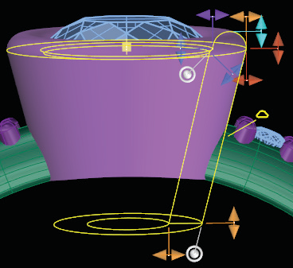
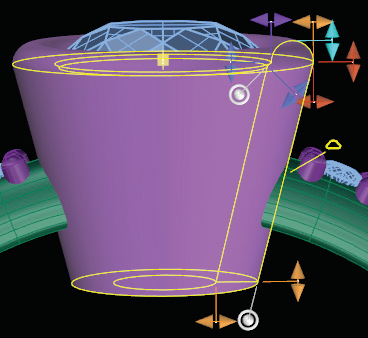
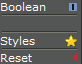

# T-Splines Bezel

- Source PDF: Matrix 8 Instruction Manual Book 2 (matrix_8_book_2.pdf)
- Page range: 252-254
- Section title: T-Splines Bezel
- Section id: m8book2-220-t-splines-bezel
- Note: boundary page(s) are shared with a neighbouring section (two-column layout); text/images may include neighbour content.

---
<!-- section m8book2-220-t-splines-bezel | T-Splines Bezel | m8book2 pages 252-254 -->

<!-- page 252 -->

Example: Boolean ON
### Editing Dimensions:
Bezel Height: Bezel Height adjusts the gallery’s
overall height. Adjust in the builder by
selecting the Bezel Height icon at the
left, running the slider below-or typing a
length in mm the box. You can also use
the Yellow Vertical Viewport Control Handle on
the base of the bezel.
Top Thickness: Top Thickness adjusts the
Example: Boolean OFF
thickness of the gallery rail. Adjust in
the builder by selecting the Top
Thickness icon at the left, running the
slider below-or typing a length in mm
the box. You can also use the Yellow Horizontal
Viewport Control Handle on the side of the bezel.
Bezel Angle: Bezel Angle adjusts the angle of
the gallery rail. Adjust in the builder by
selecting the Bezel Angle icon at the
left, running the slider below-or typing
degree in the box. You can also use the
White Rotation Viewport Control Handle on the
base of the bezel.
Bezel Placement: Bezel Placement adjusts
Styles: Styles allow you quick access to standard
designs within the builder. You can
also add your own styles so that
you can access them quickly
through the builder. Learn about
using and creating Styles in the
Styles section of the manual.
the position of the gallery rail moving it
up or down. Adjust in the builder by
selecting the Bezel Placement icon at
the left, running the slider below-or
typing a length in mm in the box. You can also use
the Yellow cube Viewport Control Handle on the
bezel.
Reset: This resets the builder back to the default.
Bezel Scale: Bezel Scale adjusts the overall scale
## T-Splines Bezel
‘gvtsBezel’
Create a T-Splines bezel around an existing gem.
of the gallery rail. Adjust in the builder
by selecting the Bezel Scale icon at the
left, running the slider below-or typing
percentage in the box. You can also use
the Violet Horizontal Viewport Control Handle on
the seat of the bezel.
Where is this Command:
Access this command from Setting> T-Splines
Bezel
### Options:
or from the F6 menu when a gem is selected
Boolean: The boolean option is on by default;
this will remove any part of the bezel that
intersects the finger rail.

<!-- page 253 -->

Steps:
Base Thickness: Base Thickness adjusts the
• Select T-Spline Bezel from the Settings Menu or
from the F6 menu with a stone selected.
• Put the selected stone into the Bezel
thickness of the bezel at its base. Adjust
in the builder by selecting the Base
Thickness icon at the left, running the
slider below-or typing a length in mm
the box. You can also use the Yellow Horizontal
Viewport Control Handle on the base of the bezel.
Builder input box (not necessary if
you used F6).
• Matrix will generate a preview of the
bezel.
Dome Height: Dome Height extends the
### Options:
Crease Top: This option adds a
rounded edge on the top of the bezel.
Adjust in the builder by selecting the
Dome Height icon at the left, running
the slider below-or typing a length in
mm the box. You can also use the Light Blue
Vertical Viewport Control Handle on the bezel top.
crease to the top of the bezel
making it so the top surface is
flat instead of domed. This
option is off by default.
Seat Height: Seat Depth will adjust how deep
Crease Seat: This option adds a Crease to the
seat of the bezel making it so the gem set is flat.
This option is on by default.
the gem sits in the bezel. Adjust in the
builder by selecting the Seat Depth
icon at the left, running the slider
below-or typing length in mm in the
box. You can also use the Blue Vertical Viewport
Control Handle on the top of the bezel.
Crease Bottom: This option adds a Crease to
the bottom of the bezel making it so the bottom
surface is flat. This option is off by default.
Seat Length: Seat Length adjusts how far down
Faces: Few/Many: This controls how many
faces the T-Splines bezel will have once created.
Remember because the resulting geometry is a
T-Splines object you can always divide faces after
the bezel is created to gain more control.
the pavilion of the stone the seat of the
bezel extends. Adjust in the builder by
selecting the Seat Length icon at the
left, running the slider below-or typing
length in mm in the box. You can also use the Blue
Diagonal Viewport Control Handle on the seat of
the bezel.
### Editing Dimensions:
Bezel Height: Bezel Height adjusts the bezel’s
Seat Angle: Seat Angle adjusts the seat of the
height from the top to the base of the
bezel. Adjust in the builder by selecting
the Bezel Height icon at the left, running
the slider below-or typing a length in
mm the box. You can also use the Yellow Vertical
Viewport Control Handle on the base bezel.
bezel. Adjust in the builder by selecting
the Seat Angle icon at the left, running
the slider below-or typing degree in the
box. You can also use the White
Rotation Viewport Control Handle on the seat of
the bezel.
Top Thickness: Top Thickness adjusts the
Bezel Angle: Bezel Angle adjusts the angle
of the side of the bezel. Adjust in the
builder by selecting the Bezel Angle
icon at the left, running the slider
below-or typing degree in the box. You
can also use the White Rotation Viewport Control
Handle on the base of the bezel.
thickness of the bezel at the girdle of
the stone. Adjust in the builder by
selecting the Top Thickness icon at the
left, running the slider below-or typing a
length in mm the box. You can also use the Yellow
Horizontal Viewport Control Handle on the side of
the bezel.

<!-- page 254 -->

Bezel Placement: Bezel Placement adjusts the
Remember, the resulting geometry is a T-Splines
object so you can always divide faces after the
bezel is created to gain more control.
### Editing Dimensions:
Height: Height adjusts the under bezel’s height
position of the bezel moving it up or
down. Adjust in the builder by selecting
the Bezel Placement icon at the left,
running the slider below-or typing a
length in mm in the box. You can also use the
Yellow cube Viewport Control Handle on the
bezel.
## T-Splines Under Bezel
from the top of the bezel base of the
bezel. Adjust in the builder by selecting
the Height icon at the left, running the
slider below-or typing a length in mm
the box. You can also use the Yellow Vertical
Viewport Control Handle on the base of the bezel.
‘gvtsUnderBezel’
Create a T-Splines under bezel around an existing
gem.
Offset: Offset adjusts the scale of the under
Where is this Command:
Access this command from Setting> T-Splines
Under Bezel
or from the F6 menu when a gem is selected
bezel on the X and Y axis. Adjust in the
builder by selecting the Offset icon at
the left, running the slider below-or
typing a length in mm the box. You can
also use the Yellow Horizontal Viewport Control
Handle on the side of the bezel.
Steps:
Thickness: Thickness adjusts the thickness of
• Select the T-Splines Under Bezel from the Setting
Menu or from the F6 menu with a stone selected.
• Put the selected stone into the Under
the under bezel. Adjust in the builder by
selecting the Thickness icon at the left,
running the slider below-or typing a
length in mm the box. You can also use
the Yellow Horizontal Viewport Control Handle on
the side of the bezel.
Bezel input box (not necessary if you
used F6).
• Matrix will generate a preview of the
bezel.
Seat Height: Seat Height adjusts the position of
### Options:
Crease Top: This option adds a crease to the
top of the bezel making it so the top surface is flat.
This option is off by default.
the top of the under bezel (this
therefore effects the overall shape of
the bezel along with the height of the
gem seat). Adjust in the builder by
selecting the Seat Height icon at the left, running
the slider below-or typing length in mm in the box.
You can also use the Blue Vertical Viewport
Control Handle on the seat of the bezel.
Crease Seat: This option adds a Crease to the
seat of the bezel making it so the
Seat Length: Seat Length adjusts how far down
gem set is flat. This option is on
by default.
Crease Bottom: This option adds a Crease to
the bottom of the bezel making it so the bottom
surface is flat. This option is off by default.
the pavilion of the stone the seat of the
bezel extends. Adjust in the builder by
selecting the Seat Length icon at the
left, running the slider below-or typing
length in mm in the box. You can also use the Blue
Diagonal Viewport Control Handle on the seat of
the bezel.
Faces: Few/Many: This controls how many
faces the T-Splines bezel will have once created.

---

## Images

-  page 252 (shared page)
-  page 252 (shared page)
-  page 252 (shared page)
-  page 253
-  page 253
-  page 254 (shared page)
