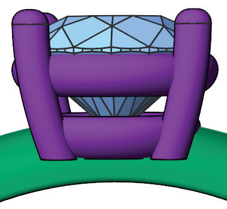
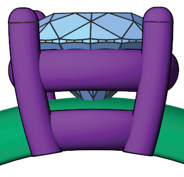
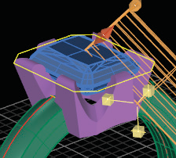
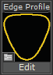

# T-Splines Under Bezel

- Source PDF: Matrix 8 Instruction Manual Book 2 (matrix_8_book_2.pdf)
- Page range: 254-255
- Section title: T-Splines Under Bezel
- Section id: m8book2-221-t-splines-under-bezel
- Note: boundary page(s) are shared with a neighbouring section (two-column layout); text/images may include neighbour content.

---
<!-- section m8book2-221-t-splines-under-bezel | T-Splines Under Bezel | m8book2 pages 254-255 -->

<!-- page 254 -->

Bezel Placement: Bezel Placement adjusts the
Remember, the resulting geometry is a T-Splines
object so you can always divide faces after the
bezel is created to gain more control.
### Editing Dimensions:
Height: Height adjusts the under bezel’s height
position of the bezel moving it up or
down. Adjust in the builder by selecting
the Bezel Placement icon at the left,
running the slider below-or typing a
length in mm in the box. You can also use the
Yellow cube Viewport Control Handle on the
bezel.
## T-Splines Under Bezel
from the top of the bezel base of the
bezel. Adjust in the builder by selecting
the Height icon at the left, running the
slider below-or typing a length in mm
the box. You can also use the Yellow Vertical
Viewport Control Handle on the base of the bezel.
‘gvtsUnderBezel’
Create a T-Splines under bezel around an existing
gem.
Offset: Offset adjusts the scale of the under
Where is this Command:
Access this command from Setting> T-Splines
Under Bezel
or from the F6 menu when a gem is selected
bezel on the X and Y axis. Adjust in the
builder by selecting the Offset icon at
the left, running the slider below-or
typing a length in mm the box. You can
also use the Yellow Horizontal Viewport Control
Handle on the side of the bezel.
Steps:
Thickness: Thickness adjusts the thickness of
• Select the T-Splines Under Bezel from the Setting
Menu or from the F6 menu with a stone selected.
• Put the selected stone into the Under
the under bezel. Adjust in the builder by
selecting the Thickness icon at the left,
running the slider below-or typing a
length in mm the box. You can also use
the Yellow Horizontal Viewport Control Handle on
the side of the bezel.
Bezel input box (not necessary if you
used F6).
• Matrix will generate a preview of the
bezel.
Seat Height: Seat Height adjusts the position of
### Options:
Crease Top: This option adds a crease to the
top of the bezel making it so the top surface is flat.
This option is off by default.
the top of the under bezel (this
therefore effects the overall shape of
the bezel along with the height of the
gem seat). Adjust in the builder by
selecting the Seat Height icon at the left, running
the slider below-or typing length in mm in the box.
You can also use the Blue Vertical Viewport
Control Handle on the seat of the bezel.
Crease Seat: This option adds a Crease to the
seat of the bezel making it so the
Seat Length: Seat Length adjusts how far down
gem set is flat. This option is on
by default.
Crease Bottom: This option adds a Crease to
the bottom of the bezel making it so the bottom
surface is flat. This option is off by default.
the pavilion of the stone the seat of the
bezel extends. Adjust in the builder by
selecting the Seat Length icon at the
left, running the slider below-or typing
length in mm in the box. You can also use the Blue
Diagonal Viewport Control Handle on the seat of
the bezel.
Faces: Few/Many: This controls how many
faces the T-Splines bezel will have once created.

<!-- page 255 -->

Example: Head after pull
Seat Angle: Seat Angle adjusts the seat of the
bezel. Adjust in the builder by selecting
the Seat Angle icon at the left, running
the slider below-or typing degree in the
box. You can also use the White
Rotation Viewport Control Handle on the seat of
the bezel.
Bezel Angle: Bezel Angle adjusts the angle
## Scallop Bezel
of the side of the bezel. Adjust in the
builder by selecting the Bezel Angle
icon at the left, running the slider
below-or typing degree in the box. You
can also use the White Rotation Viewport Control
Handle on the base of the bezel.
Placement: Bezel Placement adjusts the position
‘gvBezelCutter’
Create Scalloped bezels and other designs using
the Bezel Cutter (Scallop Bezel) in conjunction
with the Bezel Builder.
Where is this Builder:
Access this command from Setting>Scallop
Bezel
of the bezel moving it up or down.
Adjust in the builder by selecting the
Bezel Placement icon at the left, running
the slider below-or typing a length in
mm in the box. You can also use the Yellow cube
Viewport Control Handle on the bezel.
## Pull Object to Rail
or from the F6 menu when a gem or group of
gems are selected-Bezel Cutter
Steps:
‘gvPullToRail’
This command pulls objects, like heads, to meet
the Finger Rail.
• Select the Scallop Bezel from the Cutters Menu or
from the F6 menu with gem or bezel selected.
• Put the gem or bezel into the
Where is this Command:
Access this command from Setting>Pull Object
to Rail
or from the F6 menu when a head is selected
Bezel Cutter Builder input
box (not necessary if you
used F6).
Matrix will generate a preview
of the bezel cutters.
Steps:
Edge Profiles: Changing the Edge
• Select the object(s) that you wish to pull to rail.
• Select Pull to Rail from the Setting Menu-or from
F6 with a head selected.
profile changes the shape of the
cutter for the bezel.
Example: Head before pull
Steps:
• Click on Edge Profile in the builder
to open the Profile Library.
• Select a profile from the library- notice that
the bezel and bezel cut out preview updates
immediately.

---

## Images

-  page 254 (shared page)
-  page 254 (shared page)
-  page 255 (shared page)
-  page 255 (shared page)
-  page 255 (shared page)
-  page 255 (shared page)
