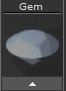

# T-Splines Under Bezel 

- Source PDF: Matrix 8 Instruction Manual Book 2 (matrix_8_book_2.pdf)
- Page range: 77-78
- Section title: T-Splines Under Bezel 
- Section id: m8book2-093-t-splines-under-bezel
- Note: boundary page(s) are shared with a neighbouring section (two-column layout); text/images may include neighbour content.

---
<!-- section m8book2-093-t-splines-under-bezel | T-Splines Under Bezel  | m8book2 pages 77-78 -->

<!-- page 77 -->

### Options:
Seat Angle: Seat Angle adjusts the seat of the
Crease Top: This option adds a crease to the
top of the bezel making it so the top surface is flat.
This option is off by default.
bezel. Adjust in the builder by selecting
the Seat Angle icon at the left, running
the slider below-or typing degree in the
box. You can also use the White
Rotation Viewport Control Handle on the seat of
the bezel.
Crease Seat: This option adds a crease to the
seat of the bezel making it so the
Bezel Angle: Bezel Angle adjusts the angle
gem set is flat. This option is on
by default.
Crease Bottom: This option adds a crease to
the bottom of the bezel making it so the bottom
surface is flat. This option is off by default.
of the side of the bezel. Adjust in the
builder by selecting the Bezel Angle
icon at the left, running the slider
below-or typing degree in the box. You
can also use the White Rotation Viewport Control
Handle on the base of the bezel.
Bezel Placement: Bezel Placement adjusts the
Faces: Few/Many: This controls how many
faces the T-Splines bezel will have once created.
Remember, the resulting geometry is a T-Splines
object so you can always divide faces after the
bezel is created to gain more control.
### Editing Dimensions:
Height: Height adjusts the under bezel’s height
position of the bezel moving it up or
down. Adjust in the builder by selecting
the Bezel Placement icon at the left,
running the slider below-or typing a
length in mm in the box. You can also use the
Yellow cube Viewport Control Handle on the
bezel.
## T-Splines Under Bezel
from the top of the bezel base of the
bezel. Adjust in the builder by selecting
the Height icon at the left, running the
slider below-or typing a length in mm
the box. You can also use the Yellow Vertical
Viewport Control Handle on the base of the bezel.
‘gvtsUnderBezel’
Creates a T-Spline Under Bezel around an existing
gem.
Offset: Offset adjusts the scale of the under
Where is this Command:
Access this builder from T-Spline> T-Splines
Under Bezel
or from the F6 menu when a gem is selected
bezel on the X and Y axis. Adjust in the
builder by selecting the Offset icon at
the left, running the slider below-or
typing a length in mm the box. You can
also use the Yellow Horizontal Viewport Control
Handle on the side of the bezel.
Steps:
Thickness: Thickness adjusts the thickness of
• Select the T-Splines Under Bezel from the T-Spline
menu. (Also located in the Setting menu or from
the F6 menu with a stone selected.)
• Put the selected stone into the Under
the under bezel. Adjust in the builder by
selecting the Thickness icon at the left,
running the slider below-or typing a
length in mm the box. You can also use
the Yellow Horizontal Viewport Control Handle on
the side of the bezel.
Bezel input box (not necessary if you
used F6).
• Matrix will generate a preview of the
bezel.

<!-- page 78 -->

Seat Height: Seat Height adjusts the position of
Where is this Command:
Access this builder from T-Spline>T-Splines
Signet
Or from the F6 menu when a ring rail is
selected
Steps:
the top of the under bezel (this
therefore effects the overall shape of
the bezel along with the height of the
gem seat). Adjust in the builder by
selecting the Seat Height icon at the left, running
the slider below-or typing length in mm in the box.
You can also use the Blue Vertical Viewport
Control Handle on the seat of the bezel.
Seat Length: Seat Length adjusts how far down
• Select the  T-Spline Signet from the T-Spline Menu.
(Also found in the Builder menu).
• Click the ‘+RingRail’ button in the
T-Spline Signet menu and select
the desired ring size (only necessary if no Ring
Rail is already present).
• Click Start.
This creates a wireframe
the pavilion of the stone the seat of the
bezel extends. Adjust in the builder by
selecting the Seat Length icon at the
left, running the slider below-or typing
length in mm in the box. You can also use the Blue
Diagonal Viewport Control Handle on the seat of
the bezel.
preview of your T-Spline
signet ring.
Seat Angle: Seat Angle adjusts the seat of the
### Editing
### Dimensions:
Shank Thickness: Shank thickness adjusts
bezel. Adjust in the builder by selecting
the Seat Angle icon at the left, running
the slider below-or typing degree in the
box. You can also use the White
Rotation Viewport Control Handle on the seat of
the bezel.
Bezel Angle: Bezel Angle adjusts the angle
of the side of the bezel. Adjust in the
builder by selecting the Bezel Angle
icon at the left, running the slider
below-or typing degree in the box. You
can also use the White Rotation Viewport Control
Handle on the base of the bezel.
the thickness band between the fingers
at the 9 and 3 o’clock positions on the
rail. Adjust in the builder by selecting the
Shank Thickness icon at the left in the
builder and running the slider below. You can all
so use the yellow horizontal Viewport Control
Handle along the side of the band or click on
‘ShankThickness’ in the Command Line and type
in the desired value.
Placement: Bezel Placement adjusts the position
Top Thickness: Top adjusts the distance
of the bezel moving it up or down.
Adjust in the builder by selecting the
Bezel Placement icon at the left, running
the slider below-or typing a length in
mm in the box. You can also use the Yellow cube
Viewport Control Handle on the bezel.
between the Finger Rail and the top of
the ring. Adjust in the builder by
selecting the Top Thickness icon at the
left in the builder and running the slider
below. You can all so use the yellow vertical
Viewport Control Handles or click on
‘TopThickness’ in the Command Line and type in
the desired value.
## T-Splines Signet
‘gvtsSignet’
Creates a Signet ring suitable for award or fine
jewelry.

---

## Images

-  page 77 (shared page)
-  page 77 (shared page)
-  page 78 (shared page)
