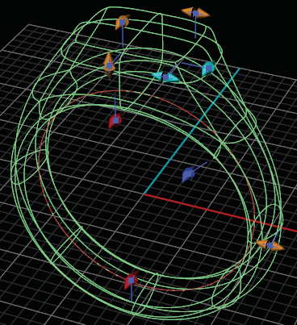

# T-Spline Signet Ring Builder 

- Source PDF: Matrix 8 Instruction Manual Book 2 (matrix_8_book_2.pdf)
- Page range: 120-121
- Section title: T-Spline Signet Ring Builder 
- Section id: m8book2-131-t-spline-signet-ring-builder
- Note: boundary page(s) are shared with a neighbouring section (two-column layout); text/images may include neighbour content.

---
<!-- section m8book2-131-t-spline-signet-ring-builder | T-Spline Signet Ring Builder  | m8book2 pages 120-121 -->

<!-- page 120 -->

Control Handle on the Top Profile or click on ‘Top
Length’ in the Command Line and type in the
desired value.
Top Width: Top Width adjusts the overall width
Styles: Styles allow you quick access to standard
designs within the builder. You can also add your
own styles so that you can access them quickly
through the builder.  See the Styles chapter in the
Manual to learn more.
## T-Spline Signet Ring Builder
‘gvtsSignet’
Create a signet ring suitable for award or fine
jewelry.
of the top of the signet in mm relative to
the Y axis in the Looking Down
viewport. Adjust in the builder by
selecting the Top Width icon at the left
in the builder and running the slider below. You
can also use the yellow Viewport Control Handle
on the Top Profile or click on ‘Top Width’ in the
Command Line and type in the desired value.
Top Thickness: Top Thickness adjusts the
Where is this Command:
Access this command from Builder>TSpline
Signet Ring Builder
Or from the F6 menu when a Ring Rail is
selected
Steps:
• Select T-Spline Signet from the Builder Menu.
• Click the ‘+RingRail’ button
distance between the Finger Rail and
the top of the ring. Adjust in the builder
by selecting the Top Thickness icon at
the left in the builder and running the
slider below. You can all so use the yellow vertical
Viewport Control Handle or click on ‘TopThickness’
in the Command Line and type in the desired
value.
Shank Thickness: Shank Thickness adjusts
in the
T-Spline Signet Builder and select the desired ring
size (only necessary if no Ring Rail is already
present).
• Click Start.
This creates a wireframe
preview of your T-Spline
signet ring.
the thickness of the band between the
fingers at the 9 and 3 o’clock positions
on the rail. Adjust in the builder by
selecting the Shank Thickness icon at
the left in the builder and running the slider below.
You can all so use the yellow horizontal Viewport
Control Handle along the side of the band or click
on ‘ShankThickness’ in the Command Line and
type in the desired value.
### Editing
### Dimensions:
Shank Thickness: Shank Thickness adjusts
Middle Width: Middle Width adjust the width of
the Middle Profile as viewed in the Side
View. Adjust in the builder by selecting
the middle width icon at the left in the
builder and running the slider below.
You can all so use the yellow horizontal Viewport
Control Handles or click on ‘MiddleWidth’ in the
Command Line and type in the desired value.
the thickness of the band between the
fingers at the 9 and 3 o’clock positions
on the rail. Adjust in the builder by
selecting the Shank Thickness icon at
the left in the builder and running the slider below.
You can all so use the yellow horizontal Viewport
Control Handle along the side of the band or click
on ‘ShankThickness’ in the Command Line and
type in the desired value.
### Options:
Reset: Will return the builder to its default
settings.
Top Thickness: Top Thickness adjusts the
distance between the Finger Rail and
the top of the ring. Adjust in the builder
by selecting the Top Thickness icon at

<!-- page 121 -->

and running the slider below. You can all so use
the red horizontal Viewport Control Handle or
click on ‘MiddleThickness’ in the Command Line
and type in the desired value.
the left in the builder and running the slider below.
You can all so use the yellow vertical Viewport
Control Handle or click on ‘TopThickness’ in the
Command Line and type in the desired value.
Top Width: Top Width adjusts the overall width
Bottom Thickness: Bottom Thickness adjusts
of the top of the signet in mm relative to
the X axis in the Looking Down
viewport. Adjust in the builder by
selecting the Top Width icon at the left
in the builder and running the slider below. You
can also use the yellow Viewport Control Handle
on the top of the signet or click on ‘Top Width’ in
the Command Line and type in the desired value.
the thickness of the ring at the bottom
of the band. Adjust in the builder by
selecting the Bottom Thickness icon at
the left in the builder and running the
slider below. You can all so use the red horizontal
Viewport Control Handle or click on
‘BottomThickness’ in the Command Line and type
in the desired value.
Top Depth: Top Depth adjusts the overall length
Top Shank Thickness: Top Shank Thickness
of the top of the signet in mm relative to
the Y axis in the Looking Down viewport.
Adjust in the builder by selecting the
Top Depth icon at the left in the builder
and running the slider below. You can also use the
yellow horizontal Viewport Control Handle on the
top of the signet or click on ‘Top Depth’ in the
Command Line and type in the desired value.
Top Width Corner: Top Width Corner controls
adjusts the thickness of the ring at 2
and 10 o’clock locations on the shank .
Adjust in the builder by selecting the
Top Shank Thickness icon at the left in
the builder and running the
slider below. You can all so
use the dark blue horizontal
Viewport  Control Handle or
click on ‘TopShankThickness’
in the Command Line and
type in the desired value.
## Raised Band Builder
the position of the top corner of along
the X axis. Adjust in the builder by
selecting the Top Width Corner icon at
the left in the builder and running the
slider below. You can also use the light blue
Viewport Control Handle on the Top Profile or
click on ‘TopWidthCorner’ in the Command Line
and type in the desired value.
‘gvBuilderRaisedBand’
Automatically place lettering - or any closed,
planar curve design - onto a band in a raised or
sunken pattern.
Top Depth Corner: Top Depth Corner controls
Where is this Command:
Access this command from Builder>Raised
Band Builder
or from the F6 menu when a Ring Rail is
selected
the position of the top corner of along
the Y axis  Adjust in the builder by
selecting the Top Depth Corner icon at
the left in the builder and running the
slider below. You can also use the light blue
Viewport Control Handle on the Top Profile or
click on ‘TopDepthCorner’ in the Command Line
and type in the desired value.
Steps:
Middle Thickness: Middle Thickness adjusts the
• Select the Raised Band Builder from the Builder
Menu.
• Click the ‘+RingRail’
thickness of the ring at the top of the
band along the finger rail. Adjust in the
builder by selecting the Middle
Thickness icon at the left in the builder
button in the
Raised Band Builder and select the desired ring
size (only necessary if no Ring Rail is already
present).

---

## Images

-  page 120 (shared page)
-  page 121 (shared page)
