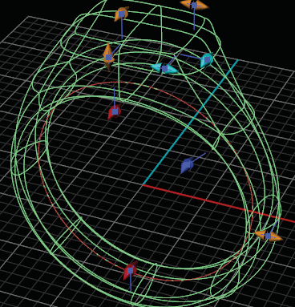

# T-Splines Signet 

- Source PDF: Matrix 8 Instruction Manual Book 2 (matrix_8_book_2.pdf)
- Page range: 78-79
- Section title: T-Splines Signet 
- Section id: m8book2-094-t-splines-signet
- Note: boundary page(s) are shared with a neighbouring section (two-column layout); text/images may include neighbour content.

---
<!-- section m8book2-094-t-splines-signet | T-Splines Signet  | m8book2 pages 78-79 -->

<!-- page 78 -->

Seat Height: Seat Height adjusts the position of
Where is this Command:
Access this builder from T-Spline>T-Splines
Signet
Or from the F6 menu when a ring rail is
selected
Steps:
the top of the under bezel (this
therefore effects the overall shape of
the bezel along with the height of the
gem seat). Adjust in the builder by
selecting the Seat Height icon at the left, running
the slider below-or typing length in mm in the box.
You can also use the Blue Vertical Viewport
Control Handle on the seat of the bezel.
Seat Length: Seat Length adjusts how far down
• Select the  T-Spline Signet from the T-Spline Menu.
(Also found in the Builder menu).
• Click the ‘+RingRail’ button in the
T-Spline Signet menu and select
the desired ring size (only necessary if no Ring
Rail is already present).
• Click Start.
This creates a wireframe
the pavilion of the stone the seat of the
bezel extends. Adjust in the builder by
selecting the Seat Length icon at the
left, running the slider below-or typing
length in mm in the box. You can also use the Blue
Diagonal Viewport Control Handle on the seat of
the bezel.
preview of your T-Spline
signet ring.
Seat Angle: Seat Angle adjusts the seat of the
### Editing
### Dimensions:
Shank Thickness: Shank thickness adjusts
bezel. Adjust in the builder by selecting
the Seat Angle icon at the left, running
the slider below-or typing degree in the
box. You can also use the White
Rotation Viewport Control Handle on the seat of
the bezel.
Bezel Angle: Bezel Angle adjusts the angle
of the side of the bezel. Adjust in the
builder by selecting the Bezel Angle
icon at the left, running the slider
below-or typing degree in the box. You
can also use the White Rotation Viewport Control
Handle on the base of the bezel.
the thickness band between the fingers
at the 9 and 3 o’clock positions on the
rail. Adjust in the builder by selecting the
Shank Thickness icon at the left in the
builder and running the slider below. You can all
so use the yellow horizontal Viewport Control
Handle along the side of the band or click on
‘ShankThickness’ in the Command Line and type
in the desired value.
Placement: Bezel Placement adjusts the position
Top Thickness: Top adjusts the distance
of the bezel moving it up or down.
Adjust in the builder by selecting the
Bezel Placement icon at the left, running
the slider below-or typing a length in
mm in the box. You can also use the Yellow cube
Viewport Control Handle on the bezel.
between the Finger Rail and the top of
the ring. Adjust in the builder by
selecting the Top Thickness icon at the
left in the builder and running the slider
below. You can all so use the yellow vertical
Viewport Control Handles or click on
‘TopThickness’ in the Command Line and type in
the desired value.
## T-Splines Signet
‘gvtsSignet’
Creates a Signet ring suitable for award or fine
jewelry.

<!-- page 79 -->

Top Width: Top Width adjusts the overall width
Bottom Thickness: Bottom Thickness adjusts
the thickness of the ring at the bottom
of the band. Adjust in the builder by
selecting the width icon at the left in the
builder and running the slider below. You
can all so use the yellow horizontal Viewport
Control Handles or click on ‘BottomThickness’ in
the Command Line and type in the desired value.
of the top of the signet in mm relative to
the X axis in the Looking Down
viewport. Adjust in the builder by
selecting the Top Width icon at the left
in the builder and running the slider below. You
can also use the yellow Viewport Control Handle
on the top or the signet or click on ‘Top Width’ in
the Command Line and type in the desired value.
Top Shank Thickness: Top Shank Thickness
Top Depth: Top Depth adjusts the overall length
adjusts the thickness of the ring at 2
and 10 o’clock locations on the shank .
Adjust in the builder by selecting the
width icon at the left in the builder and
running the slider below. You can all so use the
dark blue horizontal Viewport
of the top of the signet in mm relative to
the Y axis in the Looking Down viewport.
Adjust in the builder by selecting the
Top Depth icon at the left in the builder
and running the slider below. You can also use the
yellow horizontal Viewport Control Handle on the
top of the signet or click on ‘Top Length’ in the
Command Line and type in the desired value.
Control Handles or click on
‘TopShankThickness’ in the
Command Line and type in
the desired value.
Top Width Corner: Top Width Corner controls
T-Splines Signet complete
## Skin
the position of the top corner of along
the X axis. Adjust in the builder by
selecting the Top Width Corner icon at
the left in the builder and running the
slider below. You can also use the light blue
Viewport Control Handle on the Top Profile or
click on ‘Top Width’ in the Command Line and
type in the desired value.
‘tsSkin’
Create a T-Spline surface from a complex network
of curves.
Top Depth Corner: Top Depth Corner controls
Where is this Command:
Access this command from T-Spline>Skin
Steps:
the position of the top corner of along
the Y axis  Adjust in the builder by
selecting the Top Depth Corner icon at
the left in the builder and running the
slider below. You can also use the light blue
Viewport Control Handle on the Top Profile or
click on ‘Top Width’ in the Command Line and
type in the desired value.
Middle Thickness: Middle Thickness adjusts the
• Create a
network of
Curves.
• Select Skin from
the T-Splines
menu.
• Select the Curve
network.
• Press Enter
when done.
• A T-Splines Skin
options box will
appear.
thickness of the ring at the top of the
band along the finger rail. Adjust in the
builder by selecting the width icon at
the left in the builder and running the
slider below. You can all so use the red horizontal
Viewport Control Handles or click on ‘Middle
Thickness’ in the Command Line and type in the
desired value.

---

## Images

-  page 78 (shared page)
-  page 79 (shared page)
-  page 79 (shared page)
