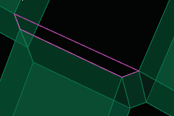
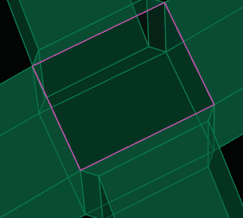
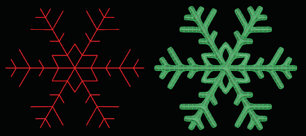
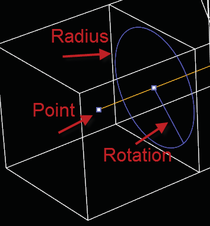
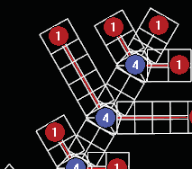
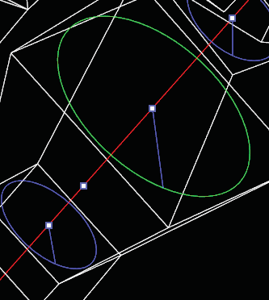
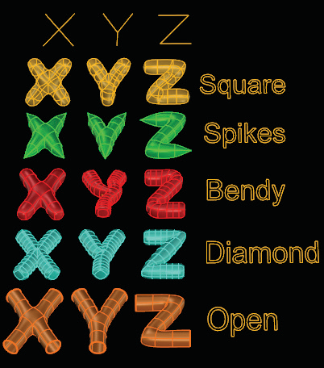
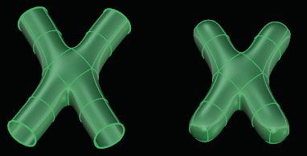
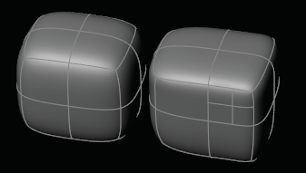

# Pipe 

- Source PDF: Matrix 8 Instruction Manual Book 2 (matrix_8_book_2.pdf)
- Page range: 58-61
- Section title: Pipe 
- Section id: m8book2-073-pipe
- Note: boundary page(s) are shared with a neighbouring section (two-column layout); text/images may include neighbour content.

---
<!-- section m8book2-073-pipe | Pipe  | m8book2 pages 58-61 -->

<!-- page 58 -->

### Simple:
### Chain:
Steps:
This option lets you create a chain of faces, with
only one click per face.
• Select Append from the T-Spline menu.
• Pick the first corner.
• Pick the second corner.
• Pick the third corner.
• Pick the fourth corner (or press Enter to create a
triangular face).
Steps:
• Select T-Spline edge, which will be the first and
second corners of the first face.
• Pick third corner of face.
• Pick fourth corner of face.
• To create the next face(s), just pick one more
corner per face, and you can rapidly add a row of
faces.
The command will create the face, then prompt to
start creating another face. Press enter to exit the
command.
### Other Options:
RetopoSnap=(Yes/No):  Turns on and off
RetopoSnap
RetopoOffset: The offset distance from the
mesh that each point will snap to. If 0, the control
points will snap right on the mesh.
Select four corners to create a new T-Splines face
with Append Simple.
AutoQuad. Yes: The command will automatically
create four-sided faces. No: The command will let
you add five- (or more) sided faces.
### From Edge:
This option lets you create a face in three clicks
instead of four.
## Pipe
Steps:
• Select T-Spline edge, which will be the first and
second corners of the face.
• Pick third corner of face.
• Pick fourth corner of face.
‘tsPipe’
This powerful tool creates T-Spline surfaces from
curves, automatically transitioning between
curves that intersect. Begin by drawing a series
of curves in the viewport using the Matrix Curve
menu. Anywhere two curves intersect it will create
a transition. A joint will be placed at the location
of the intersection. Each joint determines how the
transition will take place between the two curves.
By joining two curves together, the joint will be
removed from the Pipe layout.
Where is this Command:
Access this command from T-Spline>Pipe
Steps:
Use From Edge to add a new face with Append.
• Select the Pipe command in the T-Spline menu.
• Select a curve or curves to Pipe.
• Press Enter.
• A preview of the new piped surface will appear,
displaying in Box mode.

<!-- page 59 -->

Small Point: The small point at the center of the
radius handle is the “Set Point Position”. click on
this point and drag it along the curve to relocate
the handle to a new position.
### Command Line Options:
CurveSplitting: Specifies
• Adjust Pipe settings using the Command Line
and the control handles. A small circle will appear
near the end of each curve, and at every joint in
the curve. This is a “handle”. Handles determine
the radius of the pipe at that location as well as
its rotation orientation. The radius of the pipe will
transition between handles.
• Press Enter twice to see the results.
• Use the Box/ Smooth toggle in the T-Splines HUD
to change the view.
Hint: To create smooth piped surfaces, use as few
handles as possible to create the thick to thin look.
the tolerance used to
detect curve intersections.
By default this option is the
file tolerance and it can be
changed inside this option.
The option also graphically
shows which curves
intersect with the given tolerance.
Segments: Lets you set the number of segments
(rows of faces) that will be created on each
section of curve.
T-Splines Pipe Snowflake design shown in Smooth
mode.
AddHandle: Adds new handles on the curve
network. Each handle is a node where you can
set a local radius, angle, curve position, and the
number of segments.
### Pipe Viewport Control Handles:
RemoveHandle: Removes handles.
Radius (Circle) Handle: The Circle or Radius
handle controls the size of the tube at that point
along the curve. Click anywhere on the circle to
highlight it, and drag to change the size of the
radius.
SetMultiple: Sets the radius, angle, or curve
position values of multiple handles at once.
Sometimes, it is useful to set lots of handle values
at the same time. For example, if you wanted all of
the radii in one section of a model to be the same.
Rotation Handle: The Rotation Handle is
the small line that radiates from the center of
the radius handle. Click and drag this handle to
change the rotation of the pipe profile at that
point along the curve.
ClearMultiple: Clears handle values that have
been changed, returning them to the default
values.
Radius: Sets the global radius for the entire Pipe
network. You can also
create variable radii by
clicking on the outer
circle of the handles,
drag to change the
size. Blue circle
handles have the
default global radius.
A green circle handle
means a custom
variable radius has been set.
Pipe Viewport Control Handles

<!-- page 60 -->

Diamond: The ends of the pipes are a rotated
square or diamond shape with a top ridge along
the curve length.
### Joints Options:
Preview: Provides options for changing the
preview of the piped surface. Options include
None, Box (the default setting, which is a
wireframe box mode preview), BoxShaded, and
SmoothShaded. The SmoothShaded preview can
be very slow.
OutputType = Smooth/ Box: Setting the
option to Smooth Mode will use more computer
resources to produce the Piped object. This is the
default for T-Splines Primitives. Setting the output
to Box Mode will allow for faster editing of the
model.
AlwaysIncludeAutojoint: When the joint set
you’re working with doesn’t have any prototypes
for the number of curves coming together, tsPipe
will generate a very simple flat hub-style joint,
called an Autojoint. By default, if your current
joint set has any prototypes for a given number
of curves at the joint, it will use those prototypes.
This option allows you to also consider the
Autojoint.
Joints: Lets you set the different joints types
on the curves intersections. This is an advanced
option. See ‘Joints Options’ below for more
information.
CurrJointSet: This is identical to the CurrJointSet
option at the top level. For most users, this is the
most commonly used option.
CurrJointSet: This option lets you choose which
type of joint set is being used at each intersection
along with the end. See ‘CurrJointSet Options’
below for more information.
DefromJoints=Yes/No: Yes Bends the joints so
they will better fit the curve network.
### CurrJointSet Options:
ExportJointSet: Exports the joint set to meshes
and points in the document. There is a point,
usually near the center of the joint, which is where
the joint will connect to the curve intersection
point. The joint will freely pivot around this point
before any deformation occurs. There is also a
point in the center of each mesh face where a
pipe will connect. Currently, only quads can be
used for pipe connection faces.
Square: The
ends of the
pipes are
square and
joints maintain
their shape.
ImportJointSet: Imports a joint set into the
current joint set, from the document in the above-
described mesh and point format. Please note
that this format may change in the future as we
improve the UI and experience for custom joint
sets.
AddJointSet: Creates a new joint set, that can
then be imported into.
Open: The
ends of the
pipes are
open.
Spikes: The
ends of the
pipes come
to a point or
spike.
Bendy: The ends of the pipes are square and
joints are narrower.
DeleteJointSet: Deletes the current joint set.
Difference between tsPipe and Pipe: The Rhino
Pipe command is better at making an exact
radius. The tsPipe command will give you an
approximate radius and smoother transitions at
the intersections. One option is to use the Rhino
pipe command for large straight sections, tsPipe
for the joints, and then tsMatch to smoothly blend
the Rhino Pipe and tsPipe together.

<!-- page 61 -->

### History:
tool can be very useful to add detail on flat faces,
by quickly subdividing the face and getting more
control points.
Where is this Command:
Access this command from T-Splines>
Subdivide Simple
Steps:
This command works with Rhino’s History. To
use history, turn on Record History, and Lock
Children. Then, after you create the T-Spline, you
can move the curves, or the control points on the
curves, and the surface will update. If you change
the angle of the curve intersection, then the joints
will update to something that better fits that
angle. Once you Unlock Children and move the
T-Splines control points, then History is broken.
## Fill Hole
• Select Subdivide Simple from the T-Spline menu.
• When prompted select the T-Spline face or faces
to be subdivided.
• Press Enter when done.
Each selected T-Spline Face is divided into 4
T-Spline faces.
‘tsFillHole’
The Fill Hole command is a quick and easy way to
fill any open gap in a T-Spline model. Use this or
Append Face to create a face where a hole exists.
Where is this Command:
Access this command from T-Spline>Fill Hole
Steps:
• Select Fill Hole from the T-Spline menu.
• Select an edge along a hole on a T-Spline object.
Or, region select an entire object with multiple
holes to fill.
T-Spline Face before and after Subdivide Simple.
Note: Fill Hole can create undesirable surfaces at
times. Use Append on oddly shaped holes if needed.
### Command Line Options:
Insertion Type = Exact/ Simple: Exact:
Subdividing a face in exact mode will maintain
the surface shape. Simple: As the faces are
subdivided and multiplied, the T-Spline surface
changes to accommodate the newly-added
edges and verts.
Fill Hole before and after using Region Select to
select the T-Splines object to fill multiple holes at
once.
RetopoSnap=(Yes/No):  Turns on and off
RetopoSnap.
## Subdivide Simple
RetopoOffset: When Retopo Snap is active
this option appears. The offset distance from the
mesh that each point will snap to. If 0, the control
points will snap right on the mesh.
‘tsSubdivideFaceSimple’
Create more control over the object by adding
more Faces to a T-Spline surface. Subdividing
a face in simple mode will change the surface
making it flatter and sharper (more isocurves). This

---

## Images

-  page 58 (shared page)
-  page 58 (shared page)
-  page 59
-  page 59
-  page 59
-  page 59
-  page 60
-  page 61 (shared page)
-  page 61 (shared page)
