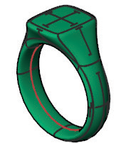
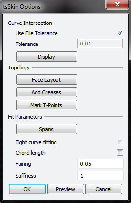

# Skin 

- Source PDF: Matrix 8 Instruction Manual Book 2 (matrix_8_book_2.pdf)
- Page range: 79-81
- Section title: Skin 
- Section id: m8book2-095-skin
- Note: boundary page(s) are shared with a neighbouring section (two-column layout); text/images may include neighbour content.

---
<!-- section m8book2-095-skin | Skin  | m8book2 pages 79-81 -->

<!-- page 79 -->

Top Width: Top Width adjusts the overall width
Bottom Thickness: Bottom Thickness adjusts
the thickness of the ring at the bottom
of the band. Adjust in the builder by
selecting the width icon at the left in the
builder and running the slider below. You
can all so use the yellow horizontal Viewport
Control Handles or click on ‘BottomThickness’ in
the Command Line and type in the desired value.
of the top of the signet in mm relative to
the X axis in the Looking Down
viewport. Adjust in the builder by
selecting the Top Width icon at the left
in the builder and running the slider below. You
can also use the yellow Viewport Control Handle
on the top or the signet or click on ‘Top Width’ in
the Command Line and type in the desired value.
Top Shank Thickness: Top Shank Thickness
Top Depth: Top Depth adjusts the overall length
adjusts the thickness of the ring at 2
and 10 o’clock locations on the shank .
Adjust in the builder by selecting the
width icon at the left in the builder and
running the slider below. You can all so use the
dark blue horizontal Viewport
of the top of the signet in mm relative to
the Y axis in the Looking Down viewport.
Adjust in the builder by selecting the
Top Depth icon at the left in the builder
and running the slider below. You can also use the
yellow horizontal Viewport Control Handle on the
top of the signet or click on ‘Top Length’ in the
Command Line and type in the desired value.
Control Handles or click on
‘TopShankThickness’ in the
Command Line and type in
the desired value.
Top Width Corner: Top Width Corner controls
T-Splines Signet complete
## Skin
the position of the top corner of along
the X axis. Adjust in the builder by
selecting the Top Width Corner icon at
the left in the builder and running the
slider below. You can also use the light blue
Viewport Control Handle on the Top Profile or
click on ‘Top Width’ in the Command Line and
type in the desired value.
‘tsSkin’
Create a T-Spline surface from a complex network
of curves.
Top Depth Corner: Top Depth Corner controls
Where is this Command:
Access this command from T-Spline>Skin
Steps:
the position of the top corner of along
the Y axis  Adjust in the builder by
selecting the Top Depth Corner icon at
the left in the builder and running the
slider below. You can also use the light blue
Viewport Control Handle on the Top Profile or
click on ‘Top Width’ in the Command Line and
type in the desired value.
Middle Thickness: Middle Thickness adjusts the
• Create a
network of
Curves.
• Select Skin from
the T-Splines
menu.
• Select the Curve
network.
• Press Enter
when done.
• A T-Splines Skin
options box will
appear.
thickness of the ring at the top of the
band along the finger rail. Adjust in the
builder by selecting the width icon at
the left in the builder and running the
slider below. You can all so use the red horizontal
Viewport Control Handles or click on ‘Middle
Thickness’ in the Command Line and type in the
desired value.

<!-- page 80 -->

Tolerance Value: View the Tolerance Value
currently set. Enter a new Tolerance Value amount
in the Command Line.
Topology:
Face Layout: Select faces and edges to change
the surface layout and press Enter when done.
Note: If your first attempt at creating a surface using
tsSkin does not yield a good result, try increasing the
quality of your surface by increasing the number of
input curves. Large open areas in between curves
may require additional curves placed there. This
command fits a surface to go through curves as
closely as possible so adding more curves may yield
better results. If the curves are good, the surface will
be good.
Hints:
Face Layout Options:
MaxAutoFace: This determines the edge
count on faces that are automatically displayed
in the Preview surface. This setting defaults at
four so that any face with four edges or less
will automatically display a surface. Any face
with more than four edges will display as a hole.
Increase the value to detect faces with more
edges. If desired, enter a zero value to activate the
manual feature and turn off this auto feature.
MaxManualFace: This determines the items that
will appear in the selection menu. For example, if
only five possible faces are desired, change this
value to five. This will limit the selection menu to
only display faces with five edges or less.
• The quality of the T-Spline surface will depend
heavily on the quality of the curve network from
which you begin.
• Use simple curves with the least amount of control
points possible to maintain the desired shape.
• Design the shape with curves as equally spaced as
possible. The curve layout should not only span in
both directions, but the shape should be defined
with the curve density as equal as possible
throughout the entire surface.
• Define the shape using four-sided curves. Avoid
using 3-sided and 5-sided curves.
• Curves in the network must intersect each other.
If they do not, an intersection is created using the
tolerance in the options box. (See below.)
### Skin Options:
Add Creases: Select edges to insert a hard
edge (crease) or  to uncrease. Press Enter when
done.
Mark T-Points: This option assists in detecting
intersections that end in T-points. It highlights the
areas of the design where T-points occur, and
allows you to make adjustments to these areas.
Curve Intersection:
Use File Tolerance = On/Off: Skin uses Rhino
Properties Units settings when defaulted to ‘ON’
. If you wish to select your own tolerance turn
Off the File Tolerance and enter a value in the
provided box. This overrides Rhino Properties unit
tolerance and uses the value entered.
Fit Parameters:  This option allows control of
how tightly the surface hugs the input curves. It
also allows for influence how the surface behaves
between the input curves.
Tolerance Value: When File Tolerance is turned
‘Off” (unchecked) enter a tolerance value to be
used during this instance of the Skin command.
Display: Change the curve splitting tolerance
value by entering a new value, and press Enter
when done. Press Enter again to return to the Skin
Options dialog box.
Display Options:
UseFileTolerance=Yes/No: Turn On or Off File
Tolerance in this Command Line option.
Spans: The Spans option influences how tightly
the surface will follow the curves by inserting new
control points. Spans are set to one by default;
this means one control point will be generated at
each intersection. By increasing the Spans to ‘2’,
one additional control point will be inserted on
the curve. Increasing the Spans to 3 will add yet
another control point on the curve, and so forth.
Increasing the Spans leads to a better fit, as well
as more control points in the generated surface.

<!-- page 81 -->

Span Steps:
Where is this Command:
Access this command from T-Spline>Loft
Steps:
• Select edges to increase Spans. A new Span is
placed at the midpoint of the edge or curve.
Additional Spans are automatically spaced,
dividing the curve equally.
• Or, Shift-select to decrease Spans.
• Press Enter when done.
• Select the Loft command from the T-Spline menu.
• Select the curves in the order you want them to be
in the surface.
• Press Enter when done.
• Select the Loft Options form the Options dialog.
• Click “OK” to complete the command.
Hints:
• All of the curves in the Loft should be either open
or closed curves.
• All of the curves should be drawn in roughly the
same direction, laying parallel to one another.
• The seam points of closed curves should be in
roughly the same location.
• The Start and End points of open curves should
be in roughly the same location.
• Control points on the curves should be in
approximately the same location along the curve.
• Use the least amount of control points possible to
create the desired shape.
Note: The order in which the curves are picked will
determine the direction the surface will pass through
the curves.
Skin creates T-Spline
Surfaces from a
network of curves.
Max Auto Face is set
to 4 (above right).
Network of curves used
in the design (top left)
and the completed
design (bottom left)
after multiple Skin
commands.
Chord Length On/Off: This option yields
a better surface fit when you have long curve
segments on the opposite side of a face from
short curve segments.
Preview: Shows a solid white preview of the Skin
surface. Click on ‘Preview” to view. Press Enter
when done viewing the Preview.
Cancel/ OK: Click on Cancel to stop the
command. Click on ‘OK’ to complete the Skin
command.
Loft Preview and Options dialog box.
## Loft
### Loft Options:
‘tsLoft’
Creates a T-Spline surface between curves. Similar
to Rhino’s Loft command, quickly create complex
surfaces from a few simple curves.
Loft Style:
Normal (default): The surface has a ‘normal’
amount of stretching between the curves. This
option is good if the curves follow a relatively
straight path or when large distances occur
between curves.

---

## Images

-  page 79 (shared page)
-  page 79 (shared page)
-  page 81 (shared page)
-  page 81 (shared page)
-  page 81 (shared page)
-  page 81 (shared page)
