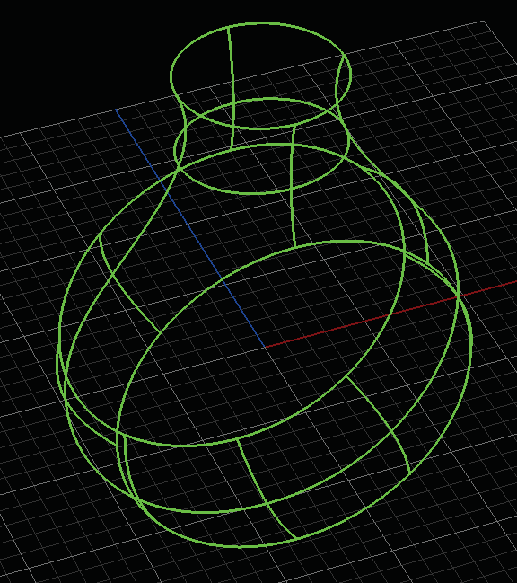
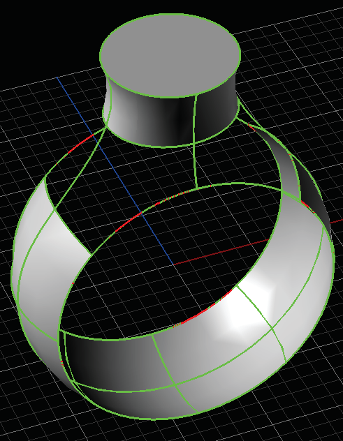
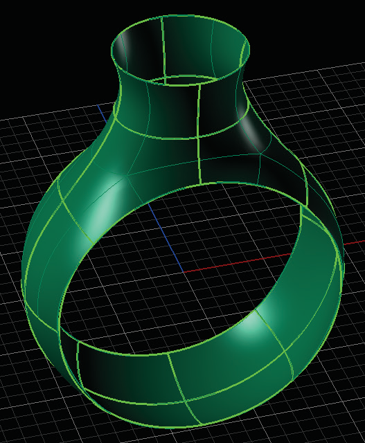
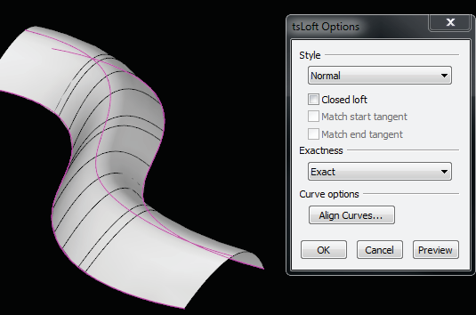

# Loft 

- Source PDF: Matrix 8 Instruction Manual Book 2 (matrix_8_book_2.pdf)
- Page range: 81-82
- Section title: Loft 
- Section id: m8book2-096-loft
- Note: boundary page(s) are shared with a neighbouring section (two-column layout); text/images may include neighbour content.

---
<!-- section m8book2-096-loft | Loft  | m8book2 pages 81-82 -->

<!-- page 81 -->

Span Steps:
Where is this Command:
Access this command from T-Spline>Loft
Steps:
• Select edges to increase Spans. A new Span is
placed at the midpoint of the edge or curve.
Additional Spans are automatically spaced,
dividing the curve equally.
• Or, Shift-select to decrease Spans.
• Press Enter when done.
• Select the Loft command from the T-Spline menu.
• Select the curves in the order you want them to be
in the surface.
• Press Enter when done.
• Select the Loft Options form the Options dialog.
• Click “OK” to complete the command.
Hints:
• All of the curves in the Loft should be either open
or closed curves.
• All of the curves should be drawn in roughly the
same direction, laying parallel to one another.
• The seam points of closed curves should be in
roughly the same location.
• The Start and End points of open curves should
be in roughly the same location.
• Control points on the curves should be in
approximately the same location along the curve.
• Use the least amount of control points possible to
create the desired shape.
Note: The order in which the curves are picked will
determine the direction the surface will pass through
the curves.
Skin creates T-Spline
Surfaces from a
network of curves.
Max Auto Face is set
to 4 (above right).
Network of curves used
in the design (top left)
and the completed
design (bottom left)
after multiple Skin
commands.
Chord Length On/Off: This option yields
a better surface fit when you have long curve
segments on the opposite side of a face from
short curve segments.
Preview: Shows a solid white preview of the Skin
surface. Click on ‘Preview” to view. Press Enter
when done viewing the Preview.
Cancel/ OK: Click on Cancel to stop the
command. Click on ‘OK’ to complete the Skin
command.
Loft Preview and Options dialog box.
## Loft
### Loft Options:
‘tsLoft’
Creates a T-Spline surface between curves. Similar
to Rhino’s Loft command, quickly create complex
surfaces from a few simple curves.
Loft Style:
Normal (default): The surface has a ‘normal’
amount of stretching between the curves. This
option is good if the curves follow a relatively
straight path or when large distances occur
between curves.

<!-- page 82 -->

Exact (default): Surface will go through the
curves, but will have more control points than a
Minimal Loft.
Tight: Surfaces created with the Tight option
follow the original curve layout closely. This option
is ideal when your curve layout bends around
corners.
Uniform: This style guarantees that every control
point affects the surface exactly the same way, no
matter how much the surface is edited.
Curve Options:
Align Curves: Click the end of a shape curve to
reverse (flip) the direction. This is useful if a twist
exists in the surface.
Preview: Allows real-time preview when
changing options.
Closed Loft On/Off: The ‘Closed Loft’ option
continues the Loft through the last curve and
round to the first. This is only available when
lofting three or more curves.
Cancel/ OK: Click on Cancel to stop the
command. Click on ‘OK’ to complete the
command.
## Duplicate
Match Start/Match End Tangency: The
Match Tangency Start and Match Tangency End
options become available when the start and/or
end curve is a surface edge so the tangency of
the new surface will match the old.
‘tsDuplicateFaces’
Use this command to quickly copy Faces from
an existing model. Use this command to isolate a
group of faces from a T-Spline object and copy
them to a new location within the viewport. Use
Duplicate to add a matching band.
Where is this Command:
Access this command from T-Spline>Duplicate
Steps:
• Select Faces to duplicate.
• Click on the Duplicate command in the T-Spline
menu.
Loft curves (left) and Loft complete (right).
Loft Exactness:
Determines how closely the surface will fit to
the curves. Choose between Minimal, Exact or
Moderate.
Duplicate faces was used on half of the box.
## Match
Minimal: Surface is not guaranteed to pass
through the curves, but each row of control points
will have the same number of points as the input
curves.
Moderate: Produces a surface with fewer
control points than Exact but with tighter surface
definition than Minimal.
‘tsMatch’
The Match command can be used to connect
T-Spline surfaces to other T-Spline surfaces or to a
NURBS surface.

---

## Images

-  page 81 (shared page)
-  page 81 (shared page)
-  page 81 (shared page)
-  page 81 (shared page)
-  page 82 (shared page)
-  page 82 (shared page)
