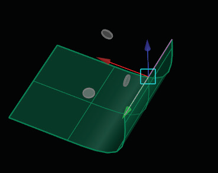
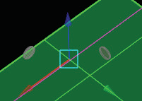
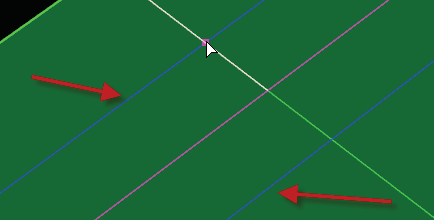

# Insert Edge Simple 

- Source PDF: Matrix 8 Instruction Manual Book 2 (matrix_8_book_2.pdf)
- Page range: 54-55
- Section title: Insert Edge Simple 
- Section id: m8book2-066-insert-edge-simple
- Note: boundary page(s) are shared with a neighbouring section (two-column layout); text/images may include neighbour content.

---
<!-- section m8book2-066-insert-edge-simple | Insert Edge Simple  | m8book2 pages 54-55 -->

<!-- page 54 -->

## Insert Edge Simple
‘tsInsertEdgeSimple’
Insert an edge to add localized detail to your
T-Spline model. Insert Edge Simple can be used
both in Smooth and Box mode. Adding an edge
with simple insertion will not move the location of
any other points; however, the surface shape will
likely change.
Using Extrude with selected edges of a plane.
### Extrude Curve:
Where is this Command:
Access this command from T-Spline>Insert
Edge Simple
Steps:
Extruding curves allows you to quickly create a
T-Spline surface.
Steps:
• Select Insert Edge Simple from the T-Spline menu.
• Select a edge loop or edge ring to be split.
• Press Enter.
• Pick a point along the edge to insert a new edge:
or, enter percentage between 0 and 1.
• Select a curve to Extrude.
• Click the T-Splines Extrude command.
• Press Enter.
• Drag the Translate (Move) manipulator.
### Command Line Options:
Selection Mode:
Edge: Allows Edges to be selected and extruded.
Insert Edge Simple before and after.
Face: Allows Faces to be selected and extruded.
### Command Line Options:
Curves: Allows Curves to be selected and
extruded.
Insertion Type: Simple/Exact: Inserting an
edge will try to keep the surface of the model
as simple as possible but the model surface will
be affected. Insert Edge Exact will add the edge
while maintaining the surface but the model will
likely become more complicated.
Both Sides: When this option is selected a edge
will be added to both sides of the original edge
positioning:
Using the Extrude Hotkey:  Instead of
clicking on the Extrude icon located within
Matrix’s T-Splines menu, you can use the Extrude
command with a hotkey. Simply select your
object, (face, edge or curve) hold down the
‘Alt’ key and drag the manipulator to create
an extrusion. This quick method for creating
extrusions works with the Translate (Move), Scale
or Rotate manipulator. It is important to note that
when using the undo command, undo twice. The
first undo changes the location of the manipulator,
the second undo removes the extra faces created
when using the extrude command.
Insert Edge Simple Both Sides.

<!-- page 55 -->

## Insert Point Simple
Percentage: The edge will be inserted this far
(enter a number between 0 and 1 as a percentage)
toward the neighboring face.
Distance: The edge will be inserted this far away
as an absolute distance from the selected edge.
To insert in the other direction, type a negative
number. (Note: the absolute distance is calculated
in Box mode, not Smooth mode).
‘tsInsertPointSimple’
Allows you to insert points on edges. It also allows
you to extend existing control points. To use the
command, click on the edges where you would
like to add control points. Simple insertion can
be used both in Smooth and Box mode. Adding
a point with simple insertion will not move the
location of any other points; however, the surface
shape will likely change.
RetopoSnap: Turns on and off RetopoSnap.
## Insert Edge Exact
Where is this Command:
Access this command from T-Spline>Insert
Point Simple
Note: The Insert Point command can destroy
the surface of the model. Avoid creating star
points, triangles and N-sided faces. If the model
automatically toggles into Box Mode and cannot
be smoothed, this is an indication that the insertion
resulted in a bad surface.
‘tsInsertEdgeExact’
Insert Edge Exact will not change the surface
shape. This can only be performed in Smooth
mode, and it may add more control points than
you desire, as well as shift existing control points
to keep the surface from changing. Using the
“Exact” mode on Insert Edge also standardizes the
surface.
Steps:
Where is this Command:
Access this command from T-Spline>Insert
Edge Exact
Steps:
• Select the Insert Point Simple command from the
T-Spline menu..
• Select an edge to insert a point.
• Press Enter.
• Click to set control point locations.
• Press Enter when done.
• Select the Insert Edge Exact command from the
T-Spline menu..
• Select a edge loop or edge ring to be split.
• Pick a point along the edge to insert a new edge.
### Command Line Options:
Using Insert Point
Simple to insert
multiple points.
### Command Line Options:
Insertion Type: Simple/Exact: Inserting an
edge will try to keep the surface of the model as
simple as possible but the model surface will be
affected. Insert Edge Exact will add and edge
while maintaining the surface but the model will
likely become more complicated.
Insertion Type: Simple/Exact: Inserting a
point will try to keep the surface of the model as
simple as possible but the model surface will be
affected. Insert Point Exact will add a point while
maintaining the surface but the model will likely
become more complicated.
Both Sides: When this option is selected a edge
will be added to both sides of the original edge
This allows you to insert edges on both sides of an
existing edge an equal distance apart, helping you
to maintain symmetry.
RetopoSnap: Turns on and off RetopoSnap.

---

## Images

-  page 54
-  page 54
-  page 54
-  page 54
-  page 55 (shared page)
