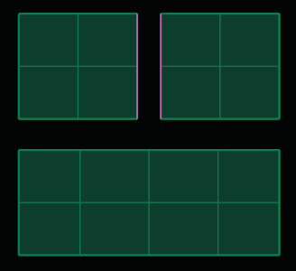
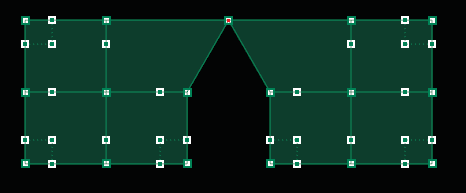
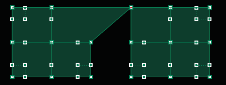

# Unweld 

- Source PDF: Matrix 8 Instruction Manual Book 2 (matrix_8_book_2.pdf)
- Page range: 64-64
- Section title: Unweld 
- Section id: m8book2-081-unweld
- Note: boundary page(s) are shared with a neighbouring section (two-column layout); text/images may include neighbour content.

---
<!-- section m8book2-081-unweld | Unweld  | m8book2 pages 64-64 -->

<!-- page 64 -->

Alternate Steps:
## Weld
• Select both set sets of edges before running the
Merge command. (Use Select Edit edit mode in
the T-Splines HUD.)
• Select Merge from the T-Splines menu.
• Both edges meet in the middle.
‘tsweld’
The Weld command is used to connect T-Splines
objects to one another, or back to themselves.
Weld connects vertices or points to each other
within a single T-Spline surface or can be used to
repair areas of a model that may not be properly
closed. The order of the selection determines the
overall result.
Note: When using Merge, no additional faces are
added between the areas being Merged. Instead the
existing edges are moved together and seamlessly
connected to one another.
Where is this Command:
Access this command from T-Spline>Weld
Note: If two points are preselected, the Weld
command will average the distances between them.
If the points are selected after the command is run,
the first point will be moved to the position of the
second point.
Steps:
• Select points (Verts) to Weld. (Use Select Vert edit
mode in the T-Splines HUD.)
• Select the Weld command in the T-Spline menu.
• Both Verts are joined and meet in the middle.
Merge with preselected points, before and after.
### Command Line Option:
Alternate Steps:
Smooth: Determines whether the surfaces are
merged smoothly or with a crease. To do so, begin
the command and use the Smooth toggle located
in the Command Line.
## Unweld
• Click on the Weld command in the T-Spline menu.
• Click on the first Vert. Press Enter.
• Click on the second Vert. Press enter.
• First Vert moves to the second.
‘tsUnweld’
The Unweld edge works backwards from Merge
edge in that it disconnects two connected edges.
However, the edges will remain on top of one
another until they are moved.
Where is this Command:
Access this command from T-Spline>Unweld
Steps:
Tip: If you Weld only one vertex, the model will
temporarily not be able to be displayed as a smooth
surface. You need to Weld at least two vertices in a
row to toggle your model to Smooth mode.
• Select edges to Unweld.
•  Select Unweld from the T-Spline menu.

---

## Images

-  page 64 (shared page)
-  page 64 (shared page)
-  page 64 (shared page)
