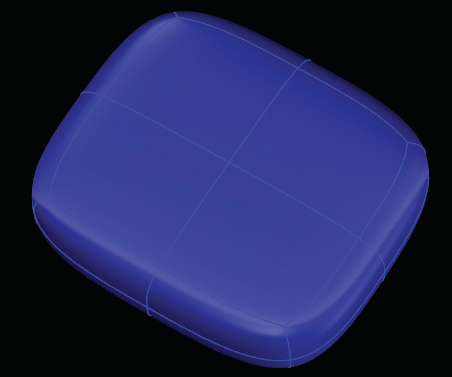

# Extrude 

- Source PDF: Matrix 8 Instruction Manual Book 2 (matrix_8_book_2.pdf)
- Page range: 53-53
- Section title: Extrude 
- Section id: m8book2-065-extrude
- Note: boundary page(s) are shared with a neighbouring section (two-column layout); text/images may include neighbour content.

---
<!-- section m8book2-065-extrude | Extrude  | m8book2 pages 53-53 -->

<!-- page 53 -->

## Extrude
‘tsExtrude’
The T-Splines Extrude command is a very
powerful way to quickly create surfaces that can
be altered using the Translate (Move), Scale and
Rotate manipulators. This tool is great to use
with an existing Primitive shape (Box, Sphere,
Quadball, etc.), allowing you to build upon the
simple Primitive creating a more complex shape.
Edit Mode set to “Select Face”.
Where is this Command:
Access this command from T-Spline>Extrude
## Select Object (Mode)
### Extrude Faces:
This is the last of four edit modes available in the
T-Splines HUD. When Object mode is selected,
the entire T-Spline will be highlighted. Choose the
appropriate mode to select a Vertex (Vert), Edge
or Face.
When using the T-Splines Extrude command
with an existing face on your model, a column of
new faces will be added around the original face,
connecting and transitioning the newly-added
surface. You can extrude a single face, multiple
adjacent faces, or multiple faces that are not
connected to one another.
Steps:
Where is this Command:
Access this command from TSpline >TSplines
HUD>Select Object
Or by typing ‘F’ when T-Splines and Hot Keys
are activated.
• Select faces to Extrude.
• Click the Extrude command from the T-Spline
menu.
• Press Enter.
• Drag the Translate (Move) Manipulator.
Steps:
• Click on Select Object in the T-Spline HUD to set
the edit mode.
• Click on the object to select it.
Extrude Faces before and after.
### Extrude Edge:
When using the Extrude command with an edge,
this tool adds a surface to an existing border edge
or edges, extending the border of your model.
Steps:
Edit Mode set to “Select Object”.
• Select Border edges to Extrude.
• Click the T-Splines Extrude command.
• Press Enter.
• Drag the Translate (Move) manipulator.

---

## Images

-  page 53 (shared page)
-  page 53 (shared page)
-  page 53 (shared page)
-  page 53 (shared page)
