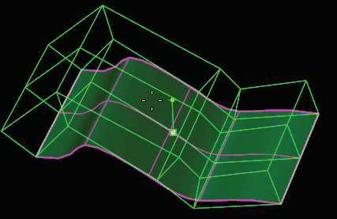
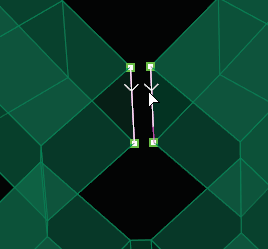

# Thicken 

- Source PDF: Matrix 8 Instruction Manual Book 2 (matrix_8_book_2.pdf)
- Page range: 56-57
- Section title: Thicken 
- Section id: m8book2-070-thicken
- Note: boundary page(s) are shared with a neighbouring section (two-column layout); text/images may include neighbour content.

---
<!-- section m8book2-070-thicken | Thicken  | m8book2 pages 56-57 -->

<!-- page 56 -->

## Insert Point Exact
Where is this Command:
Access this command from T-Spline>Thicken
Steps:
‘tsInsertPointExact’
Exact insertion will not change the surface shape.
This can only be performed in Smooth mode, and
it may add more control points than you desire,
as well as shift existing control points to keep the
surface from changing.
Where is this Command:
Access this command from T-Spline>Insert
Point Exact
• Begin with a T-Spline surface. This object can be
a two-dimensional or three-dimensional T-Spline
surface or object.
• Click the T-Splines Thicken command-and select
the T-Splines object.
• Press Enter when done.
• Move your cursor above or below the point that
appears on screen to determine the thickness of
the T-Spline object.
Note: The Insert Point command can destroy
the surface of the model. Avoid creating star
points, triangles and N-sided faces. If the model
automatically toggles into Box Mode and cannot
be smoothed, this is an indication that the insertion
resulted in a bad surface.
Steps:
Thickness is added to a plane. Specify the Thickness
by moving the cursor up or down.
• Select the Insert Point Exact command from the
T-Spline menu.
• Select an edge to insert a point.
• Click to set control point locations.
• Press Enter when done.
### Command Line Options:
Note: It is possible to create bad, overlapping
geometry when using the Thicken command. This
will happen if the minimum curvature of the model
is smaller than the thickness being applied. It is
recommended to examine the resulting surface for
self intersections. Keep in mind, if you know the
exact thickness for the finished surface, simply type
this value into the command and press Enter. The
resulting surface thickness is as close as possible to
the value entered, but the thickness may slightly vary
in certain areas of the design.
Insertion Type: Simple/Exact: Inserting a
point will try to keep the surface of the model as
simple as possible but the model surface will be
affected. Insert Point Exact will add a point while
maintaining the surface but the model will likely
become more complicated.
### Command Line Options:
RetopoSnap: Turns on and off RetopoSnap.
RetopoOffset: The offset distance from the
mesh that each point will snap to. If 0, the control
points will snap right on the mesh.
Direction Type:
PerVertexNormal: “PerVertex Normal” option
locates every vertex on the surface and thickens
the surface perpendicular or “normal” to each
vertex, creating a shell of the object.
## Thicken
Normal: Averages the direction of the normals
and settles on one direction to thicken towards.
‘tsThicken’
This powerful command adds thickness to a
T-Spline object, allowing you to easily create
three-dimensional objects and even hollow
T-Spline surfaces.
Crease Edges = Yes/No: The “CreaseEdges”
option is a Yes/No toggle that either creases the
edges of the thickened surface or leaves the
surface edges curved and soft.

<!-- page 57 -->

Copy=Yes/No: If the “Copy” option is toggled to
‘Yes’, it will leave the original not-thickened surface
behind after the new thickened surface has been
created. If ‘No’ , no copy will be created.
Note: If the surface is closed, the Thicken command
creates a second, separate surface.
Segments: The “Segments” command
determines how many faces will be added within
the Bridge. If you are bridging a long distance or
if there is an angle between the two items being
bridged, increasing the number of segments will
increase the complexity of the surface. This will
smooth the transition between objects.
## Bridge
ShowPreview=On/Off: Will display a preview in
box mode of the resulting bridge.
‘tsBridge’
This powerful tool connects Edges or Faces to
one another creating transitions between objects.
The T-Spline Bridge command creates a new
T-Spline surface between two T-Spline objects.
Where is this Command:
Access this command from T-Spline>Bridge
Follow Curve = No/Yes: The “FollowCurve”
Command Line option allows you to control the
direction of the bridge by confining it to a curve.
When using the “FollowCurve” command it is best
to place the curve in the center and perpendicular
to the faces or edges you would like to bridge.
Also, take note to increase the “Segment” count to
allow for any bends in the curve you are bridging
along.
Note: The Bridge command works on faces or border
edges. In either case, two groups of faces or edges
should be selected. If faces are selected, a bridge will
be built between the borders of the selected regions,
and the faces will be removed. You may switch
between face or edge mode by using the Selection
Mode command option. You need to have the same
number of edges or faces on each side of the bridge.
Steps:
Rotation: This Command Line option becomes
available when you select ‘FollowCurve=Yes’.
‘Rotation’ allows you to enter a value in degrees to
determine the orientation of the curve. If you draw
the curve in the correct orientation, you will not
need to use the “Rotation’ option.
Twist: The “Twist” command allows you to specify
the number of complete rotations the item will
have from the start to the end of the Bridge. This
creates a spiral effect and can also help to prevent
the surface from pinching as it bridges along the
curve.
• Select Bridge from the T-Splines menu.
• Select groups of faces or edges to bridge.
• Press Enter when done.
• Select the number of segments in the Command
Line.
• Set your point for alignment and orientation of
the bridge. (These should typically be the same
point facing the same direction as if you were
performing a Sweep.)
• Press Enter when done.
## Append
### Options:
Selection Mode=Faces/Edges: Allows you to
set the selection to either faces or face edges.
‘tsAppend’
The Append command adds new faces to a
T-Spline. This command closes a surface by
drawing a face, as opposed to using the Fill Hole
command. It is also possible to use this command
to manually draw a  face unconnected to any
surface to begin the layout for a new model.
Where is this Command:
Access this command from T-Spline>Append
There are three different modes for appending a
face: Simple, From Edge, and Chain.
Selecting edges while using the Bridge command.

---

## Images

-  page 56 (shared page)
-  page 57 (shared page)
-  page 57 (shared page)
