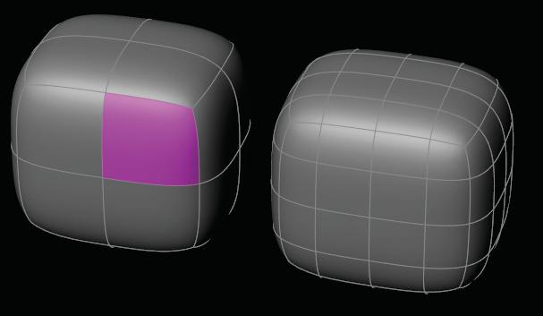
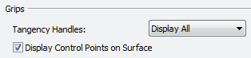
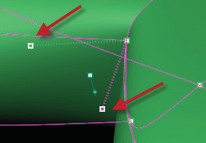
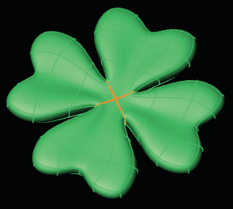

# Crease 

- Source PDF: Matrix 8 Instruction Manual Book 2 (matrix_8_book_2.pdf)
- Page range: 62-62
- Section title: Crease 
- Section id: m8book2-077-crease
- Note: boundary page(s) are shared with a neighbouring section (two-column layout); text/images may include neighbour content.

---
<!-- section m8book2-077-crease | Crease  | m8book2 pages 62-62 -->

<!-- page 62 -->

## Subdivide Exact
## Crease
‘tsCrease’
Clarify design details adding sharp edges to any
portion of the model using the Crease command.
Where is this Command:
Access this command from T-Spline>Crease
Steps:
‘tsSubdivideFaceExact’
Create more control over the object by adding
more Faces to a T-Spline surface. Subdividing
a face in Exact mode will maintain the surface
shape. To do so, additional faces may be
subdivided automatically in order to keep the
surface from distorting. In some areas of the
surface, such as near a star point, some extra
geometry must be added to maintain the surface
shape.
• Select Crease from the T-Spline menu.
• Select edges that you wish to apply a crease.
• Press Enter when done.
Where is this Command:
Access this command from T-Splines>
Subdivide Exact
Note: A Crease will transition beyond the creased
region to other portions of the T-Spline object. As a
general rule of thumb, a Crease will transition two
faces beyond the crease. The third face away from
the crease should not be affected.
Steps:
• Select Subdivide Exact command from the
T-Spline menu.
• When prompted select the T-Spline face or faces
to be subdivided.
• Press Enter when done.
Tangency Handles: To control the tangency of
a creased section to the rest of the surface, use
the Tangency Handles. Tangency Handles are not
visible by default: turn them on in the T-Splines
Options menu (T-Spline>Options).
Switch to ‘Select Vert’ edit mode, click on a handle,
hold and drag it to the desired position.
T-Spline Face before and after Subdivide Exact.
### Command Line Options:
Tangency Handle on a creased section.
Insertion Type = Exact/ Simple: Exact:
Subdividing a face in exact mode will maintain
the surface shape. Simple: As the faces are
subdivided and multiplied, the T-Spline surface
changes to accommodate the newly-added
edges and verts.
RetopoSnap=(Yes/No):  Turns on and off
RetopoSnap.
RetopoOffset: When Retopo Snap is active
this option appears. The offset distance from the
mesh that each point will snap to. If 0, the control
points will snap right on the mesh.
T-Spline leaf before and after using Crease.
Symmetry applies the Crease to the symmetric
edges.

---

## Images

-  page 62 (shared page)
-  page 62 (shared page)
-  page 62 (shared page)
-  page 62 (shared page)
-  page 62 (shared page)
