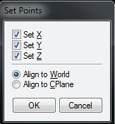
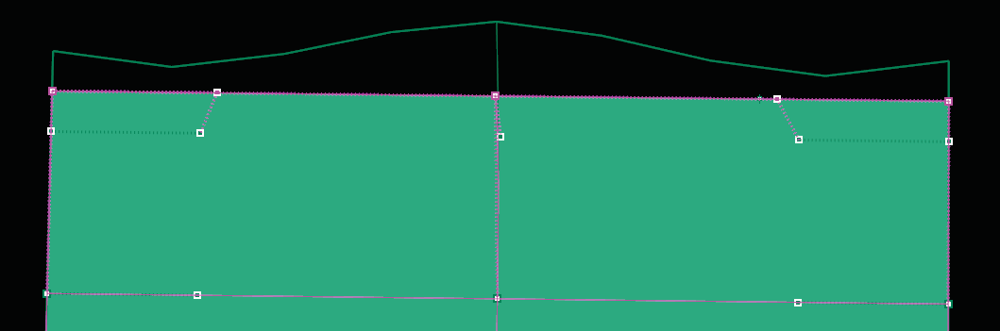

# Remove Creases 

- Source PDF: Matrix 8 Instruction Manual Book 2 (matrix_8_book_2.pdf)
- Page range: 63-63
- Section title: Remove Creases 
- Section id: m8book2-078-remove-creases
- Note: boundary page(s) are shared with a neighbouring section (two-column layout); text/images may include neighbour content.

---
<!-- section m8book2-078-remove-creases | Remove Creases  | m8book2 pages 63-63 -->

<!-- page 63 -->

## Remove Creases
‘tsRemoveCreases’
Removes selected creases from a T-Spline model.
Where is this Command:
Access this command from T-Spline> Remove
Creases
Align to World/Align to C-Plane: Aligns
using World or Construction plane coordinates.
The Align to World option allows you to determine
the location along the axis on which to Set Points.
Determine this location by eye, or enter a value
into the Command Line using World coordinates.
The Align to C-Plane command sets the points
flat against the C-Plane in whatever axis you
choose.
Steps:
Copy = Yes/No: Yes; creates a new copy of the
edited object. No: does not create a copy.
• Select Remove Creases from the T-Spline menu.
• Select the creased edges from the T-Spline object
to remove the creases.
• Press Enter when done. The Crease is now
removed from the T-Splines object.
## Set Points
In Select Vert edit mode, select the Vertices or
control points to align with Set Points.
‘SetPt’
The Set Point command quickly and efficiently
moves and organizes points or verts along a
specific axes. Use this tool to even up edges and
create uniform Vert layouts.
## Merge
Where is this Command:
Access this command from T-Spline> Set
Points
Steps:
‘tsMerge’
The Merge command is similar to Weld but
instead of working on vertices it works on edges.
Merge can be used to connect one edge, or a
chain of edges to another edge or chain of edges.
Join a single edge into one or more edges.
Where is this Command:
Access this command from T-Spline>Merge
• Select Set Points from the T-Spline menu.
• With Select Vert’ Mode enabled, select the Verts to
move.
• In the Set Points dialog, click
the check boxes for the
coordinates.
• Pick a location to match by
dragging the vertices. The
selected objects will line
up with the set point in the
direction or directions you choose.
Note: The process for merging edges will determine
the end result. If both edges or sets of edges are
highlighted prior to running the Merge command, the
new location of both edges will be averaged and they
will meet in the middle. If, on the other hand, you
begin the command and then select an edge, the first
edge that is selected will be moved to the location of
the second edge. This is important to understand to
control the face layout of the design.
Steps:
Note: To move in only direction, clear the check
boxes for the other directions. To set one check and
clear the others, right-click the check box.
### Set Point Options:
Set X/Set Y/Set Z: Align objects in the X, Y, and
Z directions.
• Select Merge from the T-Spline menu.
• Select the first edge or edge chain to Merge. (Use
Select Edge edit mode in the T-Splines HUD.)
• Press Enter.
• Select the second edge or edge chain to Merge.
• Press Enter.
• The first edge moves to meet the second.

---

## Images

-  page 63 (shared page)
-  page 63 (shared page)
