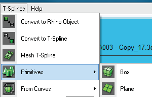
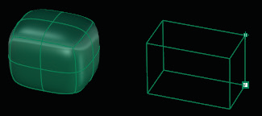

# Make Uniform 

- Source PDF: Matrix 8 Instruction Manual Book 2 (matrix_8_book_2.pdf)
- Page range: 65-65
- Section title: Make Uniform 
- Section id: m8book2-083-make-uniform
- Note: boundary page(s) are shared with a neighbouring section (two-column layout); text/images may include neighbour content.

---
<!-- section m8book2-083-make-uniform | Make Uniform  | m8book2 pages 65-65 -->

<!-- page 65 -->

## Make Uniform
‘tsMakeUniform’
This important command is used to align and
relax the surface, making it more uniform. Use the
Make Uniform command anytime you make major
changes to the topology of a model such as after
extruding or inserting edges.
Steps:
• Select T-Spline object to Make Uniform.
• Click on the Make Uniform command in the
T-Spline menu.
T-Splines Primitives consist of the following
commands and are explained in detail next:
• Box
• Sphere
• Quadball
• Cylinder
• Cone
• Torus
• Plane
## T-Spline Box
‘tsBox’
Draws T-Spline Box primitive. You can set the
density of the box in the Command Line. The
density is the number of control points (vertex
grips) that describe the box.
Where is this Command:
Access this command from T-Spline Menu>Box
Steps:
The surface above top demonstrates a model prior
to using the Make Uniform command. The surface
bottom shows the result of running the Make Uniform
command.
• Select Box from the T-Spline menu.
• Draw the base rectangle of the box. Select the
first corner location of the base by clicking in the
viewport.
• Select the location of the other corner of the base
or length by clicking again in the viewport.
• Pick the height of the box by clicking in the
viewport or press Enter to use the width.
## T-Spline Primitives
Begin designing in T-Splines with a geometric
shape to create a ring, bracelet, pendant or
earrings.
Each command can be accessed from the Main
Menu>T-Splines menu or the top drop down
T-Splines menu.
Box complete and selecting the height of the Box.

---

## Images

-  page 65 (shared page)
-  page 65 (shared page)
-  page 65 (shared page)
