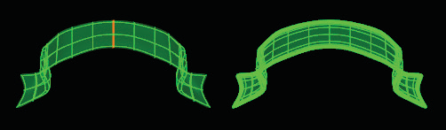
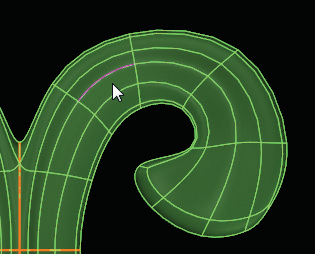
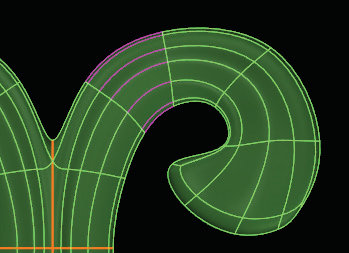

# T-Splines to Rhino Surface 

- Source PDF: Matrix 8 Instruction Manual Book 2 (matrix_8_book_2.pdf)
- Page range: 44-45
- Section title: T-Splines to Rhino Surface 
- Section id: m8book2-047-t-splines-to-rhino-surface
- Note: boundary page(s) are shared with a neighbouring section (two-column layout); text/images may include neighbour content.

---
<!-- section m8book2-047-t-splines-to-rhino-surface | T-Splines to Rhino Surface  | m8book2 pages 44-45 -->

<!-- page 44 -->

### Command Line Options (typing the
### command only):
Trimmed Surfaces: T-Splines does not support
trimmed surfaces. This means that any trimming
information will be discarded before the surface is
converted to a T-Spline, returning the surface to
its untrimmed state.
Copy=No/Yes: No Copy will replace the
selected surface with a T-Spline object.
Yes Copy will create a T-Spline object but leave
the original surface.
Output Type:
Auto: Matrix will select whether the object
created comes out in Box Mode or Smooth Mode.
Box Mode: Setting the output to Box Mode will
allow for faster editing of the model.
Degree: Any untrimmed, NURBS surface can
be converted directly to a T-Spline, since T-Spline
surfaces in Rhino are all degree 3. NURBS of
degree 4 or higher can be converted to T-Splines,
and will be rebuilt to degree 3 during conversion.
NURBS of degree 1 or 2 can also be converted to
T-Splines.
Smooth Mode: This is the default mode for
T-Splines Primitives.
Drag Mode: The Drag option allows a user to
define how the manipulators work on the screen.
This option includes; C-Plane Coordinates, World
Coordinates, Viewport, and Normal. See “Drag
Modes” in this Chapter for a full explanation.
Note: In “Options” (TSpline>Options), there is an
option to “Rebuild when increasing degree” when
converting degree 1 or 2 NURBS to T-Splines. If this
option is checked, the surface will be rebuilt, which
may change the surface slightly. If this option is not
checked, the surface will be degree elevated. This
will ensure that the surface shape does not change;
however, there will be creased control points in
the model which will make it difficult to smoothly
manipulate the T-Spline surface.
## T-Splines to Rhino Surface
Converting Mesh to T-Splines: Conversion
of meshes to T-Splines is easy. Each mesh control
point becomes a T-Spline control point. The
T-Spline surface won’t pass through the points,
but will be a smooth surface derived from the
points. The more points there are on the mesh, the
tighter the T-Splines surface will be hugged to the
control points.
‘tsConvertToRhinosurf’
The conversion is precise, will not deform the
surface, and maintains continuity. If there are no
star points in the surface, the T-Splines surface will
convert to a single Rhino NURBS surface. If the
model contains star points (and is therefore not
rectangular), it will be converted to a polysurface.
Where is this Command:
Access this command from T-Spline>TSplines
HUD> T-Splines to Rhino Surface
Steps:
Warning: Do not attempt to directly convert .STL
files to T-Splines. The resulting surface will be too
large. Instead, try reverse engineering the mesh by
using the “Append” (TSpline>Append) command
with RetopoSnap turned on (TSpline>Retopology
Snap Options).
• Select the T-Splines to Rhino Surface command in
the HUD.
• Select the T-Spline surface to convert to a Rhino
(Matrix, NURBS) surface.
Warning: Do not attempt to convert triangle
meshes to T-Splines. The resulting surface will be
too large. It is okay to have a few triangle faces
in a mesh that has mostly four-sided faces, but if
there are more than 20-50 triangle faces it will not
convert.
T-Splines original library design (left) before
and after converted to a Rhino (Matrix, NURBS)
polysurface (right).

<!-- page 45 -->

### Command Line Options (typing the
### command only):
Copy=No/Yes: No Copy will replace the
selected T-Spline object with a surface or
polysurface. Yes Copy will create a Matrix object
but leave the original T-Spline too.
Output Type:
Mesh: Outputs a mesh.
Choose Loop Select and the entire Loop of edges is
selected.
Polysurf: Outputs a polysurface.
## Ring Select
Auto: Outputs a mesh if the T-Spline is in Box
mode and a polysurface if the T-Spline is in
Smooth mode.
‘tsSelection’ SelectRing
Ring Select like Loop Select makes selecting
groups of edges easier. Ring Select selects edges
that are parallel to one another as opposed to
continuous edges (like Loop Select).
Star Continuity (G0, G1 or Auto): The Auto
setting will choose the continuity or amount of
blend for you. G0 or G1 determines the amount of
blend produced in the polysurface.
History Enabled No/Yes: Yes will enable Rhino
History. No leaves Rhino History off.
Where is this Command:
Access this command from T-Spline>TSplines
HUD>Ring Select
Steps:
## Loop Select
‘tsSelection’ SelectLoop
With one edge selected this command will select
the entire, continuous loop of edges.
• Select a T-Spline edge.
• Click on Ring Select in the T-Splines HUD to select
all edges that are in a ring around the T-Spline
object (parallel to the original edge.).
Where is this Command:
Access this command from T-Spline>TSplines
HUD>Loop Select
Steps:
Select a T-Spline
edge
• Select a T-Spline edge. (HUD mode is set to Select
Edge.)
• Click on Loop Select in the T-Splines HUD.
• Or, with an edge selected double-click on the
selected edge.
The loop of edges will all be selected.
After clicking on
Ring Select the
parallel edges are
now selected.
One T-Spline Edge
is selected.

---

## Images

-  page 44 (shared page)
-  page 45 (shared page)
-  page 45 (shared page)
-  page 45 (shared page)
-  page 45 (shared page)
