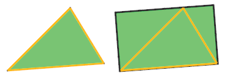
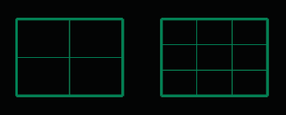

# Convert to T-Splines 

- Source PDF: Matrix 8 Instruction Manual Book 2 (matrix_8_book_2.pdf)
- Page range: 43-44
- Section title: Convert to T-Splines 
- Section id: m8book2-046-convert-to-t-splines
- Note: boundary page(s) are shared with a neighbouring section (two-column layout); text/images may include neighbour content.

---
<!-- section m8book2-046-convert-to-t-splines | Convert to T-Splines  | m8book2 pages 43-44 -->

<!-- page 43 -->

### Soft Manip, Paint, Hot Keys, Selected:
## Convert to T-Splines
‘tsConvert’
Converts an untrimmed, single, NURBS surface,
Matrix mesh or .OBJ object to a T-Spline object.
Where is this Command:
Access this command from T-Spline>TSplines
HUD>Convert to T-Splines
Soft Manipulate On/Off: When Soft
Manipulation is enabled, a moved vertex (Vert)
has a more gradual effect on the neighboring
surface. This control is set to Off as a default.
Steps:
• Select Convert to T-Splines command in the HUD.
• Select the surface or mesh to convert to a T-Spline
surface.
Rules for converting an object:
Set Soft Radius: Sets the radius value for the
Soft Manipulation. Enter a value in the provided
box. This setting allows you to determine the
area of influence that will be affected when being
manipulated. The smaller the value, the more
localized the manipulation will be. The higher the
value, the greater impact the manipulation will
have over the entire object.
Paint: This affects the way you select items on-
screen. When Paint selection is turned on, click
and drag across faces over the T-Splines model to
add them to the selection, rather than needing to
click on faces individually while holding Shift.
• Single surfaces will convert.
• Polysurfaces will not convert. (Explode the
polysurface and convert the single surfaces.)
• T-Splines will remember all trim information during
the conversion. (T-Spline object will appear as the
original, untrimmed surface)
• Matrix surface objects were originally created with
straight sides. So, the converted T-Splines object
will have straight sides. See picture.
Matrix surface (triangle) before and after Convert to
T-Splines.
Hotkeys: Hotkeys in T-Splines enables the user to
quickly change between MSR types and Selection
Modes while editing. Getting comfortable with
Hotkeys makes working in T-Splines more efficient.
When Hotkeys are ON, commands cannot be
typed in the Command Line. (Hotkeys are turned
off by default) A list of Hotkeys can be found in
the Options menu (T-Spline>Options). Or, Rhino
Options>T-Splines>Hotkeys.
Hint: Rebuild a Surface (Surface Menu> Rebuild)
to change the UV point count to increase or
decrease the potential number of faces on the
converted T-Spline object.
Selected: This field populates with the name(s) of
the T-Splines objects when T-Splines objects are
highlighted.
Surface on the left was rebuilt
with the Point Count
increasing from 2 to 6 for both
U and V directions.

<!-- page 44 -->

### Command Line Options (typing the
### command only):
Trimmed Surfaces: T-Splines does not support
trimmed surfaces. This means that any trimming
information will be discarded before the surface is
converted to a T-Spline, returning the surface to
its untrimmed state.
Copy=No/Yes: No Copy will replace the
selected surface with a T-Spline object.
Yes Copy will create a T-Spline object but leave
the original surface.
Output Type:
Auto: Matrix will select whether the object
created comes out in Box Mode or Smooth Mode.
Box Mode: Setting the output to Box Mode will
allow for faster editing of the model.
Degree: Any untrimmed, NURBS surface can
be converted directly to a T-Spline, since T-Spline
surfaces in Rhino are all degree 3. NURBS of
degree 4 or higher can be converted to T-Splines,
and will be rebuilt to degree 3 during conversion.
NURBS of degree 1 or 2 can also be converted to
T-Splines.
Smooth Mode: This is the default mode for
T-Splines Primitives.
Drag Mode: The Drag option allows a user to
define how the manipulators work on the screen.
This option includes; C-Plane Coordinates, World
Coordinates, Viewport, and Normal. See “Drag
Modes” in this Chapter for a full explanation.
Note: In “Options” (TSpline>Options), there is an
option to “Rebuild when increasing degree” when
converting degree 1 or 2 NURBS to T-Splines. If this
option is checked, the surface will be rebuilt, which
may change the surface slightly. If this option is not
checked, the surface will be degree elevated. This
will ensure that the surface shape does not change;
however, there will be creased control points in
the model which will make it difficult to smoothly
manipulate the T-Spline surface.
## T-Splines to Rhino Surface
Converting Mesh to T-Splines: Conversion
of meshes to T-Splines is easy. Each mesh control
point becomes a T-Spline control point. The
T-Spline surface won’t pass through the points,
but will be a smooth surface derived from the
points. The more points there are on the mesh, the
tighter the T-Splines surface will be hugged to the
control points.
‘tsConvertToRhinosurf’
The conversion is precise, will not deform the
surface, and maintains continuity. If there are no
star points in the surface, the T-Splines surface will
convert to a single Rhino NURBS surface. If the
model contains star points (and is therefore not
rectangular), it will be converted to a polysurface.
Where is this Command:
Access this command from T-Spline>TSplines
HUD> T-Splines to Rhino Surface
Steps:
Warning: Do not attempt to directly convert .STL
files to T-Splines. The resulting surface will be too
large. Instead, try reverse engineering the mesh by
using the “Append” (TSpline>Append) command
with RetopoSnap turned on (TSpline>Retopology
Snap Options).
• Select the T-Splines to Rhino Surface command in
the HUD.
• Select the T-Spline surface to convert to a Rhino
(Matrix, NURBS) surface.
Warning: Do not attempt to convert triangle
meshes to T-Splines. The resulting surface will be
too large. It is okay to have a few triangle faces
in a mesh that has mostly four-sided faces, but if
there are more than 20-50 triangle faces it will not
convert.
T-Splines original library design (left) before
and after converted to a Rhino (Matrix, NURBS)
polysurface (right).

---

## Images

-  page 43 (shared page)
-  page 43 (shared page)
-  page 43 (shared page)
-  page 43 (shared page)
-  page 44 (shared page)
