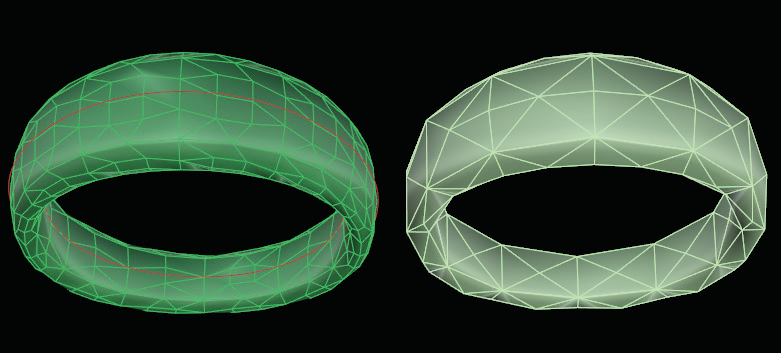

# Mesh T-Spline 

- Source PDF: Matrix 8 Instruction Manual Book 2 (matrix_8_book_2.pdf)
- Page range: 93-94
- Section title: Mesh T-Spline 
- Section id: m8book2-113-mesh-t-spline
- Note: boundary page(s) are shared with a neighbouring section (two-column layout); text/images may include neighbour content.

---
<!-- section m8book2-113-mesh-t-spline | Mesh T-Spline  | m8book2 pages 93-94 -->

<!-- page 93 -->

Steps:
• Select ‘CreateTextureMesh’ in the Command Line.
• Select a creation method from the three choices
above.
• Press Enter when done.
• Follow the prompt to draw a rectangle.
This rectangle will contain the texture map image.
The command will then unwrap the flat texture
mesh on top of this rectangle.
### Texture Mesh Live Points On:
Texture mesh with live points on.
Once the texture mesh is on top of the rectangle,
you can move the points of the mesh around
to edit which texture mesh points (the UVs)
correspond to which parts of the image. This will
then change the projection of the image onto
your T-Spline model.
## Mesh	 T-Spline
‘tsMesh’
The T-Splines Mesh command allows you to mesh
a T-Splines directly from the T-Splines work flow,
as opposed to first converting it to a NURBS
surface.
The texture mesh is just that – a mesh. You can
move the mesh points around just by using the
Control Points On (Top 11 Commands menu)
command and moving them like you would any
other mesh point. The projection of the image
on the T-Spline model will update. However, the
TextureMeshLivePointsOn option provides an
option for moving them in a cool way.
Where is this Command:
Access this command from T-Spline>Mesh
T-Spline
Steps:
The way the LivePoints work is that there are
some larger points that are the “pinned points.”
Anytime you move a point, then the pinned points
stay in place, but all the other points in the model
can move to get a nice flow to the object. You
can move any point, whether it is pinned or not.
Each time you move a point, it in turn becomes a
pinned point. If you want to turn a pinned point
back into a non-pinned point, just select it and hit
the Delete key, and it will become small again as a
movable, non-pinned point.
• Select Mesh T-Spline from the T-Spline menu.
• Select T-Spline object to Mesh.
• Press Enter when done.
• Select the T-spline meshing options in the
Command Line.
• Press Enter when done.
• A mesh is created in the same space as the
T-Splines object. Use Layer colors to turn off one
or the other.
Steps:
Note: Mesh T-Spline usually exports a more
optimized mesh for a T-spline than the Rhino Mesh
command since tsMesh recognizes T-points. tsMesh
can also be used on NURBS and polysurfaces.
• Select ‘TextureMeshLivePointsOn’ in the Command
Line.
• Select texture mesh to enable live points.
• Press Enter when done.

<!-- page 94 -->

Hints for Drawing Lines:
A mesh is made from a T-Splines object with the
Tolerance set to 0.2 (left) and 1.0 (right).
• Use Polyline or Single Line tool in the Curve menu
to draw the lines.
• If Interp Curve was used to draw a line, just rebuild
the curve (Curve Menu>Rebuild) and set the
Degree from Degree 3 to Degree 1.
• Only one degree, simple polylines are used.
• More control points on a line will create a surface
with tighter curvature.
• Less control points on the line will create a simpler,
looser surface.
• A closed line within a closed line will create a hole.
• Use ‘Split Curves’ command to split all the lines
where they may intersect.
### Options:
UseToleance = Yes/No: Determines whether to
use a specified number of divisions per face, or fit
to a tolerance.
Tolerance: If UseTolerance=Yes, the Tolerance
value determines the Mesh output as a mesh
dense enough to be within this distance of the
T-Spline surface at every point. An smaller amount
yields a more exact mesh (0.01) and a larger
amount yields a smaller file size (0.20).
Creating a T-Spline surface using From Lines.
DivisionsPerFace: If UseTolerance=No, each
face will be divided exactly this many times and
no more, even if significant detail is missing. This is
the number of divisions per T-Spline face.
Using From Lines:
## From Lines
tsFromLines’
Creates a T-Spline surface from a network of lines.
This command provides a way to make complex
surfaces with predictable results. It can also be
used to create custom primitives that are closer to
the desired final shape than the default primitives.
It can generate a closed or an open single surface,
rectangular or not, with holes and all kinds of
different topologies.
Where is this Command:
Access this command from T-Spline>From
Lines
• Select one or more networks of lines or polylines
and press Enter to create a preview mesh of faces.
This preview is the best guess of the command
at what your desired layout is, and is determined
according to the MaxAutoFace option.
• If the preview includes faces that you do not want
to include in your final model, select (click-on)
faces to remove them from the preview mesh.
• Click on edges to add faces to the preview mesh.
A pop-up box of possible faces will appear; just
select the desired face. You can control how many
faces will display in the pop-up box using the
‘MaxManualFace’ option.
• Edges which are not connected to any faces are
highlighted in red. Vertices which will result in a
non-manifold mesh are also highlighted in red.
Non-manifold vertices are automatically repaired,
but may not give you the result you’re expecting.

---

## Images

-  page 93 (shared page)
-  page 94 (shared page)
-  page 94 (shared page)
