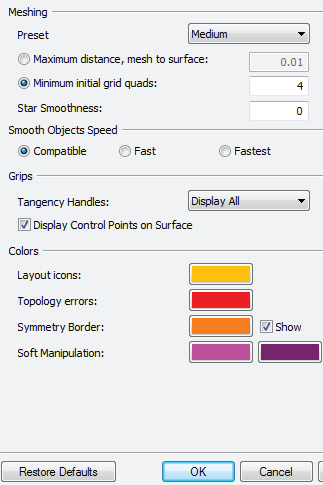
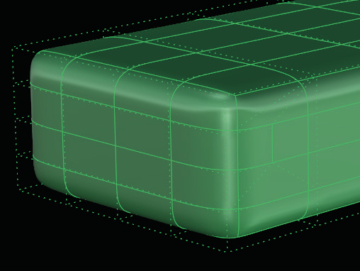

# Proxy 

- Source PDF: Matrix 8 Instruction Manual Book 2 (matrix_8_book_2.pdf)
- Page range: 98-98
- Section title: Proxy 
- Section id: m8book2-120-proxy

---
<!-- section m8book2-120-proxy | Proxy  | m8book2 pages 98-98 -->

<!-- page 98 -->

## Proxy
‘tsProxy’
Creates a Polygon Proxy of the selected T-Spline
object,. Any manipulation done to the Proxy will
also affect the T-Spline object. The main purpose
of the Proxy is to allow you to Animate and texture
map your T-Spline mesh.
Where is this Command:
Access this command from T-Spline>Proxy
Steps:
• Select Proxy from the T-Spline menu.
• Select a T-Spline Mesh to create Proxies.
• Press Enter when done.
T-Splines
Options
contains all
the presets
for the
T-Splines
program.
It is best to
leave these
settings at
their default
values unless
otherwise
directed by
Gemvision
Tech Support
or you have
advanced
knowledge.
Note: You should not add or remove edges, points or
faces from the polygon.
Display: The Display settings include default
settings for meshing, settings for how the item is
smoothed as well as the default colors for specific
items: Layout icons, Topology errors, Symmetry
and Soft Manipulation. It is recommended to leave
these settings at their default.
A polygon Proxy is created on a T-Splines object with
‘Proxy.”
Hotkeys: Hotkeys in T-Splines enables the user to
quickly change between MSR types and Selection
Modes while editing. The full list of Hotkeys are
found here. When Hotkeys are ON, commands
cannot be typed in the Command Line. (Hotkeys
are turned off by default) See T-Spline HUD for
information on enabling Hotkeys.
If the T-Spline is changed while the proxy is active,
delete the proxy and recreate it by running the Proxy
command again.
Conversion: The Conversion settings control
the resulting surfaces when using the rebuild
command. Again, it is recommended to leave
these settings at their default.
T-Splines UI (User Interface): The T-Splines
UI is used to control which menus are displayed
at startup. Because Gemvision creates an entirely
different User Interface in which to run the
program, leave these settings at their defaults.

---

## Images

-  page 98
-  page 98
