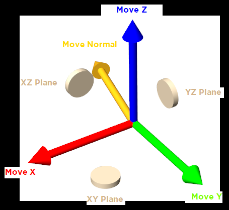

# Clay Edit

- Source PDF: Matrix 9 User Manual Addendum (matrix9.0_addendum.pdf)
- Page range: 8-8
- Section title: Clay Edit
- Section id: m9addendum-003-clay-edit
- Note: boundary page(s) are shared with a neighbouring section (two-column layout); text/images may include neighbour content.

---
<!-- section m9addendum-003-clay-edit | Clay Edit | m9addendum pages 8-8 -->

<!-- page 8 -->

### Clay Edit
and flat discs that move the selection in
two dimensions (or along a plane).
'ClayEdit'
Gumball move steps:
This command enables editting of Clayoo
SubD models and turn on the SubD Hud.
Click and drag one of the Move Gum-
ball handles
Where is this Command:
or
SubD > Clay Edit
Steps:
Click on the Clay Edit command to toggle
on or off SubD edditting.
Double click on one of the handles
and type in an exact transformation
value.
Press Enter when done.
The SubD HUD will appear in the viewport when Clay Edit is
toggled on.
### Gumball Modes
'ClayGumballModes'
The Clayoo Gumballs change how Clayoo
objects are manipulated.
Where is this Command:
Clayoo Gumball modes appear in the HUD
when Clayoo is active.
### Hot keys:
Clayoo Gumball Toggle: Q
1D Move Handles: These handles (red,
green and blue) align to the X, Y and Z
axes respectively and move the selection
along that axis.
Move: W
Rotate: E
Scale: R
Multiple Gumball: T
Normal Handle: This handle orients to the
selection's normal direction (per-
pendicular to the selection). If the selec-
tion's normal is along an axis the Normal
Handle will not appear.
Note: hot keys must be toggled on for the hot keys
to work.
2D Move Handles: Between each major
handle there is a beige disk that performs
a 2D move (XY, XZ, YZ), moving a vertex,
edge, face or object along a plane as
opposed to a single axis.
### Gumball Modes:
Rotate gumball:The Rotate gumball
rotates verts, edges, faces or the entire
object (based on the selection). The
Rotate gumball is comprised of red, green
and blue circles that surround the selec-
tion.
Rotate Gumball Steps:
Move gumball: The Move gumball relo-
cates verts, edges, faces, or the entire
object (based on the selection). The move
gumball is comprised of a series of arrows
that move the selection on a single vector
- 2 -

---

## Images

-  page 8 (shared page)
-  page 8 (shared page)
