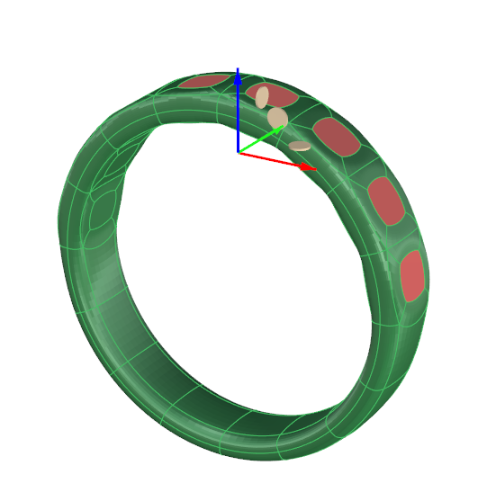
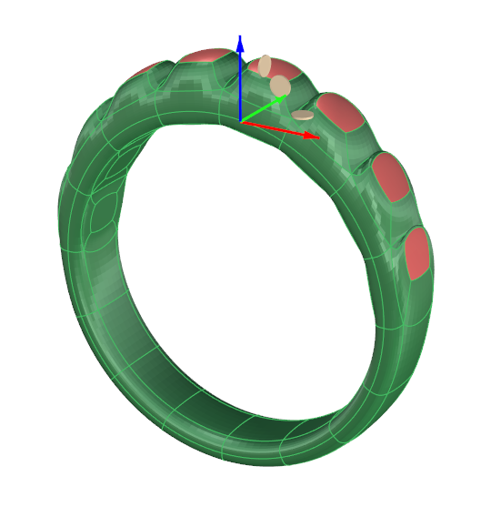
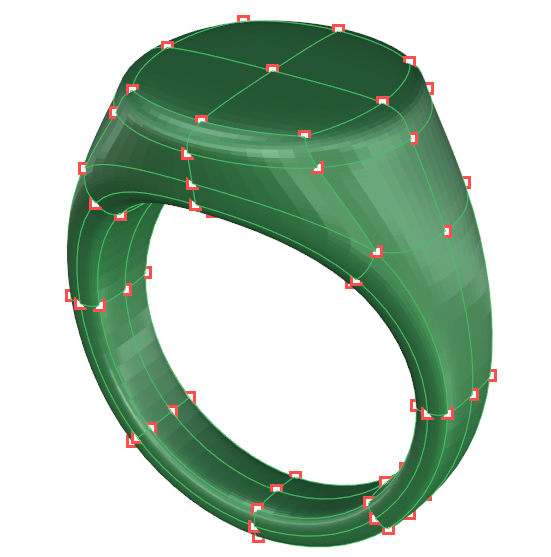
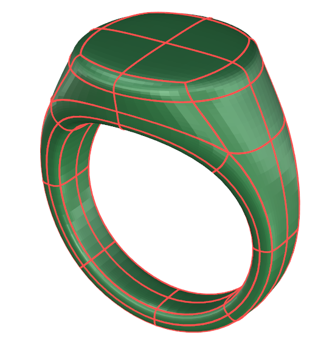
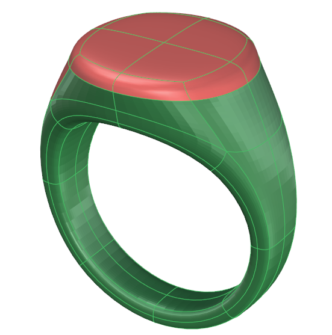

# Selection Mode

- Source PDF: Matrix 9 User Manual Addendum (matrix9.0_addendum.pdf)
- Page range: 10-10
- Section title: Selection Mode
- Section id: m9addendum-005-selection-mode

---
<!-- section m9addendum-005-selection-mode | Selection Mode | m9addendum pages 10-10 -->

<!-- page 10 -->

Vertices selection mode
Figure 1: Selection with multiple gumballs off. Figure 2: Selec-
tion after move.
Note:When this option is selected the gumballs ori-
ent themseleves to the selection as opposed to the
world cordinates (X,Y and Z axis). Therefore, the
Normal Handle will not appear. The blue Move
Handle is oriented to the surfaces normal.
Edge selection mode: In this selection
mode, when you click on a Clayoo edge
only that edge is selected. Multiple edges
can be selected by holding down Shift on
the keyboard. Select a loop of edges by
first selecting an edge and then holding
down shift and double-clicking on an adja-
cent edge.
### Selection Mode
Clayoo has four selection modes: vertices,
edges, faces and object. These modes are
at the core of how we manipulate
SubD/Clayoo objects.
Where is this Command:
Edge selection mode
Clayoo Selection modes appear in the
HUD when Clayoo is active.
### Hot Keys:
Face selection mode: In this selection
mode, when you click on a Clayoo face
only that face is selected. Multiple faces
can be selected by holding down Shift on
the keyboard. Select a loop of faces by
first selecting a face and then holding
down Shift and double-clicking on an adja-
cent face.
Vertices: A
Edges: S
Faces: D
Objects: F
Note: hot keys must be toggled on for the hot keys
to work.
Face selection mode
### Selection Modes:
Object selection mode: In this selection
mode, when you click on a Clayoo surface
the whole object is selected.
Vertices Selection Mode: When Ver-
tices mode is selected, one or more ver-
tices (a vertex grip or control point) which
define the surface can be selected and
used for editing. Select additional verts by
holding Shift on the keyboard and left-
clicking or using crossover or region
select.
- 4 -

---

## Images

-  page 10
-  page 10
-  page 10
-  page 10
-  page 10
