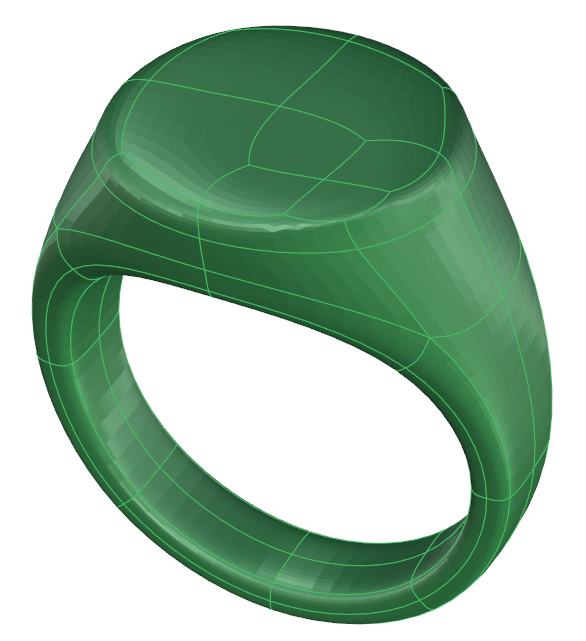

# Visualization Mode

- Source PDF: Matrix 9 User Manual Addendum (matrix9.0_addendum.pdf)
- Page range: 13-13
- Section title: Visualization Mode
- Section id: m9addendum-008-visualization-mode
- Note: boundary page(s) are shared with a neighbouring section (two-column layout); text/images may include neighbour content.

---
<!-- section m9addendum-008-visualization-mode | Visualization Mode | m9addendum pages 13-13 -->

<!-- page 13 -->

### Visualization Mode
Pick a point for the division to run
though on the Clayoo surface. A pre-
view of where the division will occur
will appear on the screen.
A Clayoo surface can be viewed as a
smooth surface or a boxy mesh. In Box
Mode the software will run more smoothly
and sometimes it can make the object
easier to manipulate. Smooth Mode gives
a more accurate view of the model.
Where is this Command:
Access this command from
SubD>HUD>View Mode
### Hot Key:
Toggle Smooth/Box Mode: Tab
Figure 1: Division selection Figure 2: Divide result
Note: Hot keys must be toggled on for the hot keys
Note: The division will only occur in the U or V dir-
to work.
ection. The division will run perpendicular to the
Clayoo edge that your mouse is hovering over.
Steps:
Steps (single face selected):
Click on the Box/Smooth toggle in
the viewport HUD
or
With one Clayoo face selected, click
on Divide in the Clayoo toolbar.
The surface will be divided in both
the U and V direction.
Press Tab (hot keys must be
enabled)
Figure 1: Smooth Mode Figure 2: Box Mode
Figure 1: Division selection Figure 2: Divide result
Steps (Ring or Loop selected):
### Clayoo Divide
'ClayDivide'
Divides Clayoo faces along U, V or both.
This tool has multiple workflows; each has
slightly different results.
Where is this Command:
Access this command from SubD>Divide
With either a Ring or Loop of faces
selected, click on Divide in the
Clayoo toolbar.
The faces will be divided along the
direction of the selection.
The Divide command can be used
on edges or multiple faces. The
steps are the same, but the results
vary: See examples below.
Steps (nothing selected):
Select Divide from the Clayoo tool-
bar.
- 7 -

---

## Images

-  page 13 (shared page)
-  page 13 (shared page)
-  page 13 (shared page)
-  page 13 (shared page)
-  page 13 (shared page)
-  page 13 (shared page)
-  page 13 (shared page)
