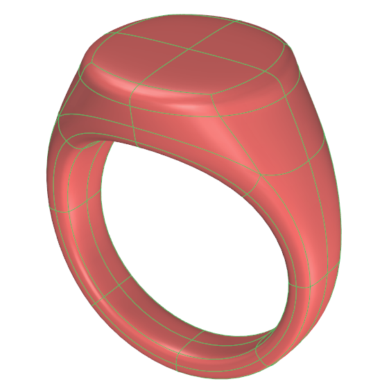
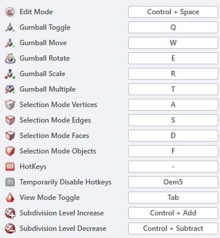

# Hot Keys

- Source PDF: Matrix 9 User Manual Addendum (matrix9.0_addendum.pdf)
- Page range: 11-11
- Section title: Hot Keys
- Section id: m9addendum-006-hot-keys

---
<!-- section m9addendum-006-hot-keys | Hot Keys | m9addendum pages 11-11 -->

<!-- page 11 -->

### Hot Keys:
Object selection mode
### Hot Keys
'ClayHotKeys'
Toggles on and off Clayoo hot keys. Hot
keys are used to quickly change between
selection modes and gumball modes.
Where is this Command:
Access this command from
SubD>HUD>Hot Keys
Note: When hot keys are enabled keyboard input is
### Options:
intercepted. The ability to type Rhino commands
will be disabled. Hold the '`' key to temporarily dis-
able hot keys.
Config.1/Config 2/Custom: The con-
figuration tabs along the top of the hot
keys options window allow for multiple
hot key configurations. Config. 2 is the
default.
Access the hot keys options from option-
s>Clayoo>Hot Keys
Set As Active: Checking this box makes
the selected tab the active hot key con-
figuration.
Import: Load hot keys from a .config file.
Export: Create a .config file from the cur-
rent configuration
Note: Use Import/Export to share hot keys con-
figurations between multiple computers.
Editing Hot Keys Steps:
Select the configuration to edit.
Click in the text field to the right of
the command.
Type the key or keys to assign the
HotKey
Click Okay to accept the changes.
Restore Defaults: In either Config. 1 or Con-
fig. 2 returns the commands to the default
configuration.

---

## Images

-  page 11
-  page 11
