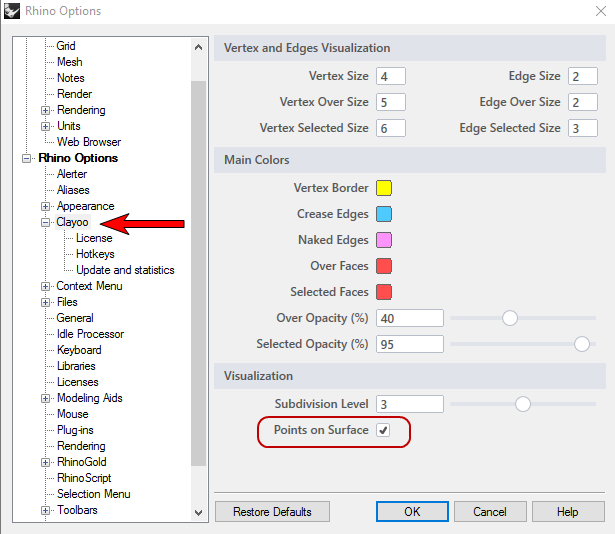
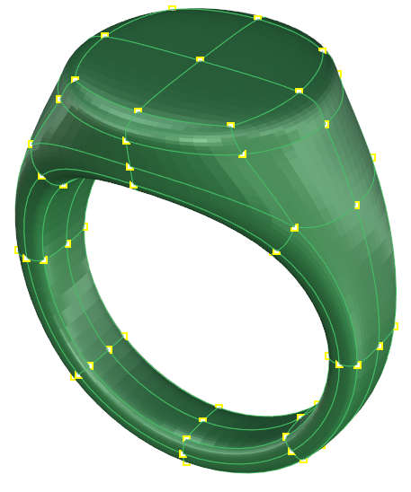
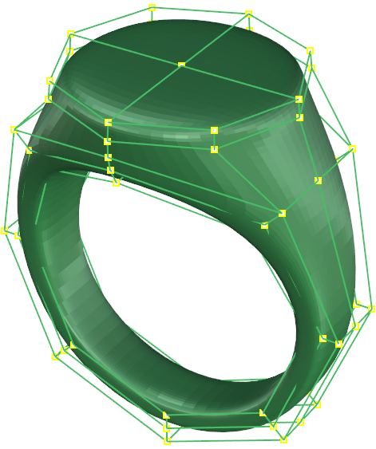

# Points On Surface

- Source PDF: Matrix 9 User Manual Addendum (matrix9.0_addendum.pdf)
- Page range: 12-12
- Section title: Points On Surface
- Section id: m9addendum-007-points-on-surface

---
<!-- section m9addendum-007-points-on-surface | Points On Surface | m9addendum pages 12-12 -->

<!-- page 12 -->

### Points On Surface
Controls the display of verts and edges of
a Clayoo surface that is in Smooth mode.
Where is this Command:
Access this command from
SubD>HUD>Points on Surface
or
In the Clayoo options
Steps:
Click on the Points on Surface
Toggle in the Viewport.
Figure 1: Points on Surface on Figure 2: Points on Surface off
- 6 -

---

## Images

-  page 12
-  page 12
-  page 12
