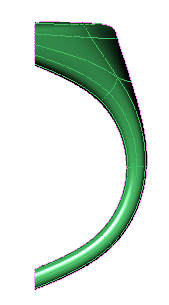
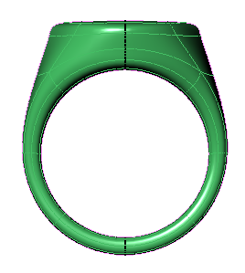
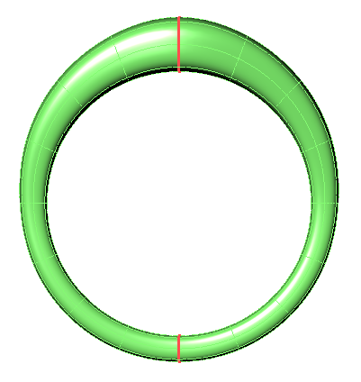
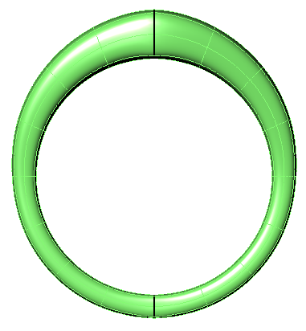
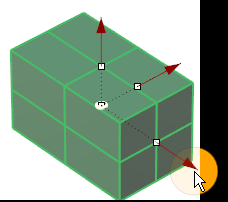
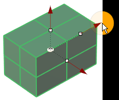
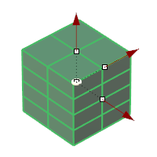
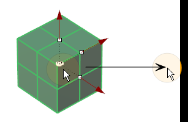

# Clayoo Box

- Source PDF: Matrix 9 User Manual Addendum (matrix9.0_addendum.pdf)
- Page range: 31-32
- Section title: Clayoo Box
- Section id: m9addendum-028-clayoo-box
- Note: boundary page(s) are shared with a neighbouring section (two-column layout); text/images may include neighbour content.

---
<!-- section m9addendum-028-clayoo-box | Clayoo Box | m9addendum pages 31-32 -->

<!-- page 31 -->

Threshold: Defines the maximum distance
geometry will be welded together.
EndSymmetry: Disables symmetry on a
selected model.
### Clayoo Box
'ClayBox'
Figure 1: Partial model prior to applying symmetry by plane Fig-
ure 2: Symmetry applied. Symmetry plane indicated by black
Creates a Clayoo Box with the specified
dimension and surface divisions. By
default it creates the surface in the CPlane
of the active view.
line.
Where is this Command:
Access this command from SubD > Box
Note: Use Symmetry by Plane to add Symmetry to
a partial model.
Steps:
Select Box from the SubD menu.
Symmetry By Edge Loop Steps:
Set the parameters for the surface
using the builder or by using the
Viewport Control Handles.
Click 'OK' in the builder or press
Enter to add the geometry to the
viewport.
### Options:
Select Symmetry from the Clayoo
menu
Select the Clayoo object.
Select Edge Loop from the com-
mand line.
Select a planar edge loop on the
Clayoo object to define the objects
symmetry
Size X: Controls the length of the Clayoo
surface along the X axis. Adjust in the
builder by running the slider or typing a
value in the input box on the left. The
width can also be adjusted dynamically by
using the corresponding Viewport Control
Handle (red arrow) in the viewport. Click
and drag the arrow to adjust the dimen-
sion, double-click to type an exact dimen-
sion in the input box.
Figure 1: Edge Loop Selection Figure 2: Symmetry defined by
Edge Loop
Note: Use Symmetry by Edge Loop to discover
Symmetry on a completed model.
### Options:
Adjust the size of the Box using the Viewport Control Handle
Plane: Add symmetry to a partial model
by defining the symmetry plane with two
points.
Edge Loop: Discover symmetry on a com-
plete model by selecting a planar edge
loop.
Size Y: Controls the length of the Clayoo
surface along the Y axis. Adjust in the
builder by running the slider or typing a
value in the input box on the left. The
width can also be adjusted dynamically by
using the corresponding Viewport Control
Handle (red arrow) in the viewport. Click
and drag the arrow to adjust the

<!-- page 32 -->

dimension, double-click to type an exact
dimension in the input box.
Figure 1: 2 Y Segments Figure 2: 4 Y Segments
Adjust the size of the Plane using the Viewport Control Handle
Segments Z: Controls the number of seg-
ments or faces along the Clayoo surface's
Z axis. Adjust in the builder by running the
slider or typing a value in the input box on
the left.
Size Z:  Controls the length of the Clayoo
surface. Adjust in the builder by running
the slider or typing a value in the input box
on the left. The width can also be adjusted
dynamically by using the corresponding
Viewport Control Handle (red arrow) in the
viewport. Click and drag the arrow to
adjust the dimension, double-click to type
an exact dimension in the input box.
Figure 1: 2 Z Segments Figure 2: 4 Z Segments
Position: Adjust the position of the Clayoo
surface by clicking and dragging the yel-
low disc at the center of the surface.
Double-click on the yellow disc and pick a
point for the box's origin.
Adjust the size of the Plane using the Viewport Control Handle
Segments X: Controls the number of seg-
ments or faces along the Clayoo surface's
X axis. Adjust in the builder by running the
slider or typing a value in the input box on
the left.
Reposition the surface by clicking and dragging the yellow disc
or double clicking on the disc and picking a new point.
When the parameters of the surface are
set as needed, click the check mark to add
the geometry to the viewport, or the ‘X’ to
cancel the command.
Figure 1: 2 X Segments Figure 2: 4 X Segments
### Clayoo Sphere
Segments Y: Controls the number of seg-
ments or faces along the Clayoo surface's
Y axis. Adjust in the builder by running the
slider or typing a value in the input box on
the left.
'ClaySphere'
Create a Clayoo Sphere or Quad Sphere
with the specified dimension and surface
- 26 -

---

## Images

-  page 31 (shared page)
-  page 31 (shared page)
-  page 31 (shared page)
-  page 31 (shared page)
-  page 31 (shared page)
-  page 31 (shared page)
-  page 31 (shared page)
-  page 32 (shared page)
-  page 32 (shared page)
-  page 32 (shared page)
-  page 32 (shared page)
-  page 32 (shared page)
-  page 32 (shared page)
-  page 32 (shared page)
-  page 32 (shared page)
-  page 32 (shared page)
