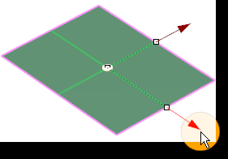
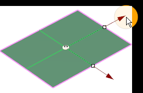
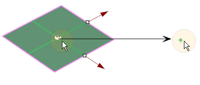
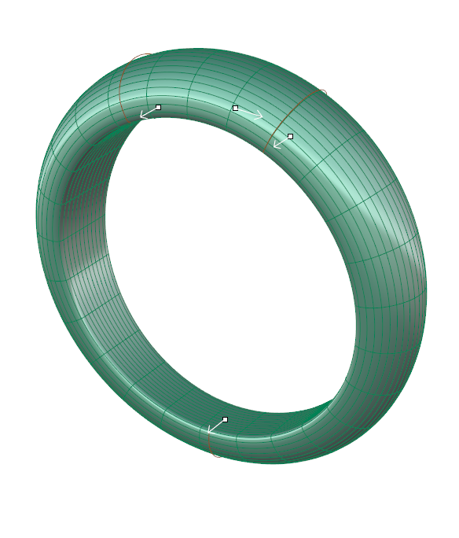
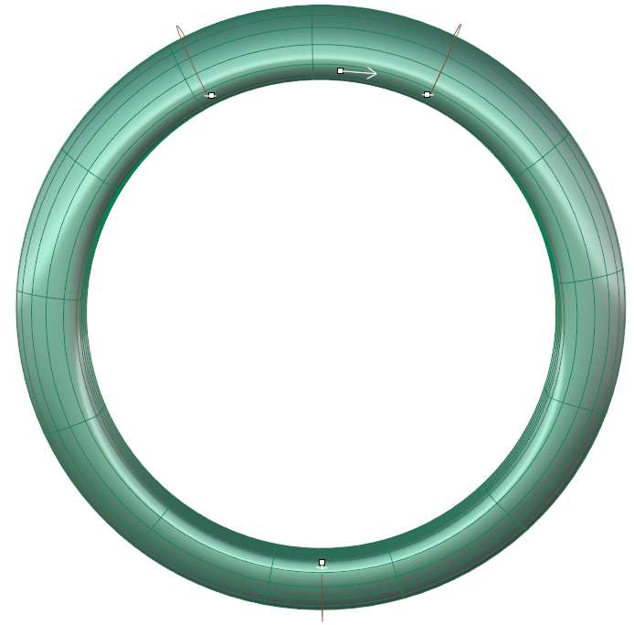
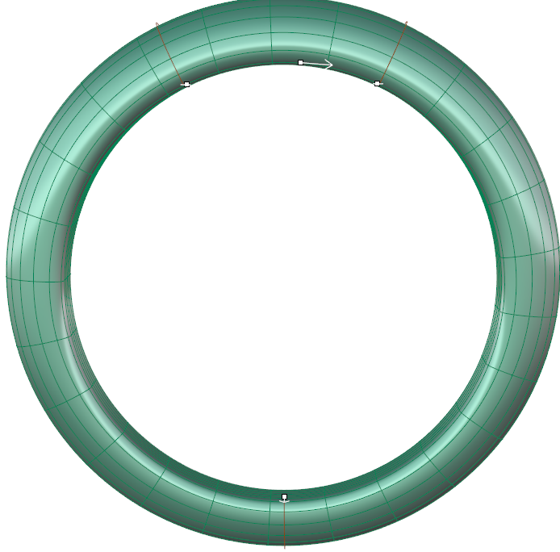
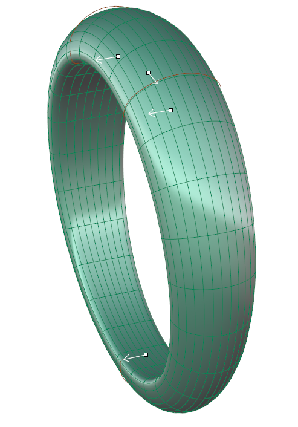

# Clayoo Plane

- Source PDF: Matrix 9 User Manual Addendum (matrix9.0_addendum.pdf)
- Page range: 37-38
- Section title: Clayoo Plane
- Section id: m9addendum-032-clayoo-plane
- Note: boundary page(s) are shared with a neighbouring section (two-column layout); text/images may include neighbour content.

---
<!-- section m9addendum-032-clayoo-plane | Clayoo Plane | m9addendum pages 37-38 -->

<!-- page 37 -->

Double-click on the yellow disc and pick a
point for the box's origin.
Adjust the size of the Plane using the Viewport Control Handle
Reposition the surface by clicking and dragging the yellow disc
or double clicking on the disc and picking a new point.
Size Y: Controls the size of the Clayoo sur-
face in the Y dimension. Adjust in the
builder by running the slider, clicking on
the plus or minus button on either side of
the slider or typing a value in the input box
on the left. The Y dimension can also be
adjusted dynamically by using the cor-
responding Viewport Control Handle (red
arrow). Click and drag the arrow to adjust
the dimension or double-click to type an
exact value in the input box.
When the parameters of the surface are
set as needed click 'OK' to add the geo-
metry to the viewport, or 'Cancel' to cancel
the command.
### Clayoo Plane
'ClayPlane'
Adjust the size of the Plane using the Viewport Control Handle
Creates a Clayoo Plane with the specified
dimensions and surface segments. By
default it creates the surface in the CPlane
of the active view.
Where is this Command:
Access this command from SubD>Plane
Steps:
Segments X: Controls the number of seg-
ments or faces along the X axis of the
Clayoo Plane. Adjust in the builder by run-
ning the slider, clicking the plus or minus
button on either side of the slider or typing
a value in the input box on the left.
Select Plane from the SubD Menu.
Set the parameters for the surface
using the builder or by using the
Viewport Control Handles.
Click 'OK' in the builder or press
Enter to add the geometry to the
viewport.
Figure 1: 2 X Segments Figure 2: 4 X Segments
### Options:
Segments Y: Controls the number of seg-
ments or faces along the Y axis of the
Clayoo Plane. Adjust in the builder by run-
ning the slider, clicking the plus or minus
button on either side of the slider or typing
a value in the input box on the left.
Size X: Controls the size of the Clayoo sur-
face in the X dimension. Adjust in the
builder by running the slider, clicking on
the plus or minus button on either side of
the slider or typing a value in the input box
on the left. The X dimension can also be
adjusted dynamically by using the cor-
responding Viewport Control Handle (red
arrow). Click and drag the arrow to adjust
the dimension or double-click to type an
exact value in the input box.
Figure 1: 2 Y Segments Figure 2: 4 Y Segments
- 31 -

<!-- page 38 -->

### Options:
Position: Adjust the position of the Clayoo
surface by clicking and dragging the yel-
low disc at the center of the surface.
Double-click on the yellow disc and pick a
point for the box's origin.
Segments: Controls the number of seg-
ments or faces running perpendicular to
the rail curve. Adjust in the builder by run-
ning the slider or typing a value in the
input box on the left.
Reposition the Plane by clicking and dragging the yellow disc or
double clicking on the disc and picking a new point.
Figure 1: 14 Segments Figure 2: 25 Segments
When the parameters of the surface are
set as needed click 'OK' to add the geo-
metry to the viewport, or 'Cancel' to cancel
the command.
### Clayoo Sweep 1
'ClaySweep1'
Segments Along: Controls the number of
segments or faces running perpendicular
to the input profile(s) of the surface.
Adjust in the builder by running the slider
or typing a value in the input box on the
left.
Creates a Clayoo surface from a rail and
profile curves.
Where is this Command:
Access this command from SubD>Sweep 1
Steps:
Figure 1: 10 Segments Along Figure 2: 25 Segments Along.
Select Sweep 1 from the Clayoo tool-
bar.
Select the rail curve.
Select the profile curve(s).
Press Enter when done.
Flip Rail: Changes the direction of the
Clayoo Sweep. This can be changed by
clicking on the option in the builder or
clicking on the white arrow on the rail
curve.
Set the parameters for the surface
using the builder or by using the
Viewport Control Handles.
Click 'OK' in the builder or press
Enter to add the geometry to the
viewport.
Align Seams: Adjust the seam point on a
closed curve profile by clicking and drag-
ging the seam point to a new location on
the curve. Seam point location can only be
changed on closed curve profiles. All pro-
files in the sweep should share the same
seam location.
Curve Direction: Change the direction of a
profile by clicking on the white arrow. All
profile curves in the sweep should be
pointing in the same direction.
Figure 1: Input curves Figure 2: Swept Clayoo surface.
- 32 -

---

## Images

-  page 37 (shared page)
-  page 37 (shared page)
-  page 37 (shared page)
-  page 37 (shared page)
-  page 37 (shared page)
-  page 37 (shared page)
-  page 37 (shared page)
-  page 37 (shared page)
-  page 37 (shared page)
-  page 38 (shared page)
-  page 38 (shared page)
-  page 38 (shared page)
-  page 38 (shared page)
-  page 38 (shared page)
-  page 38 (shared page)
-  page 38 (shared page)
