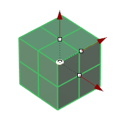
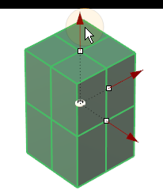
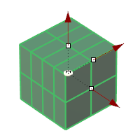
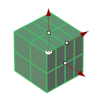
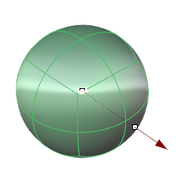
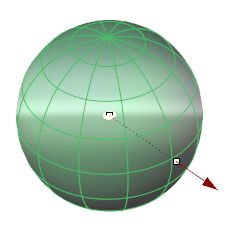
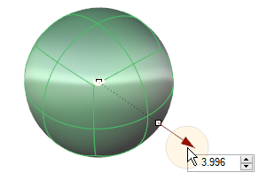
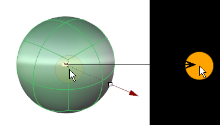

# Clayoo Sphere

- Source PDF: Matrix 9 User Manual Addendum (matrix9.0_addendum.pdf)
- Page range: 32-33
- Section title: Clayoo Sphere
- Section id: m9addendum-029-clayoo-sphere
- Note: boundary page(s) are shared with a neighbouring section (two-column layout); text/images may include neighbour content.

---
<!-- section m9addendum-029-clayoo-sphere | Clayoo Sphere | m9addendum pages 32-33 -->

<!-- page 32 -->

dimension, double-click to type an exact
dimension in the input box.
Figure 1: 2 Y Segments Figure 2: 4 Y Segments
Adjust the size of the Plane using the Viewport Control Handle
Segments Z: Controls the number of seg-
ments or faces along the Clayoo surface's
Z axis. Adjust in the builder by running the
slider or typing a value in the input box on
the left.
Size Z:  Controls the length of the Clayoo
surface. Adjust in the builder by running
the slider or typing a value in the input box
on the left. The width can also be adjusted
dynamically by using the corresponding
Viewport Control Handle (red arrow) in the
viewport. Click and drag the arrow to
adjust the dimension, double-click to type
an exact dimension in the input box.
Figure 1: 2 Z Segments Figure 2: 4 Z Segments
Position: Adjust the position of the Clayoo
surface by clicking and dragging the yel-
low disc at the center of the surface.
Double-click on the yellow disc and pick a
point for the box's origin.
Adjust the size of the Plane using the Viewport Control Handle
Segments X: Controls the number of seg-
ments or faces along the Clayoo surface's
X axis. Adjust in the builder by running the
slider or typing a value in the input box on
the left.
Reposition the surface by clicking and dragging the yellow disc
or double clicking on the disc and picking a new point.
When the parameters of the surface are
set as needed, click the check mark to add
the geometry to the viewport, or the ‘X’ to
cancel the command.
Figure 1: 2 X Segments Figure 2: 4 X Segments
### Clayoo Sphere
Segments Y: Controls the number of seg-
ments or faces along the Clayoo surface's
Y axis. Adjust in the builder by running the
slider or typing a value in the input box on
the left.
'ClaySphere'
Create a Clayoo Sphere or Quad Sphere
with the specified dimension and surface
- 26 -

<!-- page 33 -->

segments. By default it creates the surface
in the CPlane of the active view.
Where is this Command:
Access this command from SubD > Sphere
Sides: Controls the number of segments or
faces around the circumference of the
Clayoo surface. Adjust in the builder by
running the slider or typing a value in the
input box on the left.
Steps:
Select Sphere from the Clayoo tool-
bar.
Set the parameters for the surface
using the builder or by using the
Viewport Control Handles.
### Options:
Note: When Quad Sphere is on, Segments Z is dis-
Sphere Modes:
abled. This is because the quad sphere must have
an equal number of segments in each direction to
maintain the box-like topology of the quad sphere.
Quad: Creates a surface with
box like topology with each
face having four sides.
Position: Adjust the position of the Clayoo
surface by clicking and dragging the yel-
low disc at the center of the surface.
Double-click on the yellow disc and pick a
point for the box's origin.
Polygonal: Generates a surface
with faces that contain less
than four sides.
Reposition the surface by clicking and dragging the yellow disc
or double clicking on the disc and picking a new point.
When the parameters of the surface are
set as needed click 'OK' to add the geo-
metry to the viewport, or 'Cancel' to cancel
the command.
### Clayoo Cylinder
'ClayCylinder'
Radius: Controls the radius for the base
circle of the surface. Adjust in the builder
by running the slider or typing a value in
the input box on the left. The radius can
also be adjusted dynamically by using the
corresponding Viewport Control Handle
(red arrow). Click and drag the arrow to
adjust the dimension or double-click to
type an exact value in the input box.
Create a Clayoo Cylinder with the spe-
cified dimension and surface segments. By
default it creates the surface in the CPlane
of the active view.
Where is this Command:
Access this command from SubD>Cylin-
der
Steps:
- 27 -

---

## Images

-  page 32 (shared page)
-  page 32 (shared page)
-  page 32 (shared page)
-  page 32 (shared page)
-  page 32 (shared page)
-  page 32 (shared page)
-  page 32 (shared page)
-  page 32 (shared page)
-  page 32 (shared page)
-  page 32 (shared page)
-  page 33 (shared page)
-  page 33 (shared page)
-  page 33 (shared page)
-  page 33 (shared page)
-  page 33 (shared page)
