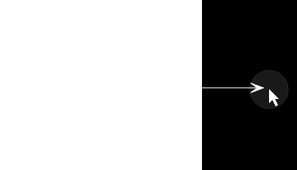
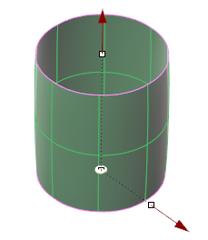
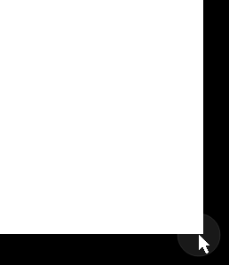
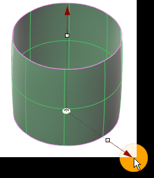
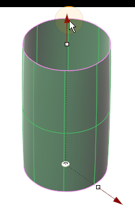
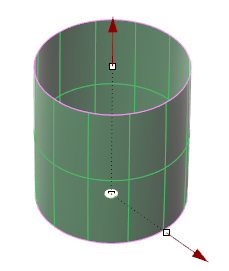
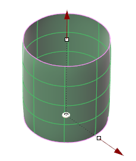

# Clayoo Cylinder

- Source PDF: Matrix 9 User Manual Addendum (matrix9.0_addendum.pdf)
- Page range: 33-35
- Section title: Clayoo Cylinder
- Section id: m9addendum-030-clayoo-cylinder
- Note: boundary page(s) are shared with a neighbouring section (two-column layout); text/images may include neighbour content.

---
<!-- section m9addendum-030-clayoo-cylinder | Clayoo Cylinder | m9addendum pages 33-35 -->

<!-- page 33 -->

segments. By default it creates the surface
in the CPlane of the active view.
Where is this Command:
Access this command from SubD > Sphere
Sides: Controls the number of segments or
faces around the circumference of the
Clayoo surface. Adjust in the builder by
running the slider or typing a value in the
input box on the left.
Steps:
Select Sphere from the Clayoo tool-
bar.
Set the parameters for the surface
using the builder or by using the
Viewport Control Handles.
### Options:
Note: When Quad Sphere is on, Segments Z is dis-
Sphere Modes:
abled. This is because the quad sphere must have
an equal number of segments in each direction to
maintain the box-like topology of the quad sphere.
Quad: Creates a surface with
box like topology with each
face having four sides.
Position: Adjust the position of the Clayoo
surface by clicking and dragging the yel-
low disc at the center of the surface.
Double-click on the yellow disc and pick a
point for the box's origin.
Polygonal: Generates a surface
with faces that contain less
than four sides.
Reposition the surface by clicking and dragging the yellow disc
or double clicking on the disc and picking a new point.
When the parameters of the surface are
set as needed click 'OK' to add the geo-
metry to the viewport, or 'Cancel' to cancel
the command.
### Clayoo Cylinder
'ClayCylinder'
Radius: Controls the radius for the base
circle of the surface. Adjust in the builder
by running the slider or typing a value in
the input box on the left. The radius can
also be adjusted dynamically by using the
corresponding Viewport Control Handle
(red arrow). Click and drag the arrow to
adjust the dimension or double-click to
type an exact value in the input box.
Create a Clayoo Cylinder with the spe-
cified dimension and surface segments. By
default it creates the surface in the CPlane
of the active view.
Where is this Command:
Access this command from SubD>Cylin-
der
Steps:
- 27 -

<!-- page 34 -->

Adjust the height of the Cylinder using the Viewport Control
Handle
Select Cylinder from the Clayoo tool-
bar.
Set the parameters for the surface
using the builder or by using the
Viewport Control Handles.
Segments: Controls the number of seg-
ments or faces running perpendicular to
the circumference of the surface. Adjust in
the builder by running the slider or typing
a value in the input box on the left.
Click 'OK' in the builder or press
Enter to add the geometry to the
viewport.
### Options:
Figure 1: 8 Segments Figure 2: 16 Segments
Radius: Controls the radius for the base
circle of the surface. Adjust in the builder
by running the slider or typing a value in
the input box on the left. The radius can
also be adjusted dynamically by using the
corresponding Viewport Control Handle
(red arrow). Click and drag the arrow to
adjust the dimension or double-click to
type an exact value in the input box.
Segments Z: Controls the number of seg-
ments or faces parallel to the cir-
cumference of the Clayoo surface. Adjust
in the builder by running the slider or typ-
ing a value in the input box on the left.
Adjust the radius of the Cylinder using the Viewport Control
Handle
Figure 1: 2 Segments Figure 2: 4 Segments
Top Cap Options: Creates a cap by adding
a face or faces to the top of the Clayoo sur-
face. Select the desired option from the
drop-down menu.
Height: Controls the height of the Clayoo
surface. Adjust in the builder by running
the slider or typing a value in the input box
on the left. The height can also be adjus-
ted dynamically by using the cor-
responding Viewport Control Handle (red
arrow). Click and drag the arrow to adjust
the dimension or double-click to type an
exact value in the input box.
Polygonal: Creates a cap by adding poly-
gonal faces to the top edge of the Clayoo
surface.
Ngon: Creates a cap using a single Clayoo
face resulting in an n-gon shaped face.
None: Creates a Clayoo surface with no
cap.

<!-- page 35 -->

default it creates the surface in the CPlane
of the active view.
Where is this Command:
Access this command from SubD>Cone
Right Click Command: Truncated Clay
Cone
Steps:
Figure 1: Polygon Cap Figure 2: Ngon Cap Figure 3: None
Select Cone from the Clayoo tool-
bar.
Bottom Cap Options: Creates a cap by
adding a face or faces to the bottom of
the Clayoo surface. Select the desired
option from the drop-down menu.
Set the parameters for the surface
using the builder or by using the
Viewport Control Handles.
Polygonal: Creates a cap by adding poly-
gonal faces to the bottom edge of the
Clayoo surface.
Click 'OK' in the builder or press
Enter to add the geometry to the
viewport.
Ngon: Creates a cap using a single Clayoo
face resulting in an n-gon shaped face.
### Options:
None: Creates a Clayoo surface with no
cap.
Figure 1: Polygon Cap Figure 2: Ngon Cap Figure 3: None
Top Radius: Controls the radius of the
base circle for the top of the Clayoo Trun-
cated Cone. Adjust in the builder by run-
ning the slider or typing a value in the
input box on the left. The radius can also
be adjusted dynamically by using the cor-
responding Viewport Control Handle (red
arrow). Click and drag the arrow to adjust
the dimension or double-click to type an
exact value in the input box.
Position: Adjust the position of the Clayoo
surface by clicking and dragging the yel-
low disc at the center of the surface.
Double-click on the yellow disc and pick a
point for the box's origin.
Adjust the top radius of the cone using the Viewport Control
Handle. Only available if creating a truncated cone.
Note: Top Radius control is only available with a
Reposition the Plane by clicking and dragging the yellow disc or
truncated cone.
double clicking on the disc and picking a new point.
When the parameters of the surface are
set as needed click 'OK' to add the geo-
metry to the viewport, or 'Cancel' to cancel
the command.
### Clayoo Cone
'ClayCone'
Radius: Controls the radius for the base
circle of the surface. Adjust in the builder
by running the slider or typing a value in
the input box on the left. The radius can
also be adjusted dynamically by using the
corresponding Viewport Control Handle
(red arrow). Click and drag the arrow to
adjust the dimension or double-click to
type an exact value in the input box.
Create a Clayoo Cone with the specified
dimension and surface divisions. By
- 29 -

---

## Images

-  page 33 (shared page)
-  page 33 (shared page)
-  page 33 (shared page)
-  page 33 (shared page)
-  page 33 (shared page)
-  page 34
-  page 34
-  page 34
-  page 34
-  page 34
-  page 34
-  page 34
-  page 35 (shared page)
-  page 35 (shared page)
-  page 35 (shared page)
-  page 35 (shared page)
-  page 35 (shared page)
-  page 35 (shared page)
-  page 35 (shared page)
-  page 35 (shared page)
-  page 35 (shared page)
-  page 35 (shared page)
