# Clayoo Cone

- Source PDF: Matrix 9 User Manual Addendum (matrix9.0_addendum.pdf)
- Page range: 35-37
- Section title: Clayoo Cone
- Section id: m9addendum-031-clayoo-cone
- Note: boundary page(s) are shared with a neighbouring section (two-column layout); text/images may include neighbour content.

---
<!-- section m9addendum-031-clayoo-cone | Clayoo Cone | m9addendum pages 35-37 -->

<!-- page 35 -->

default it creates the surface in the CPlane
of the active view.
Where is this Command:
Access this command from SubD>Cone
Right Click Command: Truncated Clay
Cone
Steps:
Figure 1: Polygon Cap Figure 2: Ngon Cap Figure 3: None
Select Cone from the Clayoo tool-
bar.
Bottom Cap Options: Creates a cap by
adding a face or faces to the bottom of
the Clayoo surface. Select the desired
option from the drop-down menu.
Set the parameters for the surface
using the builder or by using the
Viewport Control Handles.
Polygonal: Creates a cap by adding poly-
gonal faces to the bottom edge of the
Clayoo surface.
Click 'OK' in the builder or press
Enter to add the geometry to the
viewport.
Ngon: Creates a cap using a single Clayoo
face resulting in an n-gon shaped face.
### Options:
None: Creates a Clayoo surface with no
cap.
Figure 1: Polygon Cap Figure 2: Ngon Cap Figure 3: None
Top Radius: Controls the radius of the
base circle for the top of the Clayoo Trun-
cated Cone. Adjust in the builder by run-
ning the slider or typing a value in the
input box on the left. The radius can also
be adjusted dynamically by using the cor-
responding Viewport Control Handle (red
arrow). Click and drag the arrow to adjust
the dimension or double-click to type an
exact value in the input box.
Position: Adjust the position of the Clayoo
surface by clicking and dragging the yel-
low disc at the center of the surface.
Double-click on the yellow disc and pick a
point for the box's origin.
Adjust the top radius of the cone using the Viewport Control
Handle. Only available if creating a truncated cone.
Note: Top Radius control is only available with a
Reposition the Plane by clicking and dragging the yellow disc or
truncated cone.
double clicking on the disc and picking a new point.
When the parameters of the surface are
set as needed click 'OK' to add the geo-
metry to the viewport, or 'Cancel' to cancel
the command.
### Clayoo Cone
'ClayCone'
Radius: Controls the radius for the base
circle of the surface. Adjust in the builder
by running the slider or typing a value in
the input box on the left. The radius can
also be adjusted dynamically by using the
corresponding Viewport Control Handle
(red arrow). Click and drag the arrow to
adjust the dimension or double-click to
type an exact value in the input box.
Create a Clayoo Cone with the specified
dimension and surface divisions. By
- 29 -

<!-- page 36 -->

Figure 1: 4 Segments Z Figure 2: 8 Segments Z
Adjust the radius of the Cone using the Viewport Control
Handle
Cap Top: Creates a cap by adding a face
or faces to the top of the Clayoo Trun-
cated Cone.
Top Cap Options: Creates a cap by adding
a face or faces to the top of the Clayoo sur-
face. Select the desired option from the
drop-down menu.
Height: Controls the height of the Clayoo
surface. Adjust in the builder by running
the slider or typing a value in the input box
on the left. The height can also be adjus-
ted dynamically by using the cor-
responding Viewport Control Handle (red
arrow). Click and drag the arrow to adjust
the dimension or double-click to type an
exact value in the input box.
Polygonal: Creates a cap by adding poly-
gonal faces to the top edge of the Clayoo
surface.
Ngon: Creates a cap using a single Clayoo
face resulting in an n-gon shaped face.
None: Creates a Clayoo surface with no
cap.
Adjust the height of the Cone using the Viewport Control
Handle
Note: Top Cap options are only available with a
truncated cone.
Segments: Controls the number of seg-
ments or faces running perpendicular to
the circumference of the surface. Adjust in
the builder by running the slider or typing
a value in the input box on the left.
Cap Options: Creates a cap by adding a
face or faces to the edge of the Clayoo sur-
face. Select the desired option from the
drop-down menu.
Polygonal: Creates a cap by adding poly-
gonal faces to the edge of the Clayoo sur-
face.
Ngon: Creates a cap using a single Clayoo
face resulting in an n-gon shaped face.
Figure 1: 8 Segments Figure 2: 16 Segments
None: Creates a Clayoo surface with no
cap.
Segments Z: Controls the number of seg-
ments or faces parallel to the cir-
cumference of the Clayoo surface. Adjust
in the builder by running the slider or typ-
ing a value in the input box on the left.
Position: Adjust the position of the Clayoo
surface by clicking and dragging the yel-
low disc at the center of the surface.
- 30 -

<!-- page 37 -->

Double-click on the yellow disc and pick a
point for the box's origin.
Adjust the size of the Plane using the Viewport Control Handle
Reposition the surface by clicking and dragging the yellow disc
or double clicking on the disc and picking a new point.
Size Y: Controls the size of the Clayoo sur-
face in the Y dimension. Adjust in the
builder by running the slider, clicking on
the plus or minus button on either side of
the slider or typing a value in the input box
on the left. The Y dimension can also be
adjusted dynamically by using the cor-
responding Viewport Control Handle (red
arrow). Click and drag the arrow to adjust
the dimension or double-click to type an
exact value in the input box.
When the parameters of the surface are
set as needed click 'OK' to add the geo-
metry to the viewport, or 'Cancel' to cancel
the command.
### Clayoo Plane
'ClayPlane'
Adjust the size of the Plane using the Viewport Control Handle
Creates a Clayoo Plane with the specified
dimensions and surface segments. By
default it creates the surface in the CPlane
of the active view.
Where is this Command:
Access this command from SubD>Plane
Steps:
Segments X: Controls the number of seg-
ments or faces along the X axis of the
Clayoo Plane. Adjust in the builder by run-
ning the slider, clicking the plus or minus
button on either side of the slider or typing
a value in the input box on the left.
Select Plane from the SubD Menu.
Set the parameters for the surface
using the builder or by using the
Viewport Control Handles.
Click 'OK' in the builder or press
Enter to add the geometry to the
viewport.
Figure 1: 2 X Segments Figure 2: 4 X Segments
### Options:
Segments Y: Controls the number of seg-
ments or faces along the Y axis of the
Clayoo Plane. Adjust in the builder by run-
ning the slider, clicking the plus or minus
button on either side of the slider or typing
a value in the input box on the left.
Size X: Controls the size of the Clayoo sur-
face in the X dimension. Adjust in the
builder by running the slider, clicking on
the plus or minus button on either side of
the slider or typing a value in the input box
on the left. The X dimension can also be
adjusted dynamically by using the cor-
responding Viewport Control Handle (red
arrow). Click and drag the arrow to adjust
the dimension or double-click to type an
exact value in the input box.
Figure 1: 2 Y Segments Figure 2: 4 Y Segments
- 31 -

---

## Images

- 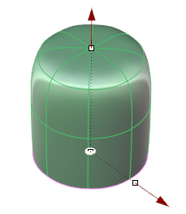 page 35 (shared page)
- 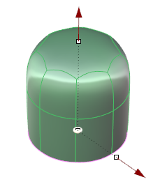 page 35 (shared page)
- 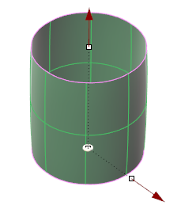 page 35 (shared page)
- 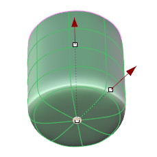 page 35 (shared page)
- 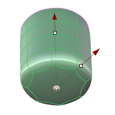 page 35 (shared page)
- 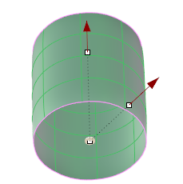 page 35 (shared page)
-  page 35 (shared page)
- 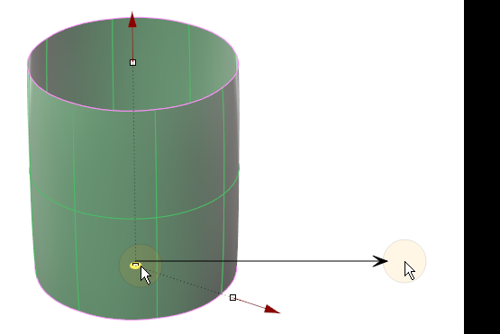 page 35 (shared page)
- 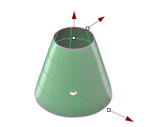 page 35 (shared page)
- 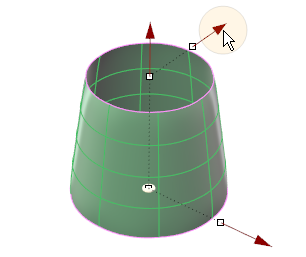 page 35 (shared page)
- 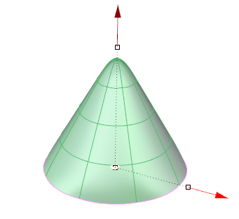 page 36
-  page 36
- 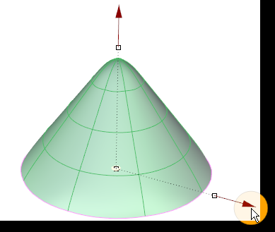 page 36
-  page 36
- 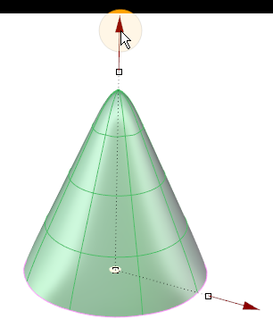 page 36
- 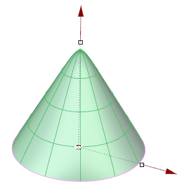 page 36
- 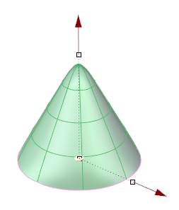 page 36
- 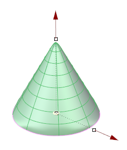 page 36
- 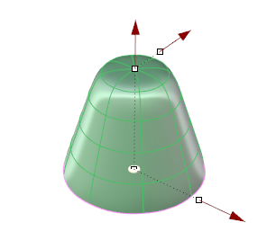 page 36
- 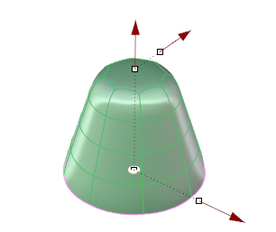 page 36
- 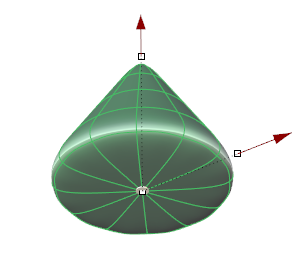 page 36
- 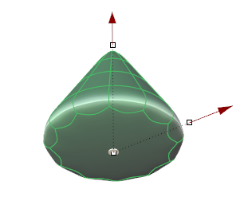 page 36
- 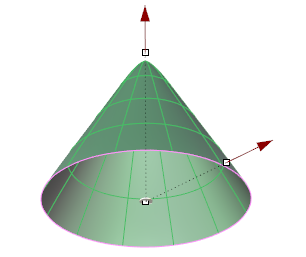 page 36
- 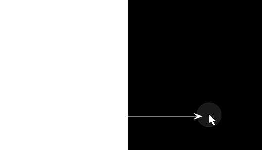 page 37 (shared page)
- 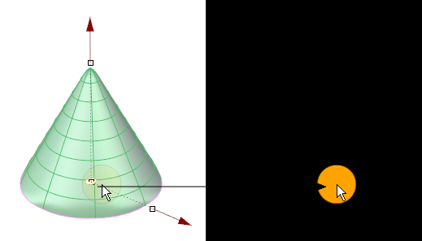 page 37 (shared page)
- 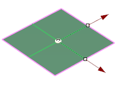 page 37 (shared page)
-  page 37 (shared page)
-  page 37 (shared page)
-  page 37 (shared page)
-  page 37 (shared page)
- 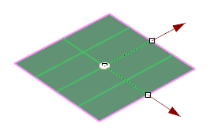 page 37 (shared page)
- 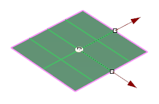 page 37 (shared page)
