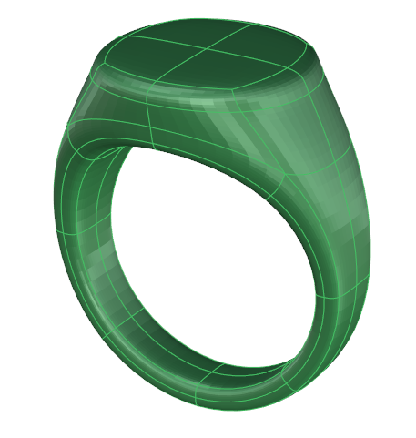
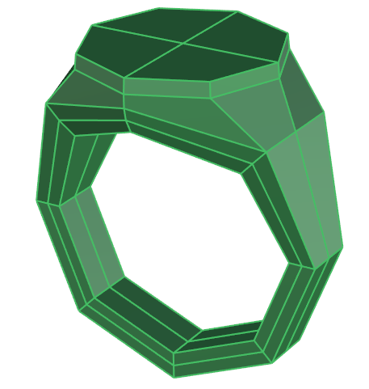
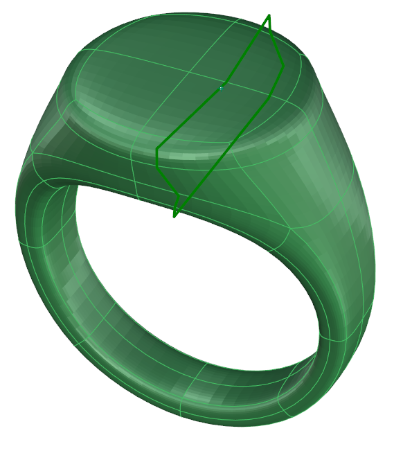
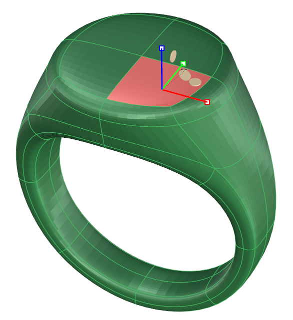
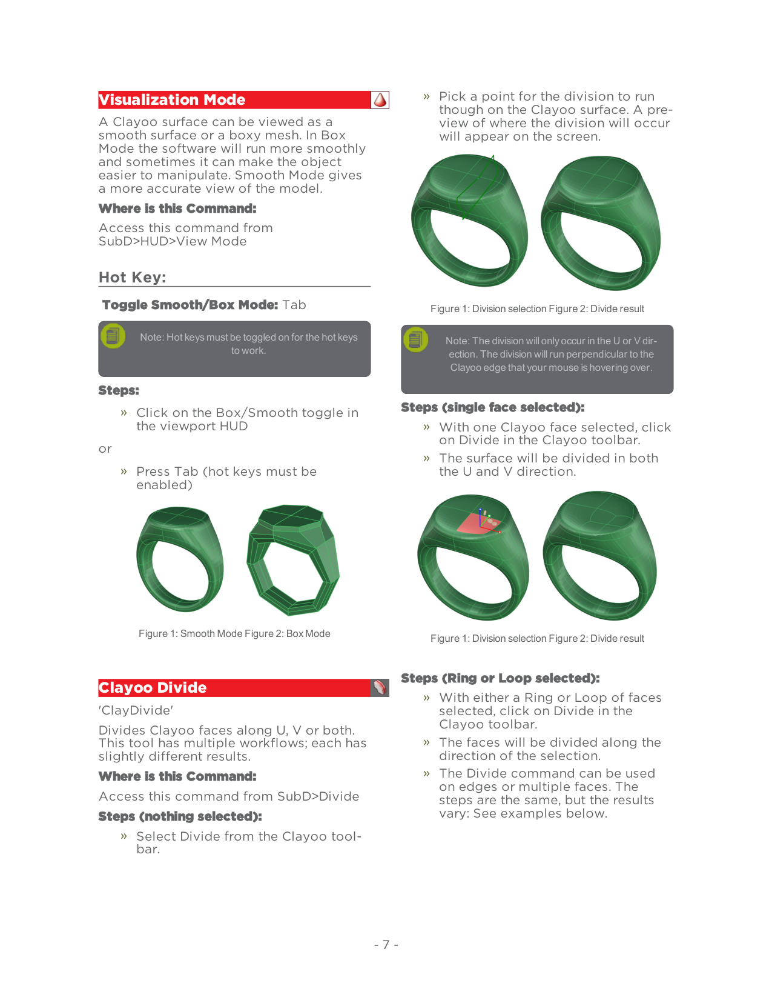
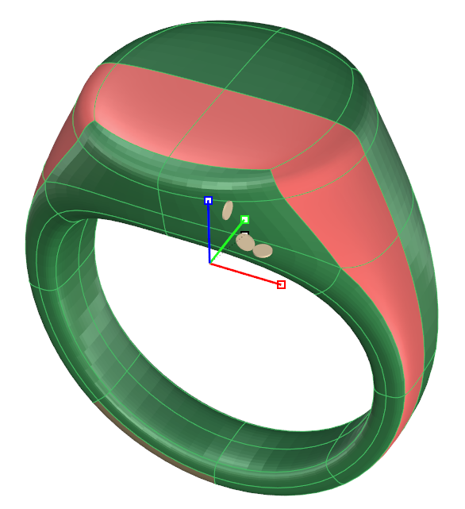
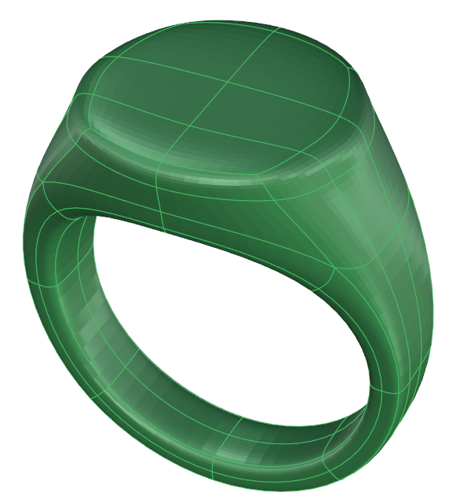
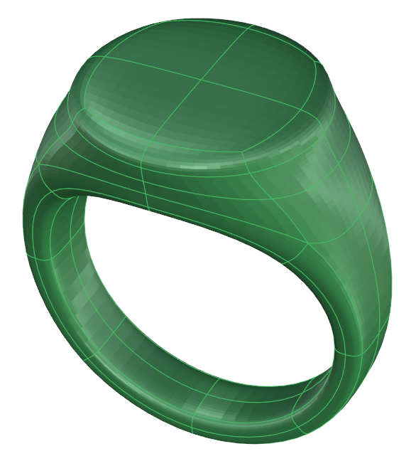
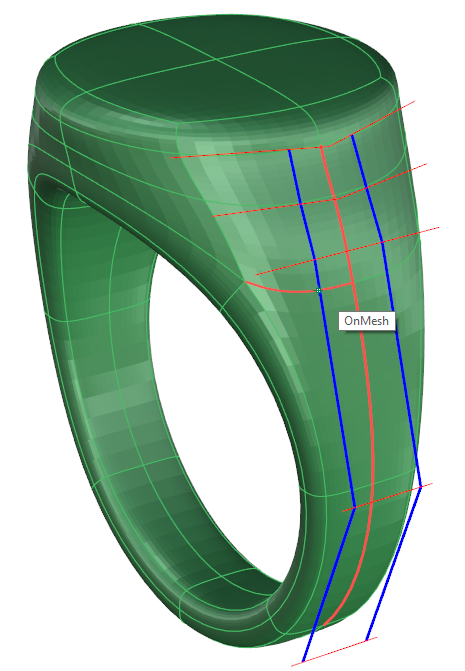
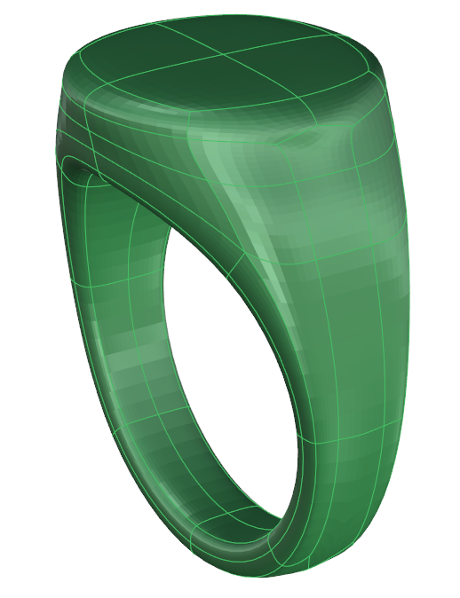

# Clayoo Divide

- Source PDF: Matrix 9 User Manual Addendum (matrix9.0_addendum.pdf)
- Page range: 13-14
- Section title: Clayoo Divide
- Section id: m9addendum-009-clayoo-divide
- Note: boundary page(s) are shared with a neighbouring section (two-column layout); text/images may include neighbour content.

---
<!-- section m9addendum-009-clayoo-divide | Clayoo Divide | m9addendum pages 13-14 -->

<!-- page 13 -->

### Visualization Mode
Pick a point for the division to run
though on the Clayoo surface. A pre-
view of where the division will occur
will appear on the screen.
A Clayoo surface can be viewed as a
smooth surface or a boxy mesh. In Box
Mode the software will run more smoothly
and sometimes it can make the object
easier to manipulate. Smooth Mode gives
a more accurate view of the model.
Where is this Command:
Access this command from
SubD>HUD>View Mode
### Hot Key:
Toggle Smooth/Box Mode: Tab
Figure 1: Division selection Figure 2: Divide result
Note: Hot keys must be toggled on for the hot keys
Note: The division will only occur in the U or V dir-
to work.
ection. The division will run perpendicular to the
Clayoo edge that your mouse is hovering over.
Steps:
Steps (single face selected):
Click on the Box/Smooth toggle in
the viewport HUD
or
With one Clayoo face selected, click
on Divide in the Clayoo toolbar.
The surface will be divided in both
the U and V direction.
Press Tab (hot keys must be
enabled)
Figure 1: Smooth Mode Figure 2: Box Mode
Figure 1: Division selection Figure 2: Divide result
Steps (Ring or Loop selected):
### Clayoo Divide
'ClayDivide'
Divides Clayoo faces along U, V or both.
This tool has multiple workflows; each has
slightly different results.
Where is this Command:
Access this command from SubD>Divide
With either a Ring or Loop of faces
selected, click on Divide in the
Clayoo toolbar.
The faces will be divided along the
direction of the selection.
The Divide command can be used
on edges or multiple faces. The
steps are the same, but the results
vary: See examples below.
Steps (nothing selected):
Select Divide from the Clayoo tool-
bar.
- 7 -

<!-- page 14 -->

Figure 1: Division selection Figure 2: Divide result
Figure 1: Split Sides Selection Figure 2: Split Sides result
### Options:
DeleteCentralEdge False/True: When this
option is set to True the original set of
edges will be removed after the command
is completed. The default is False, leaving
the original set of edges in place.
Figure 1: Division selection Figure 2: Divide result
### Split Sides
'ClaySplitSides'
Inserts parallel edges on both sides of a
selected set of edges.
Where is this Command:
Access this command from SubD>Split
Sides
Steps:
### Inset
'ClayInset'
Insets Clayoo faces inside the selected
face(s) at a specified distance.
Where is this Command:
Select the surface edges to be split.
Select Split Sides from the Calyoo
toolbar.
Pick a point on the Clayoo surface
to set the location of the additional
surface edges.
Access this command from SubD>Inset
Steps:
Select Inset from the Clayoo toolbar.
Select a Clayoo face or group of
faces to create new inset surfaces.
Adjust the parameters in the builder.
Click 'Okay' to add the geometry to
the viewport.

---

## Images

-  page 13 (shared page)
-  page 13 (shared page)
-  page 13 (shared page)
-  page 13 (shared page)
-  page 13 (shared page)
-  page 13 (shared page)
-  page 13 (shared page)
-  page 14 (shared page)
-  page 14 (shared page)
-  page 14 (shared page)
-  page 14 (shared page)
-  page 14 (shared page)
-  page 14 (shared page)
-  page 14 (shared page)
