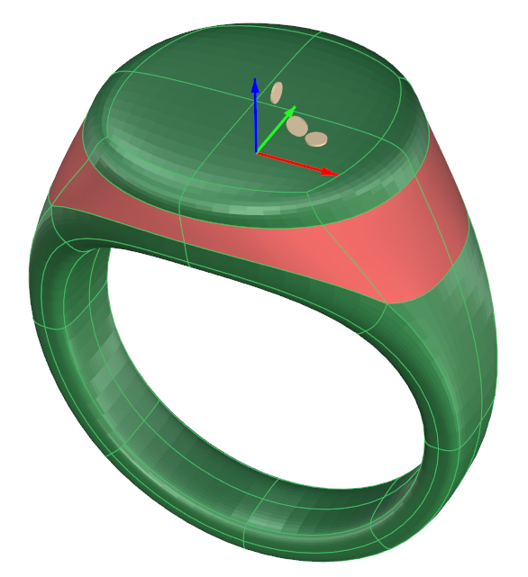
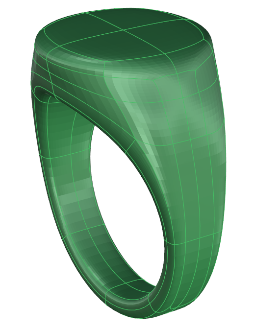
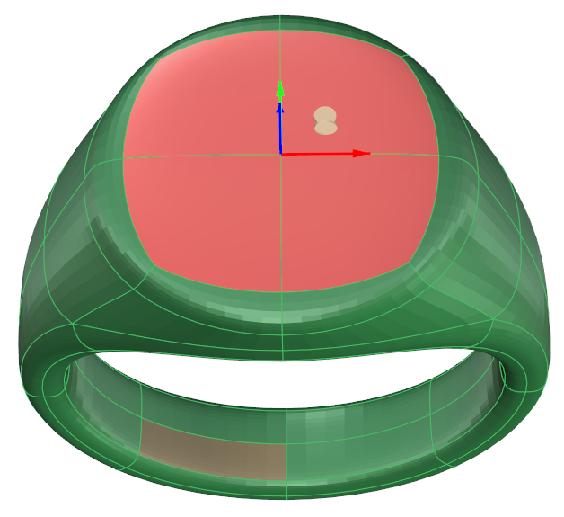
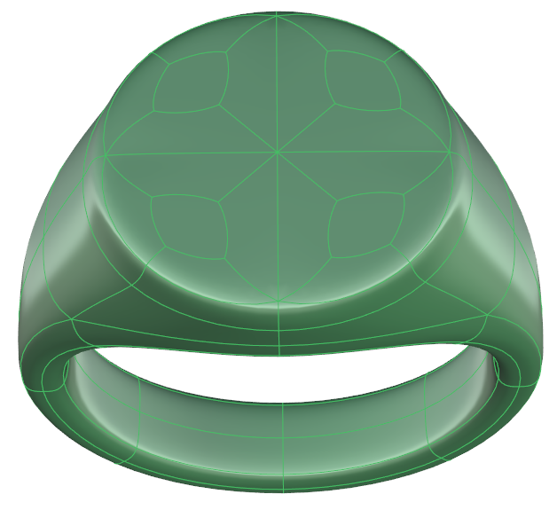
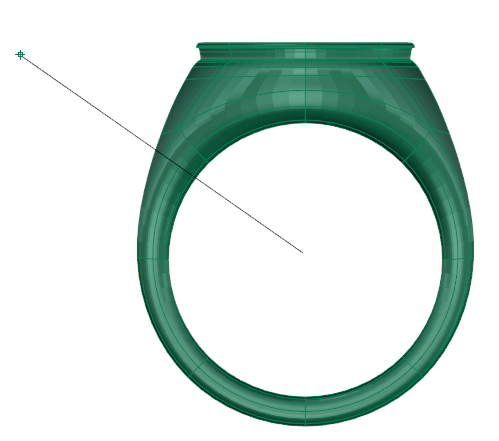
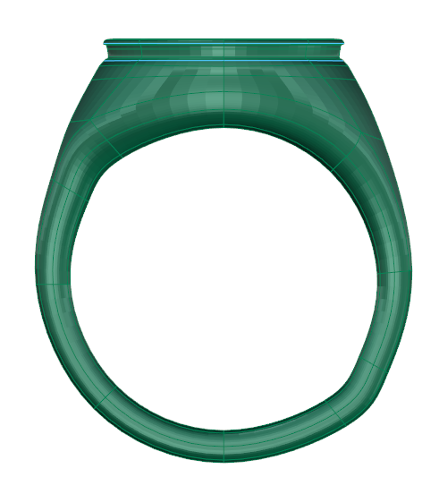

# Inset

- Source PDF: Matrix 9 User Manual Addendum (matrix9.0_addendum.pdf)
- Page range: 14-15
- Section title: Inset
- Section id: m9addendum-011-inset
- Note: boundary page(s) are shared with a neighbouring section (two-column layout); text/images may include neighbour content.

---
<!-- section m9addendum-011-inset | Inset | m9addendum pages 14-15 -->

<!-- page 14 -->

Figure 1: Division selection Figure 2: Divide result
Figure 1: Split Sides Selection Figure 2: Split Sides result
### Options:
DeleteCentralEdge False/True: When this
option is set to True the original set of
edges will be removed after the command
is completed. The default is False, leaving
the original set of edges in place.
Figure 1: Division selection Figure 2: Divide result
### Split Sides
'ClaySplitSides'
Inserts parallel edges on both sides of a
selected set of edges.
Where is this Command:
Access this command from SubD>Split
Sides
Steps:
### Inset
'ClayInset'
Insets Clayoo faces inside the selected
face(s) at a specified distance.
Where is this Command:
Select the surface edges to be split.
Select Split Sides from the Calyoo
toolbar.
Pick a point on the Clayoo surface
to set the location of the additional
surface edges.
Access this command from SubD>Inset
Steps:
Select Inset from the Clayoo toolbar.
Select a Clayoo face or group of
faces to create new inset surfaces.
Adjust the parameters in the builder.
Click 'Okay' to add the geometry to
the viewport.

<!-- page 15 -->

### Options:
Select Knife from the Clayoo tool-
bar.
Select the start point and end point
of a line defining the Knife or pick an
axis in the command line.
### Inset Mode:
Figure 1: Defining Knife plane. Figure 2: Result of Knife com-
mand.
Group: With multiple faces selected the
inset is based off of the overall shape of
the group
### Options:
Cplane: Adds a division on an existing
Clayoo surface through the active con-
struction.
.
WorldXY: Adds a division on an existing
Clayoo surface through the XY axis.
Individual: With multiple faces selected
each face is inset individually.
World YZ: Adds a division on an existing
Clayoo surface through the YZ axis.
World ZX: Adds a division on an existing
Clayoo surface through the ZX axis.
### Clayoo Extrude
'ClayExtrude'
Creates an extrusion of the selected geo-
metry. This command is compatible with
both faces and edges.
Where is this Command:
SubD > Extrude
Distance: Controls the distance from the
face edges to the inset surface. Adjust in
the builder by running the slider or typing
a value in the input box on the left.
Edge Extrusion Steps:
When the parameters of the surface are
set as needed click 'OK' to add the geo-
metry to the viewport, or 'Cancel' to cancel
the command.
### Clayoo Knife
'ClayKnife'
The extrusion of edges creates a
new face for each selected edge.
Edge Extrusion Steps:
Select edges to be extruded.
Select Extrude from the Clayoo tool-
bar.
Use the Viewport Control Handle to
adjust the exhaustion distance.
Create subdivisions on a Clayoo surface
defined by a line or axis.
Where is this Command:
Access this command from SubD > Knife
Steps:
- 9 -

---

## Images

-  page 14 (shared page)
-  page 14 (shared page)
-  page 14 (shared page)
-  page 14 (shared page)
-  page 14 (shared page)
-  page 14 (shared page)
-  page 14 (shared page)
-  page 15 (shared page)
-  page 15 (shared page)
-  page 15 (shared page)
-  page 15 (shared page)
-  page 15 (shared page)
