# Clayoo Extrude

- Source PDF: Matrix 9 User Manual Addendum (matrix9.0_addendum.pdf)
- Page range: 15-17
- Section title: Clayoo Extrude
- Section id: m9addendum-013-clayoo-extrude
- Note: boundary page(s) are shared with a neighbouring section (two-column layout); text/images may include neighbour content.

---
<!-- section m9addendum-013-clayoo-extrude | Clayoo Extrude | m9addendum pages 15-17 -->

<!-- page 15 -->

### Options:
Select Knife from the Clayoo tool-
bar.
Select the start point and end point
of a line defining the Knife or pick an
axis in the command line.
### Inset Mode:
Figure 1: Defining Knife plane. Figure 2: Result of Knife com-
mand.
Group: With multiple faces selected the
inset is based off of the overall shape of
the group
### Options:
Cplane: Adds a division on an existing
Clayoo surface through the active con-
struction.
.
WorldXY: Adds a division on an existing
Clayoo surface through the XY axis.
Individual: With multiple faces selected
each face is inset individually.
World YZ: Adds a division on an existing
Clayoo surface through the YZ axis.
World ZX: Adds a division on an existing
Clayoo surface through the ZX axis.
### Clayoo Extrude
'ClayExtrude'
Creates an extrusion of the selected geo-
metry. This command is compatible with
both faces and edges.
Where is this Command:
SubD > Extrude
Distance: Controls the distance from the
face edges to the inset surface. Adjust in
the builder by running the slider or typing
a value in the input box on the left.
Edge Extrusion Steps:
When the parameters of the surface are
set as needed click 'OK' to add the geo-
metry to the viewport, or 'Cancel' to cancel
the command.
### Clayoo Knife
'ClayKnife'
The extrusion of edges creates a
new face for each selected edge.
Edge Extrusion Steps:
Select edges to be extruded.
Select Extrude from the Clayoo tool-
bar.
Use the Viewport Control Handle to
adjust the exhaustion distance.
Create subdivisions on a Clayoo surface
defined by a line or axis.
Where is this Command:
Access this command from SubD > Knife
Steps:
- 9 -

<!-- page 16 -->

Note: Edges can also be extruded by selecting the
edges and holding Alt on the keyboard when mov-
ing the Viewport Control Handles.
Face Extrusion Steps:
Figure 1: Extrusion Selection. Figure 2: Extru-
sion by Indvidual
Select faces to be extruded.
Select Extrude from the Clayoo tool-
bar.
Adjust the parameters in the builder.
Curve: If using this option, click on this
input to select the curve for the extrusion
to follow.
Click 'OK' in the builder or press
Enter to add the geometry to the
viewport.
### Options:
Extrude Mode:
Group: Extrudes each group of
faces as one extrusion.
Figure 1: Extrusion Selection. Figure 2: Extrusion by Curve
Flip Curve: Click on the Flip Curve button
to change the direction of the extrusion.
Figure 1: Extrusion Selection. Figure 2: Extru-
sion by Group
Local Normals: Extrudes in the
direction of the normal of the
selection.
Height: Controls the height of the Clayoo
surface. Adjust in the builder by running
the slider or typing a value in the input box
on the left. The height can also be adjus-
ted dynamically by using the cor-
responding Viewport Control Handle. Click
and drag the arrow to adjust the dimen-
sion.
Figure 1: Extrusion Selection. Figure 2: Extru-
sion by Normal
Figure 1: Height=1 Figure 2: Height=3
Individual: Each face is
extruded individually creating
multiple extrusions.
Segments: Controls the number of seg-
ments or faces along the height of the
extrusion. Adjust in the builder by running
the slider or typing a value in the input box
at the left.
- 10 -

<!-- page 17 -->

Steps:
Select Bridge from the Clayoo tool-
bar.
Select the faces you wish to bridge
together.
Figure 1: Segments=2 Figure 2:Sements=5
Press Enter when done.
Set the parameters for the surface
using the builder.
Click 'OK' in the builder or press
Enter to add the geometry to the
viewport.
Taper: Controls the taper of the extrusion.
Negative values will make the top of the
extrusion smaller while positive values will
make it larger. Adjust in the builder by run-
ning the slider or typing an exact value in
the input box on the left.
### Options:
Bridge Mode:
Figure 1: Taper =0 Figure 2: Taper=-1.5
When the parameters of the surface are
set as needed click 'OK' to add the geo-
metry to the viewport, or 'Cancel' to cancel
the command.
### Clayoo Offset
Linear: The
bridged surface
has G1 continuity
to the selected
faces. To put
another way the
surface created fol-
lows the shortest
path between the
two sets of faces-a
straight line.
'ClayOffset'
Copies a face or a group of faces a spe-
cified distance from the original.
Where is this Command:
Access this command from Clayoo > Off-
set
Steps:
By Curve: The bridged surface
follows a selected curve.
Select a face or a group of faces.
Select Offset from the Clayoo tool-
bar.
Type the offset distance in the com-
mand line or use the Viewport Con-
trol Handles to set the offset
distance.
Press Enter when done.
By Curve> Flip Curve: This
option is available when using
the By Curve mode. This
option flips the direction of
the bridged surface.
Tangent:
### Clayoo Bridge
'ClayBridge'
Connects faces together, creating a trans-
ition between Clayoo objects.
Where is this Command:
Access this command from SubD> Bridge
- 11 -

---

## Images

-  page 15 (shared page)
-  page 15 (shared page)
-  page 15 (shared page)
-  page 15 (shared page)
-  page 15 (shared page)
- 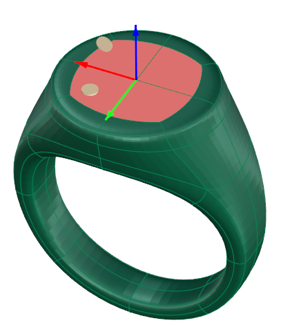 page 16
- 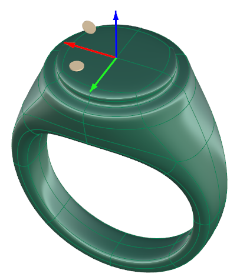 page 16
- 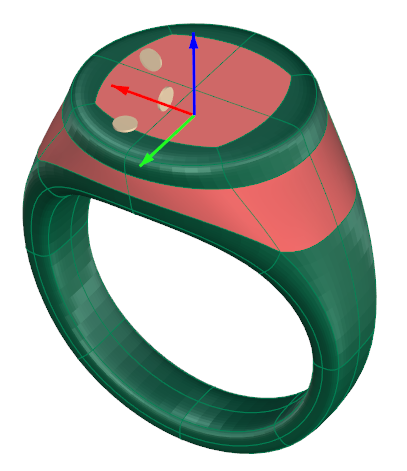 page 16
- 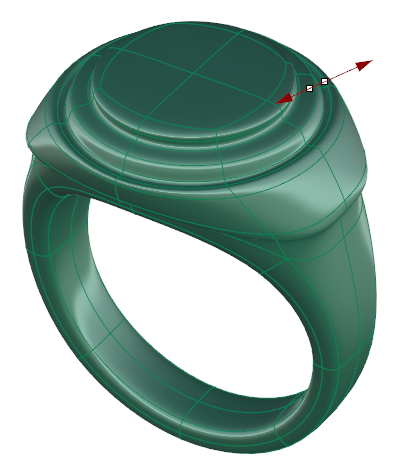 page 16
- 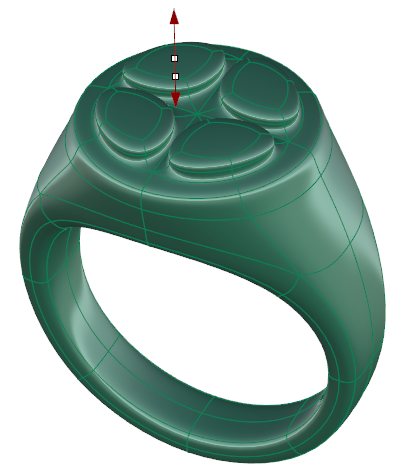 page 16
- 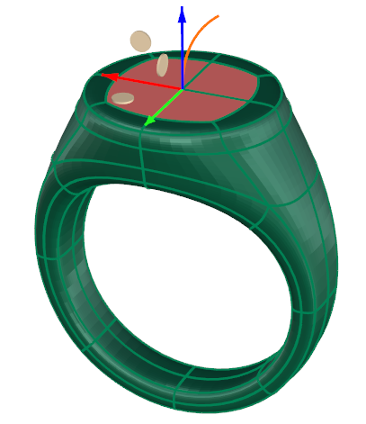 page 16
- 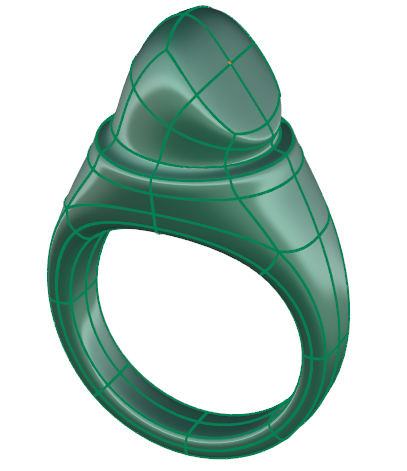 page 16
- 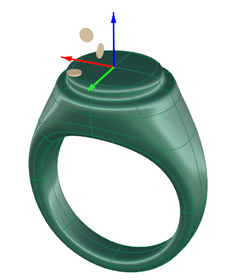 page 16
- 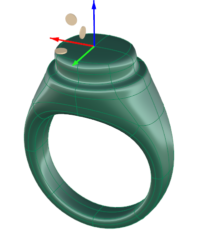 page 16
- 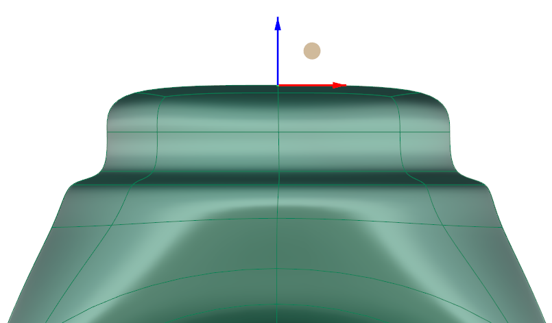 page 17 (shared page)
- 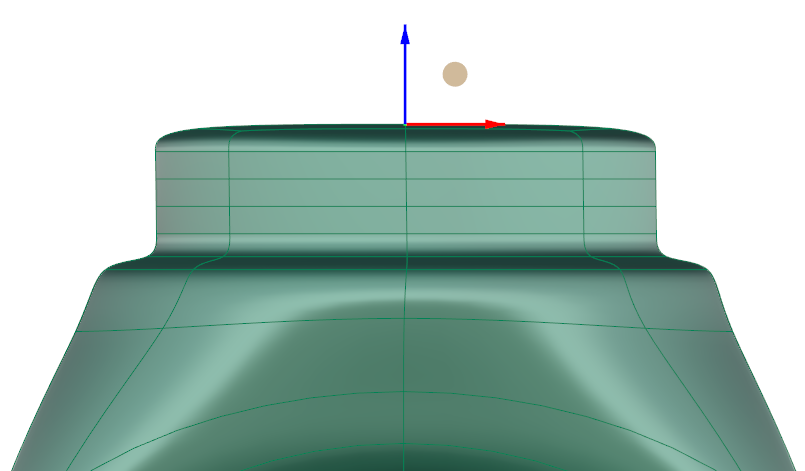 page 17 (shared page)
-  page 17 (shared page)
- 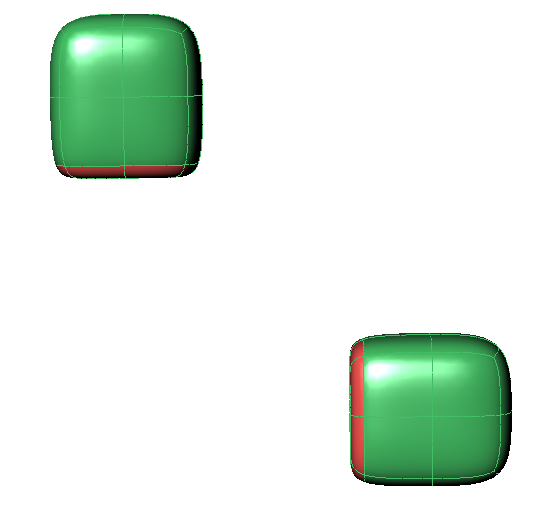 page 17 (shared page)
-  page 17 (shared page)
-  page 17 (shared page)
-  page 17 (shared page)
-  page 17 (shared page)
