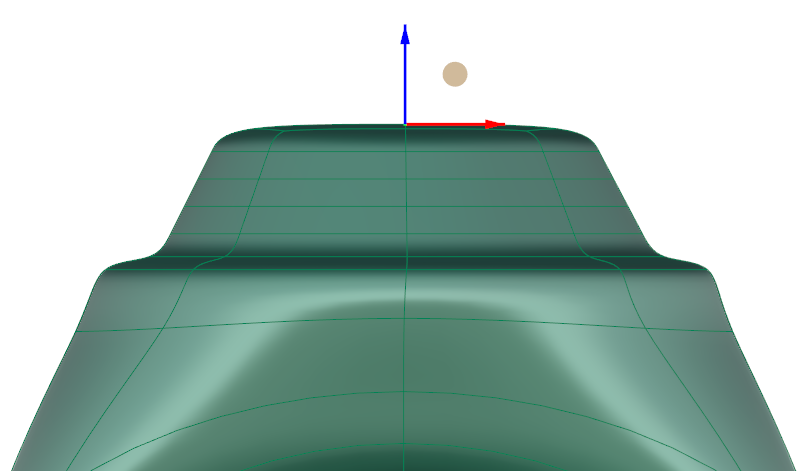
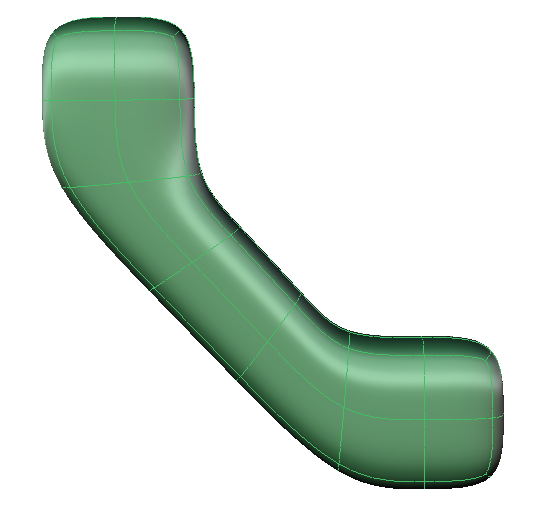
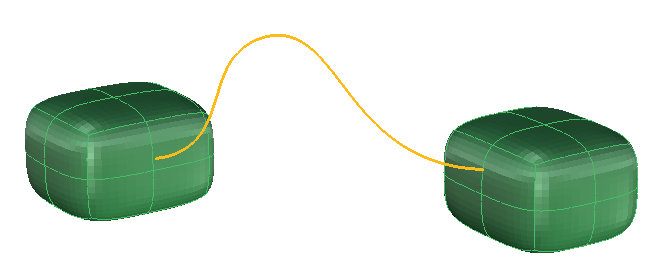
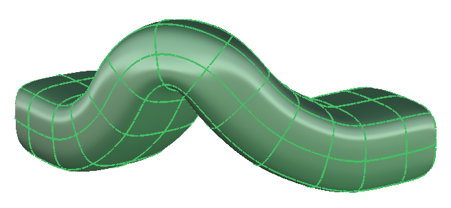
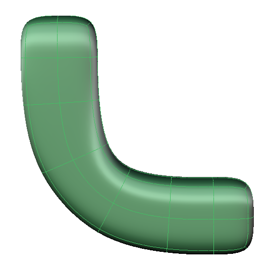

# Clayoo Bridge

- Source PDF: Matrix 9 User Manual Addendum (matrix9.0_addendum.pdf)
- Page range: 17-18
- Section title: Clayoo Bridge
- Section id: m9addendum-015-clayoo-bridge
- Note: boundary page(s) are shared with a neighbouring section (two-column layout); text/images may include neighbour content.

---
<!-- section m9addendum-015-clayoo-bridge | Clayoo Bridge | m9addendum pages 17-18 -->

<!-- page 17 -->

Steps:
Select Bridge from the Clayoo tool-
bar.
Select the faces you wish to bridge
together.
Figure 1: Segments=2 Figure 2:Sements=5
Press Enter when done.
Set the parameters for the surface
using the builder.
Click 'OK' in the builder or press
Enter to add the geometry to the
viewport.
Taper: Controls the taper of the extrusion.
Negative values will make the top of the
extrusion smaller while positive values will
make it larger. Adjust in the builder by run-
ning the slider or typing an exact value in
the input box on the left.
### Options:
Bridge Mode:
Figure 1: Taper =0 Figure 2: Taper=-1.5
When the parameters of the surface are
set as needed click 'OK' to add the geo-
metry to the viewport, or 'Cancel' to cancel
the command.
### Clayoo Offset
Linear: The
bridged surface
has G1 continuity
to the selected
faces. To put
another way the
surface created fol-
lows the shortest
path between the
two sets of faces-a
straight line.
'ClayOffset'
Copies a face or a group of faces a spe-
cified distance from the original.
Where is this Command:
Access this command from Clayoo > Off-
set
Steps:
By Curve: The bridged surface
follows a selected curve.
Select a face or a group of faces.
Select Offset from the Clayoo tool-
bar.
Type the offset distance in the com-
mand line or use the Viewport Con-
trol Handles to set the offset
distance.
Press Enter when done.
By Curve> Flip Curve: This
option is available when using
the By Curve mode. This
option flips the direction of
the bridged surface.
Tangent:
### Clayoo Bridge
'ClayBridge'
Connects faces together, creating a trans-
ition between Clayoo objects.
Where is this Command:
Access this command from SubD> Bridge
- 11 -

<!-- page 18 -->

Segments: Controls the number of seg-
ments or faces as part of the bridge com-
mand. Adjust in the builder by running the
slider or typing a value in the input box on
the left.
Align Bridge:
Note: Clay faces must have a minimum of three
Adjust the seam point and direction of the
bridged surface by clicking on the Align
button in the Bridge builder.
points.
Align Steps:
Note: If the Autoquad option is on a new face will be
created once four points are selected. Otherwise
the command will create ngon faces.
Click on Align in the builder.
Change the seam point by clicking
on one of the 8 white dots.
Change the surface direction by
clicking on the dot a second time.
FromEdge Steps:
Pick an edge to append a face to
Pick additional points to define the
face.
Press Enter to close the command
Chain Steps:
### Append Face
'ClayAppend'
Pick an edge to append a face to
Pick two points to define the first
face
The adjacent edge is passed forward
For each subsequent face select 1
point
### Options:
Adds new faces to a Clayoo surface.This
command closes a surface by drawing a
face, as opposed to using the Fill com-
mand. It is also possible to use this com-
mand to manually draw a face
unconnected to any surface to begin the
layout for a new model.
Append has three different command line
modes (Point, FromEdge, Chain) each with
a slighlty different set of steps.
Where is this Command:
Autoquad=Yes/No: When set to Yes the
command will automatically create a new
face when once four edges are created.
When set to No Ngons of greater than
edges can be created by picking more
points.
Mode:
Access this command from SubD>Append
Face
Point Steps:
Point: Create new Clayoo
faces by picking three or more
points.
Pick the first point
Pick the second and third point
Continue to select points or press
Enter to close the command.
FromEdge: Create new Clayoo
faces from and existing
Clayoo Edge and at least 1
additional point.
Chain: Automaticly detects
and selects the adjacent edge
after the first face is created.
Weld=Yes/No: When the option is set to
Yes coincident verts are welded together
- 12 -

---

## Images

-  page 17 (shared page)
-  page 17 (shared page)
-  page 17 (shared page)
-  page 17 (shared page)
-  page 17 (shared page)
-  page 17 (shared page)
-  page 17 (shared page)
-  page 17 (shared page)
-  page 18 (shared page)
-  page 18 (shared page)
-  page 18 (shared page)
