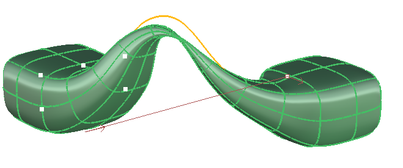
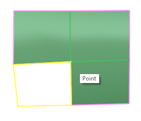
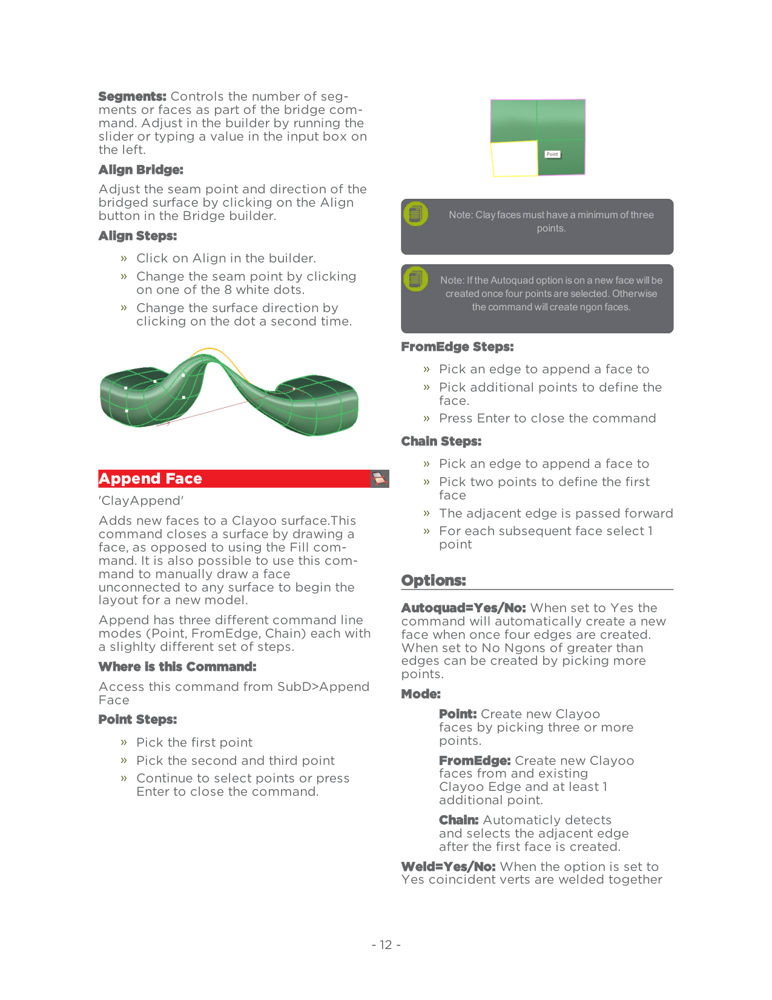
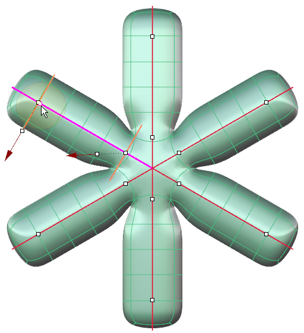
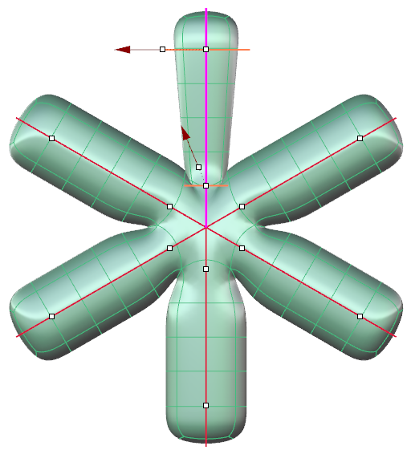
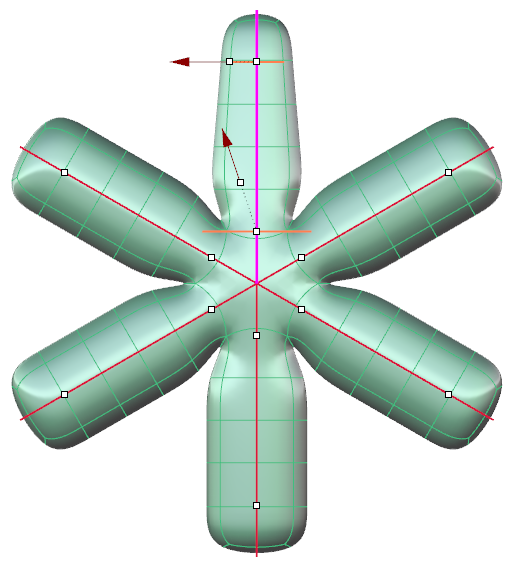

# Append Face

- Source PDF: Matrix 9 User Manual Addendum (matrix9.0_addendum.pdf)
- Page range: 18-19
- Section title: Append Face
- Section id: m9addendum-016-append-face
- Note: boundary page(s) are shared with a neighbouring section (two-column layout); text/images may include neighbour content.

---
<!-- section m9addendum-016-append-face | Append Face | m9addendum pages 18-19 -->

<!-- page 18 -->

Segments: Controls the number of seg-
ments or faces as part of the bridge com-
mand. Adjust in the builder by running the
slider or typing a value in the input box on
the left.
Align Bridge:
Note: Clay faces must have a minimum of three
Adjust the seam point and direction of the
bridged surface by clicking on the Align
button in the Bridge builder.
points.
Align Steps:
Note: If the Autoquad option is on a new face will be
created once four points are selected. Otherwise
the command will create ngon faces.
Click on Align in the builder.
Change the seam point by clicking
on one of the 8 white dots.
Change the surface direction by
clicking on the dot a second time.
FromEdge Steps:
Pick an edge to append a face to
Pick additional points to define the
face.
Press Enter to close the command
Chain Steps:
### Append Face
'ClayAppend'
Pick an edge to append a face to
Pick two points to define the first
face
The adjacent edge is passed forward
For each subsequent face select 1
point
### Options:
Adds new faces to a Clayoo surface.This
command closes a surface by drawing a
face, as opposed to using the Fill com-
mand. It is also possible to use this com-
mand to manually draw a face
unconnected to any surface to begin the
layout for a new model.
Append has three different command line
modes (Point, FromEdge, Chain) each with
a slighlty different set of steps.
Where is this Command:
Autoquad=Yes/No: When set to Yes the
command will automatically create a new
face when once four edges are created.
When set to No Ngons of greater than
edges can be created by picking more
points.
Mode:
Access this command from SubD>Append
Face
Point Steps:
Point: Create new Clayoo
faces by picking three or more
points.
Pick the first point
Pick the second and third point
Continue to select points or press
Enter to close the command.
FromEdge: Create new Clayoo
faces from and existing
Clayoo Edge and at least 1
additional point.
Chain: Automaticly detects
and selects the adjacent edge
after the first face is created.
Weld=Yes/No: When the option is set to
Yes coincident verts are welded together
- 12 -

<!-- page 19 -->

you wish to make active.
creating a single Clayoo surface. When set
to No coincident verts are created but not
welded creating two separate Clayoo
objects.
Retopology=Yes/No: When set to Yes
detects existing surfaces so that a new
Clayoo surface can be created with
improved topology. When Retopology is
one points will 'snap' to existing surfaces
in the documents based on the Offset set
in the command line.
Changing active curves in a multipipe operation
Start Radius: Controls the radius of the
pipe at the start of the active curve. Adjust
in the builder by running the slider, or typ-
ing a value in the input box on the left. The
Start Radius can also be adjusted dynam-
ically using the corresponding Viewport
Control Handle (red arrow). Click and drag
the arrow to adjust the dimension or
double-click and type a value in the box.
Offset: This option only appears if Reto-
pology is set to Yes.
### Clayoo Pipe
'ClayPipe'
Creates Clayoo surfaces from curves, auto-
matically transitioning between curves
that intersect.
Figure 1: Start Radius=1 Figure 2: Start Radius=3
Where is this Command:
Access this command from SubD>Pipe
Steps:
End Radius: Controls the radius of the pipe
at the end of the active curve. Adjust in the
builder by running the slider, or typing a
value in the input box on the left. The End
Radius can also be adjusted dynamically
using the corresponding Viewport Control
Handle (red arrow). Click and drag the
arrow to adjust the dimension or double-
click and type a value in the box.
Select the Pipe command in the
Clayoo menu.
Select a curve or curves to Pipe.
Press Enter.
Note: Hold Shift while dragging the Radius View-
port Control Handle (red arrow) and the Start and
Set the parameters for the surface
using the builder or by using the
Viewport Control Handles.
End Radius will be adjusted together.
### Multiple Pipe Options:
These options in a multipipe operation
(one that uses more than one curve) affect
only the active curve or the one with View-
port Control Handles.
Steps to change the active curve:
While inside the Pipe command
click on the white dot on the curve

---

## Images

-  page 18 (shared page)
-  page 18 (shared page)
-  page 18 (shared page)
-  page 19 (shared page)
-  page 19 (shared page)
-  page 19 (shared page)
-  page 19 (shared page)
-  page 19 (shared page)
-  page 19 (shared page)
-  page 19 (shared page)
