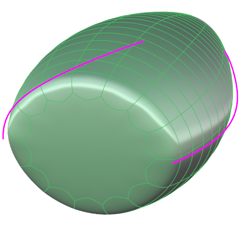
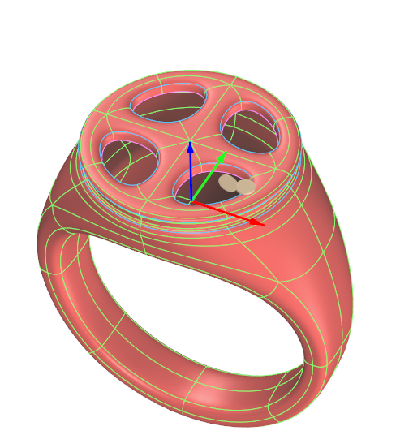
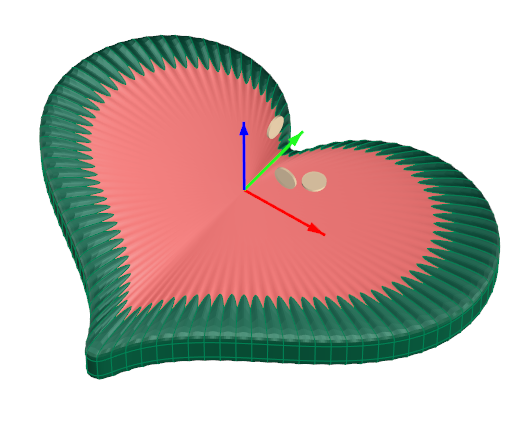
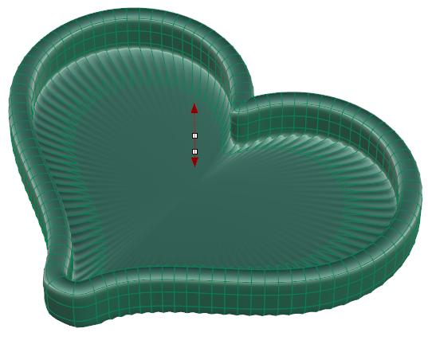

# Clayoo Fill

- Source PDF: Matrix 9 User Manual Addendum (matrix9.0_addendum.pdf)
- Page range: 47-47
- Section title: Clayoo Fill
- Section id: m9addendum-040-clayoo-fill
- Note: boundary page(s) are shared with a neighbouring section (two-column layout); text/images may include neighbour content.

---
<!-- section m9addendum-040-clayoo-fill | Clayoo Fill | m9addendum pages 47-47 -->

<!-- page 47 -->

None: Creates a Clayoo surface with no
cap.
Figure 1: Select Entire Object Figure 2: All holes filled.
Figure 1: Polygon Cap Figure 2: Ngon Cap
### Clayoo Shell
'ClayShell'
When the parameters of the surface are
set as needed, click the check mark to add
the geometry to the viewport, or the ‘X’ to
cancel the command.
Creates a hollowed out shell of a solid
Clayoo surface while removing selected
faces.
Where is this Command:
Access this command from SubD > Shell
### Clayoo Fill
Steps:
'ClayFill'
Creates a Clayoo face to close any open-
ings in a Clayoo surface.
Select Shell from the Clayoo toolbar.
Select faces on the Clayoo surface
to remove.
Where is this Command:
Press Enter when done.
Access this command from SubD>Fill
Steps (for single hole):
Specify the thickness in the Com-
mand Line or dynamically using the
Viewport Control Handles.
Press Enter to add the geometry to
the viewport.
Select Fill from the Clayoo toolbar.
Select an edge or edges along the
hole to fill.
Press Enter when done.
Figure 1: Before Shell Figure 2: After Shell
### Options:
Figure 1: Select edge along one hole. Figure 2: Hole filled
Steps (all holes):
Distance: Controls the thickness of the
Clayoo surface. Adjust using the Viewport
Control Handles or by typing a value in the
Command Line
Select Fill from the Clayoo toolbar.
Select the entire Clayoo object.
### Clayoo Extract
Press Enter when done.
'ClayooExtract'
- 41 -

---

## Images

-  page 47 (shared page)
-  page 47 (shared page)
-  page 47 (shared page)
-  page 47 (shared page)
-  page 47 (shared page)
-  page 47 (shared page)
-  page 47 (shared page)
-  page 47 (shared page)
