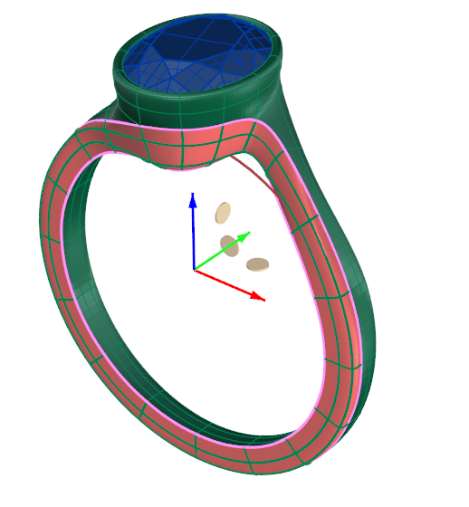
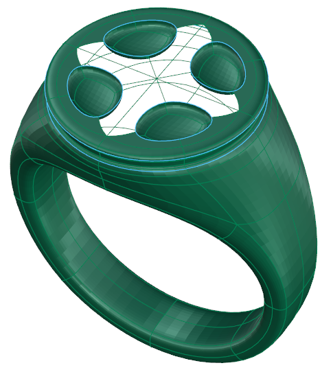
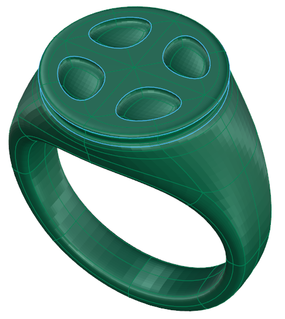

# Clayoo Extract

- Source PDF: Matrix 9 User Manual Addendum (matrix9.0_addendum.pdf)
- Page range: 47-48
- Section title: Clayoo Extract
- Section id: m9addendum-042-clayoo-extract
- Note: boundary page(s) are shared with a neighbouring section (two-column layout); text/images may include neighbour content.

---
<!-- section m9addendum-042-clayoo-extract | Clayoo Extract | m9addendum pages 47-48 -->

<!-- page 47 -->

None: Creates a Clayoo surface with no
cap.
Figure 1: Select Entire Object Figure 2: All holes filled.
Figure 1: Polygon Cap Figure 2: Ngon Cap
### Clayoo Shell
'ClayShell'
When the parameters of the surface are
set as needed, click the check mark to add
the geometry to the viewport, or the ‘X’ to
cancel the command.
Creates a hollowed out shell of a solid
Clayoo surface while removing selected
faces.
Where is this Command:
Access this command from SubD > Shell
### Clayoo Fill
Steps:
'ClayFill'
Creates a Clayoo face to close any open-
ings in a Clayoo surface.
Select Shell from the Clayoo toolbar.
Select faces on the Clayoo surface
to remove.
Where is this Command:
Press Enter when done.
Access this command from SubD>Fill
Steps (for single hole):
Specify the thickness in the Com-
mand Line or dynamically using the
Viewport Control Handles.
Press Enter to add the geometry to
the viewport.
Select Fill from the Clayoo toolbar.
Select an edge or edges along the
hole to fill.
Press Enter when done.
Figure 1: Before Shell Figure 2: After Shell
### Options:
Figure 1: Select edge along one hole. Figure 2: Hole filled
Steps (all holes):
Distance: Controls the thickness of the
Clayoo surface. Adjust using the Viewport
Control Handles or by typing a value in the
Command Line
Select Fill from the Clayoo toolbar.
Select the entire Clayoo object.
### Clayoo Extract
Press Enter when done.
'ClayooExtract'
- 41 -

<!-- page 48 -->

Either duplicate existing Clayoo faces or
remove Clayoo faces from an existing
Clayoo model.
Where is this Command:
Access this command from SubD>Extract
Steps:
Figure 1: Surface with Flipped Normals Figure 2: Surface after
Select Clayoo Faces to be Extrac-
ted.
Select Extract from the Clayoo tool-
bar.
running the flip normals command.
Note: Surface normals will sometimes flip when
manipulating a Clayoo surface. All surfaces nor-
mals should be facing out prior to converting into an
NURBS object.
Unify Normals Steps:
Figure 1: Extract Surface selection Figure 2: Extract Surface
result (faces moved to illustrate extraction)
Select the Clayoo surface to have
the normals unified.
Select Unify Normals from the
Clayoo toolbar.
### Options:
Copy Yes/No: With copy Yes selected this
command will duplicate the selected
Clayoo faces in place. When copy is set to
No the selected Clayoo faces are extrac-
ted from the Clayoo object without mak-
ing a copy.
### Clayoo Flip Normals
'ClayFlip'
Figure 1: Surface with Flipped Normals Figure 2: Surface after
running the Unify normals command.
Changes the normal direction of a Clayoo
surface. Use when a Clayoo surface has
turned itself inside out.
### Convert Surfaces
Where is this Command:
Access this command from SubD > Flip
Creates a Clayoo surface based on a sur-
face or polysurface.
Right Click command: Unify Normals
'ClayConvertSurface''
Makes sure that all face normals on a
Clayoo surface point the same direction.
Where is this Command:
Steps:
Access this command from SubD>Create
By Surfaces
Steps:
Select the faces or surfaces to flip
their normals.
Select Flip Normals from the Clayoo
toolbar.
Select a surface or polysurface in
the viewport.
Click on the Create by Surfaces com-
mand.
- 42 -

---

## Images

-  page 47 (shared page)
-  page 47 (shared page)
-  page 47 (shared page)
-  page 47 (shared page)
-  page 47 (shared page)
-  page 47 (shared page)
-  page 47 (shared page)
-  page 47 (shared page)
-  page 48 (shared page)
-  page 48 (shared page)
-  page 48 (shared page)
-  page 48 (shared page)
-  page 48 (shared page)
