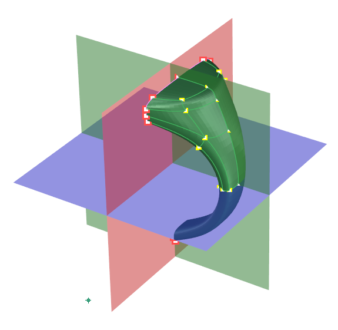
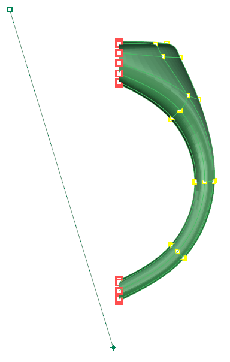
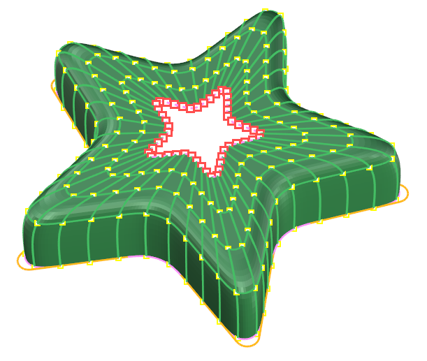
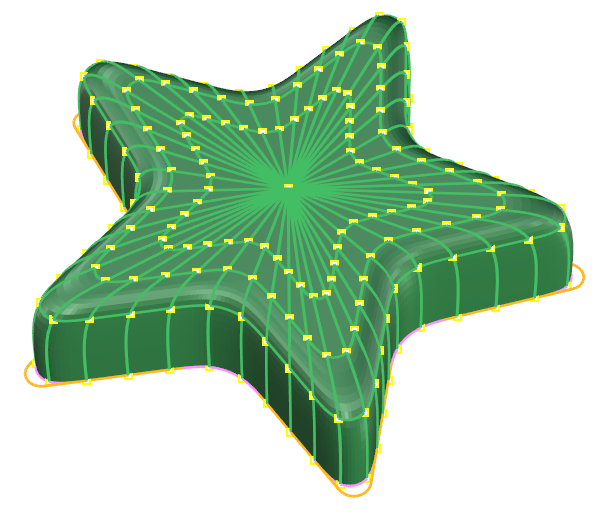

# Collapse

- Source PDF: Matrix 9 User Manual Addendum (matrix9.0_addendum.pdf)
- Page range: 28-28
- Section title: Collapse
- Section id: m9addendum-024-collapse
- Note: boundary page(s) are shared with a neighbouring section (two-column layout); text/images may include neighbour content.

---
<!-- section m9addendum-024-collapse | Collapse | m9addendum pages 28-28 -->

<!-- page 28 -->

Figure 1: User defined plane Figure 2: Points Projected to
plane.
Dynamic: Use to create a plane parallel to
an existing surface.
Dynamic Steps:
Select the geometry to be projected
to a plane (either vertices, edges,
faces or object).
Select Project to Plane from the
Clayoo toolbar.
Select the plane to project the geo-
metry to.
Cursor will change to a plane.
Pick a point to define the location of
the plane. If the cursor is on an exist-
ing surface the plane will be parallel
to that surface.
### Collapse
'ClayCollapse'
This tool joins all vertices of the selected
geometry in the center of the selection. It
works with faces, vertices and edges.
### Options:
Where is this Command:
Cplane: Projects the selected geometry to
the active construction plane.
Access this command from SubD > Col-
lapse
Steps:
XY: Projects the selected geometry to the
XY construction plane, indicated in blue.
Select by clicking on the blue plane or
selecting XY from the command line.
Select Collapse from the Clayoo
toolbar.
Select the vertices to Collapse.
Press Enter when done.
YZ: Projects the selected geometry to the
YZ construction plane, indicated in red.
Select by clicking on the red plane or
selecting YZ from the command line.
ZX: Projects the selected geometry to the
ZX construction plane, indicated in green.
Select by clicking on the green plane or
selecting ZX from the command line.
SetPlaneByLine: Projects the selected geo-
metry to a user defined line.
Set Plane by Line Steps:
Figure 1: Selection of verts Figures 2: Collapsed verts
Pick the fist point for line.
Pick the second point for line.
### Match
'ClayMatch'
The Match command can be used to con-
nect Clayoo surfaces to other Clayoo sur-
faces or Clayoo edges to a target curve.
Where is this Command:
Access this command from SubD>Match
The Match command's default options
change based on the order of operation.
Both approaches are outlined below. The
options can always be changed in the com-
- 22 -

---

## Images

-  page 28 (shared page)
-  page 28 (shared page)
-  page 28 (shared page)
-  page 28 (shared page)
-  page 28 (shared page)
