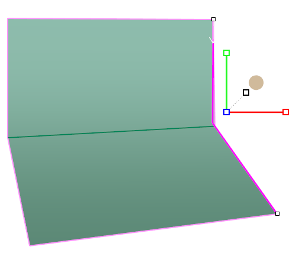
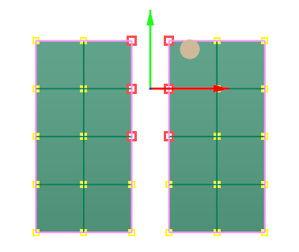
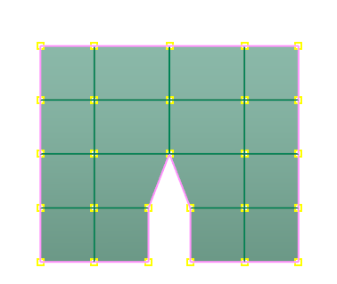
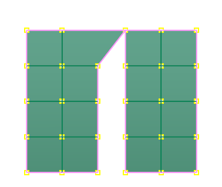

# Weld

- Source PDF: Matrix 9 User Manual Addendum (matrix9.0_addendum.pdf)
- Page range: 30-30
- Section title: Weld
- Section id: m9addendum-026-weld
- Note: boundary page(s) are shared with a neighbouring section (two-column layout); text/images may include neighbour content.

---
<!-- section m9addendum-026-weld | Weld | m9addendum pages 30-30 -->

<!-- page 30 -->

Figure 1: Domain 1=0 Domain 2=1 Figure 2: Domain 1=.15
First Vert moves to the second.
Domain 2=.85
### Options:
### Weld
Average=Yes/No: When this option is set
to Yes vertices move to the average
(middle) or the selected verts. When set to
no the first vert that is selected will move
to the second.
The Weld command is used to connect
Clayoo surfaces to one another, or back to
themselves. Weld connects vertices or
points to each other in a Clayoo surface.
The order of the selection affects the
defaults of the command.
Weld=Yes/No: When this option is set to
yeas vertices are welded after they are
matched. Set to No the verts will remain
unwelded.
Where is this Command:
Access this command from SubD>Weld
Tolerance: Sets the maximum distance
apart verts can be to be matched and wel-
ded.
### Clayoo Symmetry
'ClaySymmetry'
Note: If two points are preselected, the
Weld command will average the distances
between them. If the points are selected
after the command is run, the first point
will be moved to the position of the
second point.
Steps:
Applies symmetry (mirroring) along the X,
Y, or Z axis (axial) to a Clayoo surface.
You can discover existing Symmetry on a
complete model, or add new Symmetry to
a complete a partial model.
Select points (Verts) to Weld.
Select the Weld command in the T-
Spline menu.
Where is this Command:
Access this command from SubD>Sym-
metry
Symmetry By Plane Steps:
Both Verts are joined and meet in the middle
Select Symmetry from the Clayoo
menu
Select the Clayoo object.
Select Plane from the command line.
Pick two points to define symmetry
plane.
Click on the Weld command in the
T-Spline menu.
Click on the first Vert. Press Enter.
Click on the second Vert. Press
enter.
- 24 -

---

## Images

-  page 30 (shared page)
-  page 30 (shared page)
-  page 30 (shared page)
-  page 30 (shared page)
-  page 30 (shared page)
-  page 30 (shared page)
