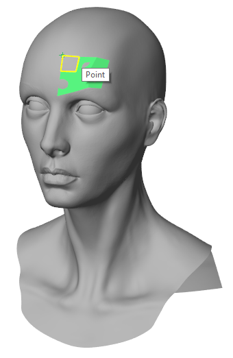
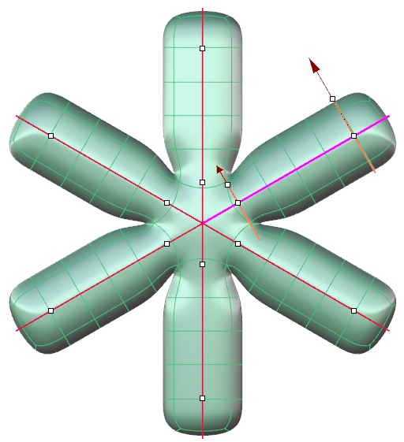
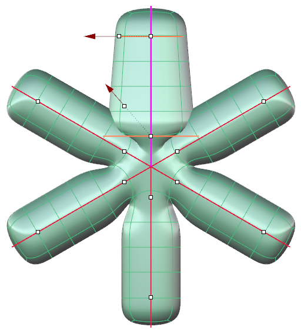
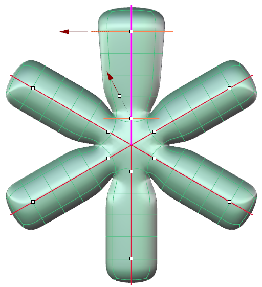
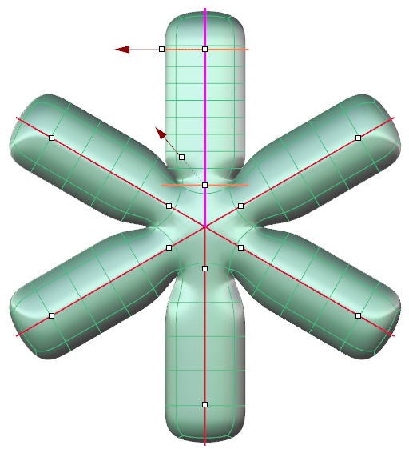
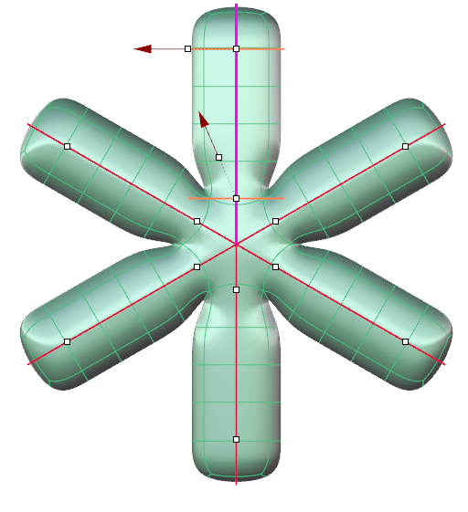

# Clayoo Pipe

- Source PDF: Matrix 9 User Manual Addendum (matrix9.0_addendum.pdf)
- Page range: 19-20
- Section title: Clayoo Pipe
- Section id: m9addendum-017-clayoo-pipe
- Note: boundary page(s) are shared with a neighbouring section (two-column layout); text/images may include neighbour content.

---
<!-- section m9addendum-017-clayoo-pipe | Clayoo Pipe | m9addendum pages 19-20 -->

<!-- page 19 -->

you wish to make active.
creating a single Clayoo surface. When set
to No coincident verts are created but not
welded creating two separate Clayoo
objects.
Retopology=Yes/No: When set to Yes
detects existing surfaces so that a new
Clayoo surface can be created with
improved topology. When Retopology is
one points will 'snap' to existing surfaces
in the documents based on the Offset set
in the command line.
Changing active curves in a multipipe operation
Start Radius: Controls the radius of the
pipe at the start of the active curve. Adjust
in the builder by running the slider, or typ-
ing a value in the input box on the left. The
Start Radius can also be adjusted dynam-
ically using the corresponding Viewport
Control Handle (red arrow). Click and drag
the arrow to adjust the dimension or
double-click and type a value in the box.
Offset: This option only appears if Reto-
pology is set to Yes.
### Clayoo Pipe
'ClayPipe'
Creates Clayoo surfaces from curves, auto-
matically transitioning between curves
that intersect.
Figure 1: Start Radius=1 Figure 2: Start Radius=3
Where is this Command:
Access this command from SubD>Pipe
Steps:
End Radius: Controls the radius of the pipe
at the end of the active curve. Adjust in the
builder by running the slider, or typing a
value in the input box on the left. The End
Radius can also be adjusted dynamically
using the corresponding Viewport Control
Handle (red arrow). Click and drag the
arrow to adjust the dimension or double-
click and type a value in the box.
Select the Pipe command in the
Clayoo menu.
Select a curve or curves to Pipe.
Press Enter.
Note: Hold Shift while dragging the Radius View-
port Control Handle (red arrow) and the Start and
Set the parameters for the surface
using the builder or by using the
Viewport Control Handles.
End Radius will be adjusted together.
### Multiple Pipe Options:
These options in a multipipe operation
(one that uses more than one curve) affect
only the active curve or the one with View-
port Control Handles.
Steps to change the active curve:
While inside the Pipe command
click on the white dot on the curve

<!-- page 20 -->

Figure 1: Radius End=1 Figure 2: Radius Edn+3
Segments: Controls the number of seg-
ments or faces running perpendicular to
the input curve(s) of the surface. Adjust in
the builder by running the slider or typing
a value in the input box on the left.
Figure 1: Global Segments=4 Figure 2: Global Segments=8
### Command Line Options:
These options only appear in the com-
mand line.
Figure 1: Segments=4 Figure 2: Segments=8
Edit Mode: Controls what the options in
the command line controls.
### Joint Options:
These options affect the joints or inter-
sections in a multipipe operation.
Global Parameters: Command
line options affect the piped
surface globaly.
Start Align: Rotates the joint at the start of
the active curve 90 degrees.
End Align: Rotates the joint at the end of
the active curve 90 degrees.
EndCurveParameters: Com-
mand line options control the
piped surface at the end of the
curve.
### Global Options:
StartCurveParameters: Com-
mand line options control the
piped surface at the start of
the curve.
Global Radius: Controls the radius of the
entire piped surface regardless of which
curve is active. Adjust in the builder by run-
ning the slider, or typing a value in the
input box on the left.
Distance: Controls the pipe profiles dis-
tance from the ends of the curve. Adjust in
the viewport by clicking and dragging the
white dot at the center of the profile or in
the command line by clicking on the
option and typing a value.
### EndCurve/StartCurve Options:
These options only appear when use either
end curve
Figure 1: Global Radius=1 Figure 2: Global Radius=2
Angle: Rotates the seam point of the pipe
profile creating a twisting surface. Adjust
in the viewport by clicking and dragging
on the pipe profile (orange curve) or in the
command line by clicking on the option
and typing a value.
### Clayoo Bezel
Global Segments:Controls the number of
segments or faces of the entire piped sur-
face regardless of which curve is active.
Adjust in the builder by running the slider,
or typing a value in the input box on the
left.
‘ClayBezel’
Creates a Clayoo bezel around an existing
gem.
Where is this Command:
- 14 -

---

## Images

-  page 19 (shared page)
-  page 19 (shared page)
-  page 19 (shared page)
-  page 19 (shared page)
-  page 19 (shared page)
-  page 19 (shared page)
-  page 19 (shared page)
-  page 20 (shared page)
-  page 20 (shared page)
-  page 20 (shared page)
-  page 20 (shared page)
-  page 20 (shared page)
