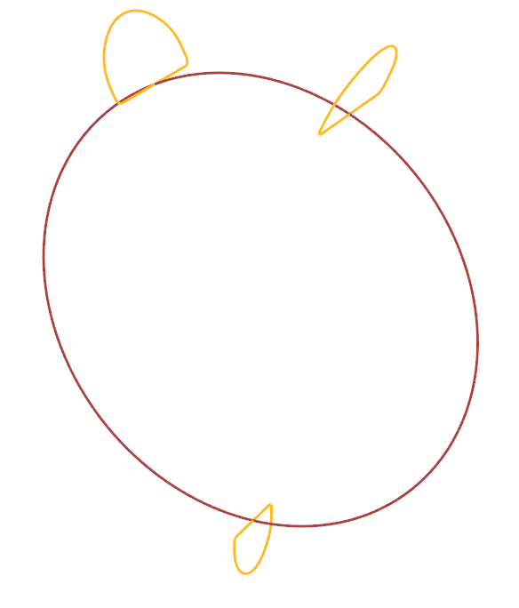
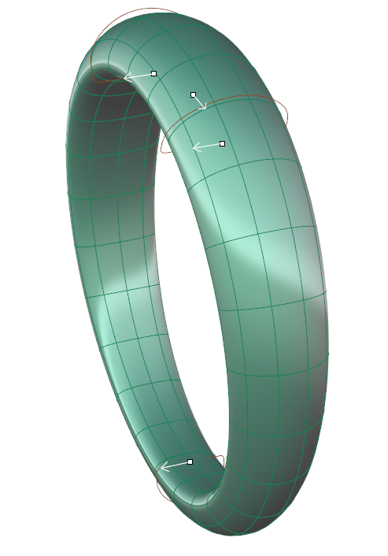
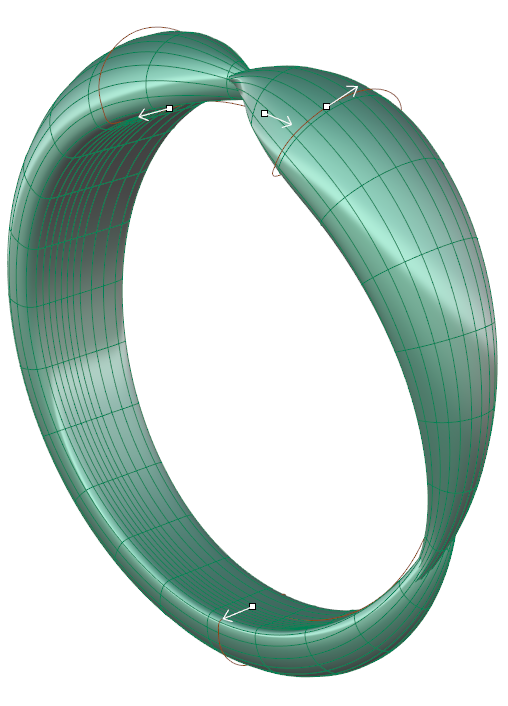
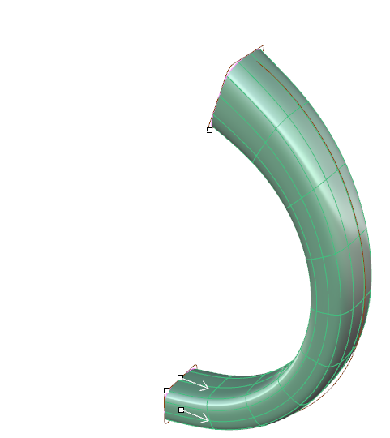
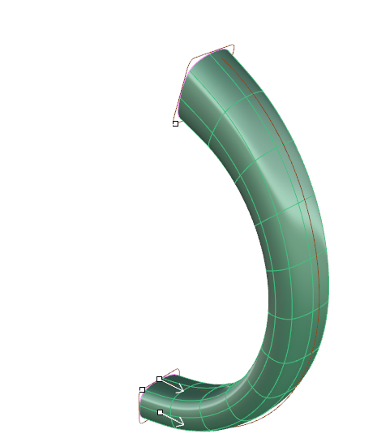

# Clayoo Sweep 1

- Source PDF: Matrix 9 User Manual Addendum (matrix9.0_addendum.pdf)
- Page range: 38-39
- Section title: Clayoo Sweep 1
- Section id: m9addendum-033-clayoo-sweep-1
- Note: boundary page(s) are shared with a neighbouring section (two-column layout); text/images may include neighbour content.

---
<!-- section m9addendum-033-clayoo-sweep-1 | Clayoo Sweep 1 | m9addendum pages 38-39 -->

<!-- page 38 -->

### Options:
Position: Adjust the position of the Clayoo
surface by clicking and dragging the yel-
low disc at the center of the surface.
Double-click on the yellow disc and pick a
point for the box's origin.
Segments: Controls the number of seg-
ments or faces running perpendicular to
the rail curve. Adjust in the builder by run-
ning the slider or typing a value in the
input box on the left.
Reposition the Plane by clicking and dragging the yellow disc or
double clicking on the disc and picking a new point.
Figure 1: 14 Segments Figure 2: 25 Segments
When the parameters of the surface are
set as needed click 'OK' to add the geo-
metry to the viewport, or 'Cancel' to cancel
the command.
### Clayoo Sweep 1
'ClaySweep1'
Segments Along: Controls the number of
segments or faces running perpendicular
to the input profile(s) of the surface.
Adjust in the builder by running the slider
or typing a value in the input box on the
left.
Creates a Clayoo surface from a rail and
profile curves.
Where is this Command:
Access this command from SubD>Sweep 1
Steps:
Figure 1: 10 Segments Along Figure 2: 25 Segments Along.
Select Sweep 1 from the Clayoo tool-
bar.
Select the rail curve.
Select the profile curve(s).
Press Enter when done.
Flip Rail: Changes the direction of the
Clayoo Sweep. This can be changed by
clicking on the option in the builder or
clicking on the white arrow on the rail
curve.
Set the parameters for the surface
using the builder or by using the
Viewport Control Handles.
Click 'OK' in the builder or press
Enter to add the geometry to the
viewport.
Align Seams: Adjust the seam point on a
closed curve profile by clicking and drag-
ging the seam point to a new location on
the curve. Seam point location can only be
changed on closed curve profiles. All pro-
files in the sweep should share the same
seam location.
Curve Direction: Change the direction of a
profile by clicking on the white arrow. All
profile curves in the sweep should be
pointing in the same direction.
Figure 1: Input curves Figure 2: Swept Clayoo surface.
- 32 -

<!-- page 39 -->

### Options:
Segments: Controls the number of seg-
ments or faces running perpendicular to
the input rails of the surface. Adjust in the
builder by running the slider or typing a
value in the input box on the left.
Figure 1: Seams and direction match. Figure 2: Seam rotated.
Figure 3: Mismatched directions
When the parameters of the surface are
set as needed click 'OK' to add the geo-
metry to the viewport, or 'Cancel' to cancel
the command.
Figure 1: Segments=9 Figure 2: Segments=18
### Clayoo Sweep 2
'ClaySweep2'
Creates a Clayoo surface from two rails
and profile curves.
Where is this Command:
Segments Along: Controls the number of
segments or faces running perpendicular
to the input profile(s) of the surface.
Adjust in the builder by running the slider
or typing a value in the input box on the
left.
Access this command from SubD>Sweep
2
Steps:
Select Sweep 2 from the Clayoo
menu.
Select the first rail curve.
Select the second rail curve.
Select the profile curve(s).
Figure 1: Segments Along=8 Figure 2: Segments Along=16
Press Enter when done.
Set the parameters for the surface
using the builder or by using the
Viewport Control Handles.
Flip Rail: Changes the direction of the
Clayoo Sweep. This can be changed by
clicking on the option in the builder or
clicking on the white arrow on the rail
curve.
Click 'OK' in the builder or press
Enter to add the geometry to the
viewport.
Figure 1: Input Rails and Profiles Figure 2: Output Clayoo Sur-
face
Align Seams: Adjust the seam point on a
closed curve profile by clicking and drag-
ging the seam point Viewport Control
Handle to a new location on the curve.
Seam point location can only be changed
on closed curve profiles. All profiles in the
sweep should share the same seam loc-
ation.

---

## Images

-  page 38 (shared page)
-  page 38 (shared page)
-  page 38 (shared page)
-  page 38 (shared page)
-  page 38 (shared page)
-  page 38 (shared page)
-  page 38 (shared page)
-  page 39 (shared page)
-  page 39 (shared page)
-  page 39 (shared page)
-  page 39 (shared page)
-  page 39 (shared page)
-  page 39 (shared page)
-  page 39 (shared page)
-  page 39 (shared page)
