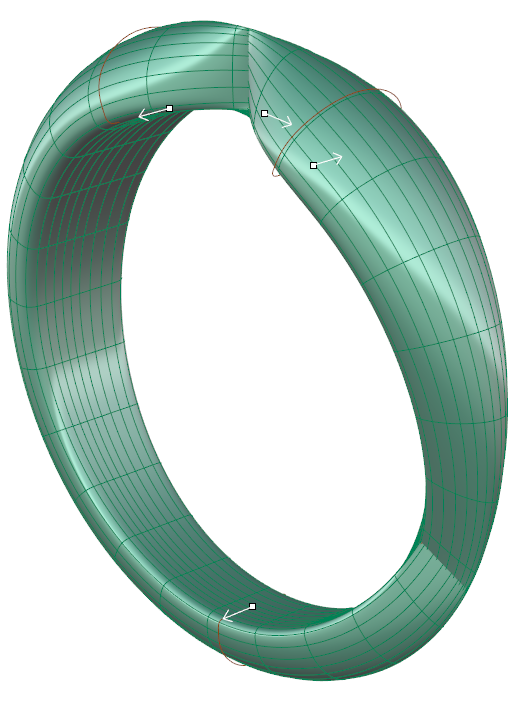
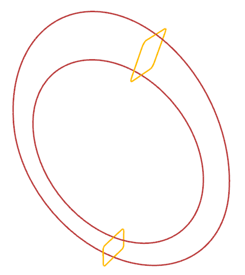
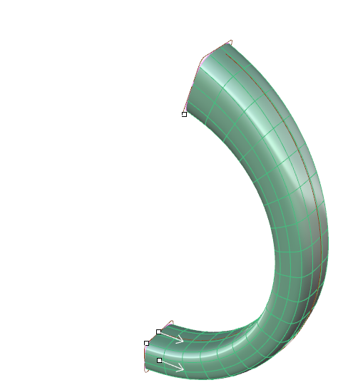
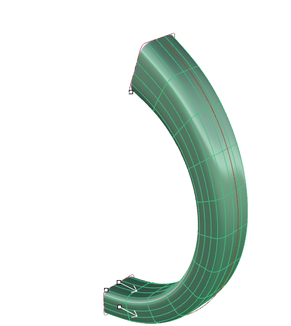
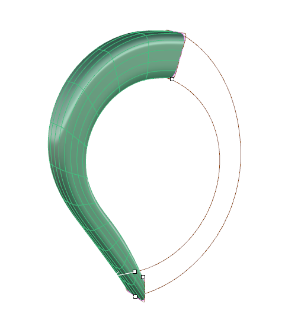
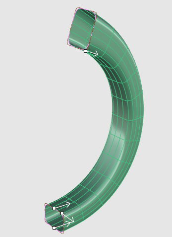
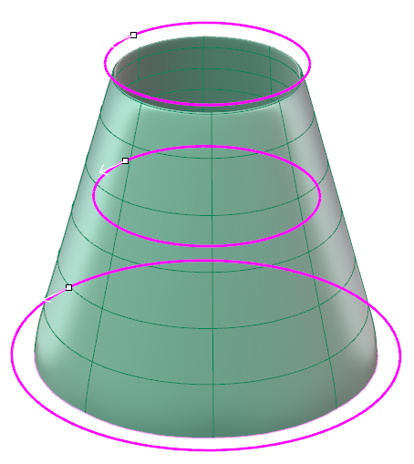

# Clayoo Sweep 2

- Source PDF: Matrix 9 User Manual Addendum (matrix9.0_addendum.pdf)
- Page range: 39-40
- Section title: Clayoo Sweep 2
- Section id: m9addendum-034-clayoo-sweep-2
- Note: boundary page(s) are shared with a neighbouring section (two-column layout); text/images may include neighbour content.

---
<!-- section m9addendum-034-clayoo-sweep-2 | Clayoo Sweep 2 | m9addendum pages 39-40 -->

<!-- page 39 -->

### Options:
Segments: Controls the number of seg-
ments or faces running perpendicular to
the input rails of the surface. Adjust in the
builder by running the slider or typing a
value in the input box on the left.
Figure 1: Seams and direction match. Figure 2: Seam rotated.
Figure 3: Mismatched directions
When the parameters of the surface are
set as needed click 'OK' to add the geo-
metry to the viewport, or 'Cancel' to cancel
the command.
Figure 1: Segments=9 Figure 2: Segments=18
### Clayoo Sweep 2
'ClaySweep2'
Creates a Clayoo surface from two rails
and profile curves.
Where is this Command:
Segments Along: Controls the number of
segments or faces running perpendicular
to the input profile(s) of the surface.
Adjust in the builder by running the slider
or typing a value in the input box on the
left.
Access this command from SubD>Sweep
2
Steps:
Select Sweep 2 from the Clayoo
menu.
Select the first rail curve.
Select the second rail curve.
Select the profile curve(s).
Figure 1: Segments Along=8 Figure 2: Segments Along=16
Press Enter when done.
Set the parameters for the surface
using the builder or by using the
Viewport Control Handles.
Flip Rail: Changes the direction of the
Clayoo Sweep. This can be changed by
clicking on the option in the builder or
clicking on the white arrow on the rail
curve.
Click 'OK' in the builder or press
Enter to add the geometry to the
viewport.
Figure 1: Input Rails and Profiles Figure 2: Output Clayoo Sur-
face
Align Seams: Adjust the seam point on a
closed curve profile by clicking and drag-
ging the seam point Viewport Control
Handle to a new location on the curve.
Seam point location can only be changed
on closed curve profiles. All profiles in the
sweep should share the same seam loc-
ation.

<!-- page 40 -->

Set the parameters for the surface
using the builder or by using the
Viewport Control Handles.
Click 'OK' in the builder or press
Enter to add the geometry to the
viewport.
Note: All of the curves in the Loft should either be
open or closed.
Figure 1: Seams Aligned Figure 2: Top Profile seam rotated
Note: Use the least number of control points as pos-
180 degrees
sible to create the desired shape.
Note: The order the curves are selected will determ-
Curve Direction: Change the direction of a
profile by clicking on the white arrow. All
profile curves in the sweep should be
pointing in the same direction.
ine the order in which the Loft passes through
them.
### Options:
Segments: Controls the number of seg-
ments or faces running perpendicular to
the input curve(s) of the surface. Adjust in
the builder by running the slider or typing
a value in the input box on the left.
Figure 1: Matched curve direction Figure 2: Mismatched curve
direction
When the parameters of the surface are
set as needed click 'OK' to add the geo-
metry to the viewport, or 'Cancel' to cancel
the command.
Left: 8 segments Right: 12 segments
### Clayoo Loft
'ClayLoft'
Segments Along: Controls the number of
segments or faces running perpendicular
to the input profile(s) of the surface.
Adjust in the builder by running the slider
or typing a value in the input box on the
left.
Creates a Clayoo surface through two or
more curves. Similar to Rhino's Loft com-
mand, quickly create complex surfaces
from a few simple curves.
Where is this Command:
Access this command from SubD>Loft
Steps:
Left: 6 segments along Right: 12 segments along
Select Create Loft from the Clayoo
toolbar.
Select curves in the order that the
surface should pass through them.
Press Enter when done.
- 34 -

---

## Images

-  page 39 (shared page)
-  page 39 (shared page)
-  page 39 (shared page)
-  page 39 (shared page)
-  page 39 (shared page)
-  page 39 (shared page)
-  page 39 (shared page)
-  page 39 (shared page)
-  page 39 (shared page)
-  page 40 (shared page)
-  page 40 (shared page)
-  page 40 (shared page)
-  page 40 (shared page)
-  page 40 (shared page)
-  page 40 (shared page)
-  page 40 (shared page)
