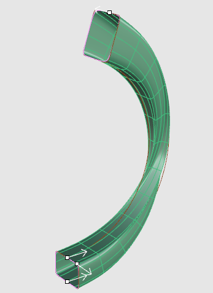
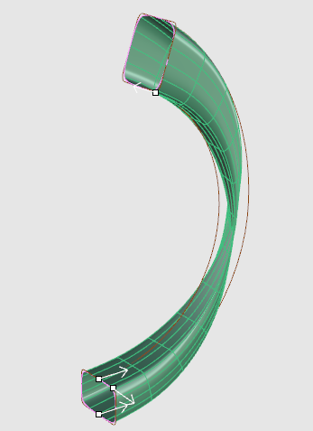
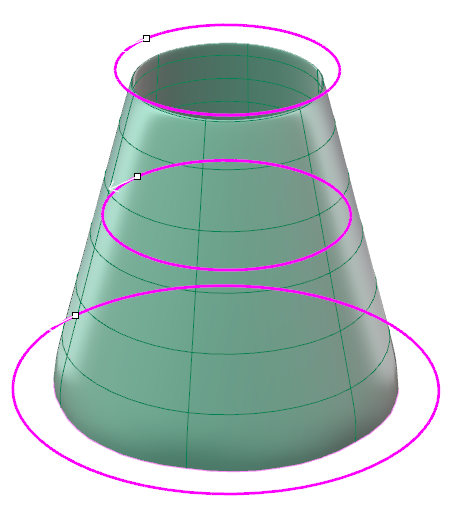
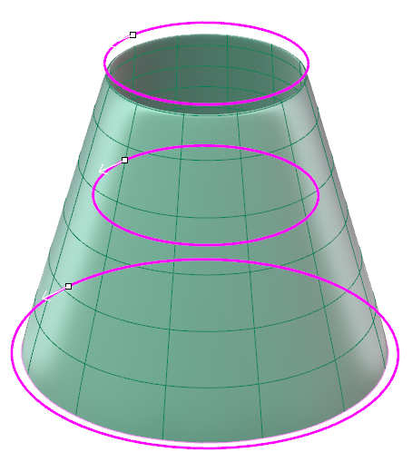
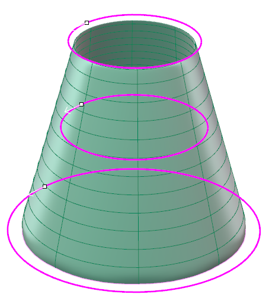
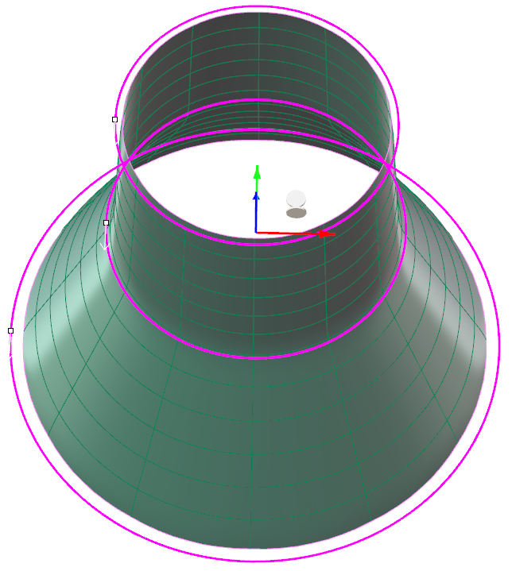
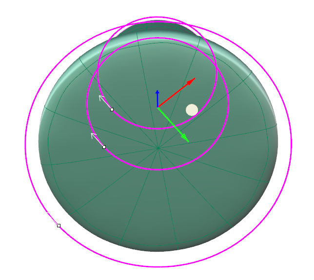
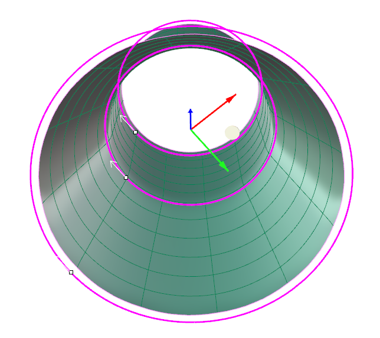
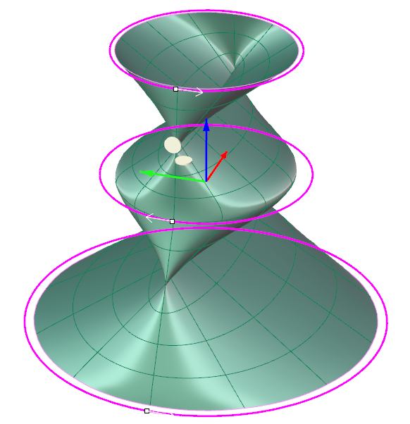

# Clayoo Loft

- Source PDF: Matrix 9 User Manual Addendum (matrix9.0_addendum.pdf)
- Page range: 40-41
- Section title: Clayoo Loft
- Section id: m9addendum-035-clayoo-loft
- Note: boundary page(s) are shared with a neighbouring section (two-column layout); text/images may include neighbour content.

---
<!-- section m9addendum-035-clayoo-loft | Clayoo Loft | m9addendum pages 40-41 -->

<!-- page 40 -->

Set the parameters for the surface
using the builder or by using the
Viewport Control Handles.
Click 'OK' in the builder or press
Enter to add the geometry to the
viewport.
Note: All of the curves in the Loft should either be
open or closed.
Figure 1: Seams Aligned Figure 2: Top Profile seam rotated
Note: Use the least number of control points as pos-
180 degrees
sible to create the desired shape.
Note: The order the curves are selected will determ-
Curve Direction: Change the direction of a
profile by clicking on the white arrow. All
profile curves in the sweep should be
pointing in the same direction.
ine the order in which the Loft passes through
them.
### Options:
Segments: Controls the number of seg-
ments or faces running perpendicular to
the input curve(s) of the surface. Adjust in
the builder by running the slider or typing
a value in the input box on the left.
Figure 1: Matched curve direction Figure 2: Mismatched curve
direction
When the parameters of the surface are
set as needed click 'OK' to add the geo-
metry to the viewport, or 'Cancel' to cancel
the command.
Left: 8 segments Right: 12 segments
### Clayoo Loft
'ClayLoft'
Segments Along: Controls the number of
segments or faces running perpendicular
to the input profile(s) of the surface.
Adjust in the builder by running the slider
or typing a value in the input box on the
left.
Creates a Clayoo surface through two or
more curves. Similar to Rhino's Loft com-
mand, quickly create complex surfaces
from a few simple curves.
Where is this Command:
Access this command from SubD>Loft
Steps:
Left: 6 segments along Right: 12 segments along
Select Create Loft from the Clayoo
toolbar.
Select curves in the order that the
surface should pass through them.
Press Enter when done.
- 34 -

<!-- page 41 -->

Note: More segments will follow the input curves
more closely but can result in a surface that is more
Direction: Adjust the direction and seams
of the input curves using the arrows in the
viewport.
difficult to manipulate.
Loft Direction Steps:
Click on the white arrow to change
the direction of one of the curves.
Cap Start: Creates a cap by adding a face
or faces to the start of the Clayoo surface.
Select the desired mode from the drop-
down menu.
### Cap Start Modes:
Polygonal: Creates a cap by adding poly-
gonal faces.
Ngon: Creates a cap using a single Clayoo
face resulting in an n-gon shaped face.
Figure 1: Input curves direction are mismatched. Figure
2: Curve direction all match. Figure 3: Detail of the direction
None: Creates a Clayoo surface with no
cap.
Viewport Control.
Seam Postion Steps:
Click and drag the white dot at the
end of the arrow. Drag to a new pos-
ition.
Figure 1: Polygon Cap Figure 2: Ngon Cap Figure 3: None
Cap End: Creates a cap by adding a face
or faces to the end of the Clayoo surface.
Select the desired mode from the drop-
down menu.
### Cap End Modes:
Figure 1: Seam points all in the same position. Figure 2: Seam
point on middle curve rotated 45 degrees.
Polygonal: Creates a cap by adding poly-
gonal faces.
Note: Most of the time the direction and seams
should match. If the surface self intersects it will cre-
Ngon: Creates a cap using a single Clayoo
face resulting in an n-gon shaped face.
ate an invalid surface.
None: Creates a Clayoo surface with no
cap.
### Clayoo Wrap
'ClayWrap'
When the parameters of the surface are
set as needed click 'OK' to add the geo-
metry to the viewport, or 'Cancel' to cancel
the command.
Wraps a Clayoo object around a target
object.
Where is this Command:
Access this command from SubD>Wrap
Steps:
Figure 1: Polygon Cap Figure 2: Ngon Cap Figure 3: None
Select the Clayoo surface (external)
to wrap around an existing NURBS

---

## Images

-  page 40 (shared page)
-  page 40 (shared page)
-  page 40 (shared page)
-  page 40 (shared page)
-  page 40 (shared page)
-  page 40 (shared page)
-  page 40 (shared page)
-  page 41 (shared page)
-  page 41 (shared page)
-  page 41 (shared page)
-  page 41 (shared page)
-  page 41 (shared page)
-  page 41 (shared page)
-  page 41 (shared page)
-  page 41 (shared page)
-  page 41 (shared page)
-  page 41 (shared page)
