# Clayoo Revolve

- Source PDF: Matrix 9 User Manual Addendum (matrix9.0_addendum.pdf)
- Page range: 42-44
- Section title: Clayoo Revolve
- Section id: m9addendum-037-clayoo-revolve
- Note: boundary page(s) are shared with a neighbouring section (two-column layout); text/images may include neighbour content.

---
<!-- section m9addendum-037-clayoo-revolve | Clayoo Revolve | m9addendum pages 42-44 -->

<!-- page 42 -->

Figure 1: Input Surfaces Figure 2: Auto Size=No Figure 3:
Auto Size=Yes
Copy=Yes/No: When Copy is set to yes
the original external surface remains once
the command has run. When set to No the
original external surface is deleted.
object.
Select the internal NURBS object,
press Enter when done.
Adjust the parameters in the com-
mand line and press Enter when
done.
### Clayoo Revolve
'ClayRevolve'
Creates a surface from an input curve
revolved around an axis.
Where is this Command:
Access this command from SubD >
Revolve
Figure 1: Input surfaces Figure 2: Select Internal Figure 3: Res-
Steps:
ult
### Options:
Select Revolve from the Clayoo tool-
bar.
Select a curve in the viewport
Wrap Modes:
Set the parameters for the surface
using the builder or by using the
Viewport Control Handles.
By Normal: Uses the wrapped
object's normal to assist the
wrapper object in following
the wrapped object's surface.
Click 'OK' in the builder or press
Enter to add the geometry to the
viewport.
ByIterations: Takes a series of
samples along the wrapped
objects surface to assisted in
the wrapper object following
the wrapped object's surface.
Iterations: This
option is only avail-
able when ByIter-
ations is selected.
Controls how
many samples
along the surface
are taken to create
the wrapped sur-
face.
Figure 1: Input curve
Figure 2: Revolved Clayoo surface.
### Options:
Auto Size=Yes/No: Matches the size of
the wrapper object (external) to the
wrapped object (internal)
Axis: Controls the axis which the Clayoo
surfaces revolves around.
X: Revolves the curve around the X axis to
create a Clayoo surface
Y: Revolves the curve around the Y axis to
create a Clayoo surface
Z: Revolves the curve around the Z axis to
create a Clayoo surface
- 36 -

<!-- page 43 -->

Figure 1: X Axis
Figure 2: Y Axis
Figure 3: Z Axis
Note: The axis used will depend on the orientaion
Figure 1: 10 Segments Along
Figure 2: 20 Segments Along
of the revolved curve. In the preceeding example
the curve was flat on the XZ plane.
Cap Start: Creates a cap by adding a face
or faces to the start of the Clayoo surface.
Select the desired mode from the drop-
down menu.
Custom: Define a custom axis for the
Clayoo surface to revolve around.
Angle to Fill:
### Cap Start Modes:
Polygonal: Creates a cap by adding poly-
gonal faces.
Ngon: Creates a cap using a single Clayoo
face resulting in an n-gon shaped face.
Segments: Controls the number of seg-
ments or faces along the circumference of
the surface. Adjust in the builder by run-
ning the slider, clicking the plus or minus
button on either side of the slider or typing
a value in the input box on the left.
None: Creates a Clayoo surface with no
cap.
Figure 1: Polygon Cap Figure 2: Ngon Cap Figure 3: None
Figure 1: 12 Segments
Figure 2: 20 Segments
Cap End: Creates a cap by adding a face
or faces to the end of the Clayoo surface.
Select the desired mode from the drop-
down menu.
Segments Along: Controls the number of
segments or faces running perpendicular
to the input profile(s) of the surface.
Adjust in the builder by running the slider
or typing a value in the input box on the
left.
### Cap End Modes:
Polygonal: Creates a cap by adding poly-
gonal faces.
Ngon: Creates a cap using a single Clayoo
face resulting in an n-gon shaped face.
None: Creates a Clayoo surface with no
cap.
- 37 -

<!-- page 44 -->

Segments: Controls the number of seg-
ments or faces along the input curve.
Adjust in the builder by running the slider,
clicking the plus or minus button on either
side of the slider or typing a value in the
input box on the left.
Figure 1: Polygon Cap Figure 2: Ngon Cap Figure 3: None
When the parameters of the surface are
set as needed, click the check mark to add
the geometry to the viewport, or the ‘X’ to
cancel the command.
Figure 1: 7 Segments Figure 2: 14 Segments
### Create By Curve
'ClayCreateByCurve'
This command creates a Clayoo surface
from an input curve.
Segments Along: Controls the number of
segments or faces along the height of the
Clayoo surface. Adjust in the builder by
running the slider, clicking the plus or
minus button on either side of the slider or
typing a value in the input box on the left.
Where is this Command:
Access this command from SubD > Create
By Curve
Steps:
Select a curve in the viewport.
Figure 1: 1 Segment Along Figure 2: 4 Semgents Along
Set the parameters in the Clayoo
Create by Curve Builder
Click on the check mark in the
Create by Curve builder or press
Enter to add the geometry to the
viewport.
### Options:
Symmetry: Extrudes a Clayoo surface
from both sides of the input curve(s). With
this option selected, distance and division
parameters are double the value set in the
builder.
Distance: Controls the height of the
Clayoo surface. The distance can also be
adjusted dynamically by using the cor-
responding Viewport Control Handle (red
arrow). Click and drag the arrow to adjust
the dimension or double-click to type an
exact value in the input box.
Figure 1: Symmetry Off Figure 2: Symmetry On
Cap Start: Creates a cap by adding a face
or faces to the start of the Clayoo surface.
Select the desired mode from the drop-
down menu.
Adjust the distance using the Viewport Control Handle

---

## Images

-  page 42 (shared page)
- 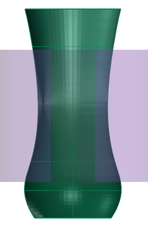 page 42 (shared page)
- 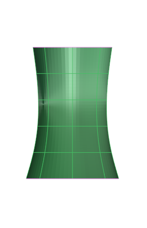 page 42 (shared page)
-  page 42 (shared page)
- 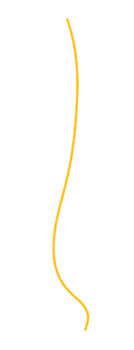 page 42 (shared page)
- 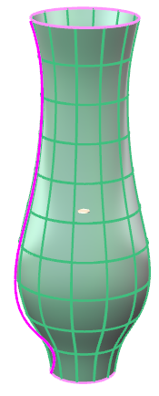 page 42 (shared page)
- 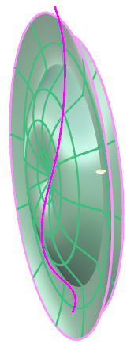 page 43
- 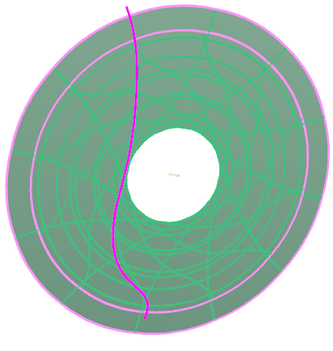 page 43
- 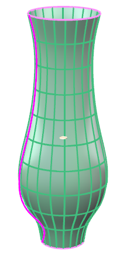 page 43
- 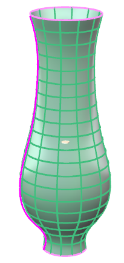 page 43
- 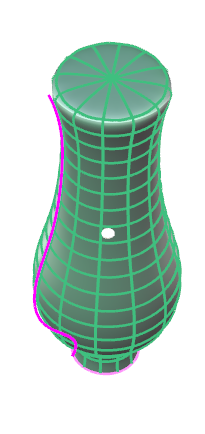 page 43
- 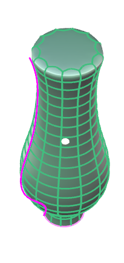 page 43
- 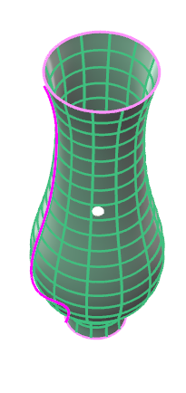 page 43
- 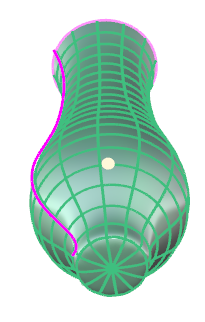 page 44 (shared page)
-  page 44 (shared page)
- 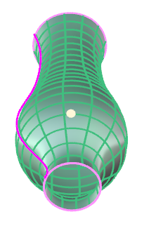 page 44 (shared page)
-  page 44 (shared page)
-  page 44 (shared page)
- 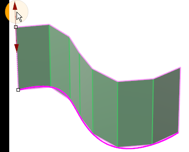 page 44 (shared page)
-  page 44 (shared page)
-  page 44 (shared page)
-  page 44 (shared page)
