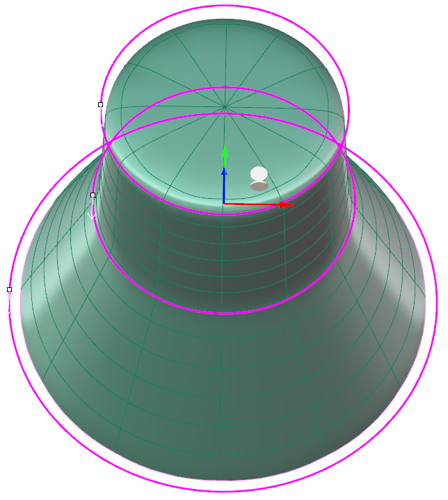
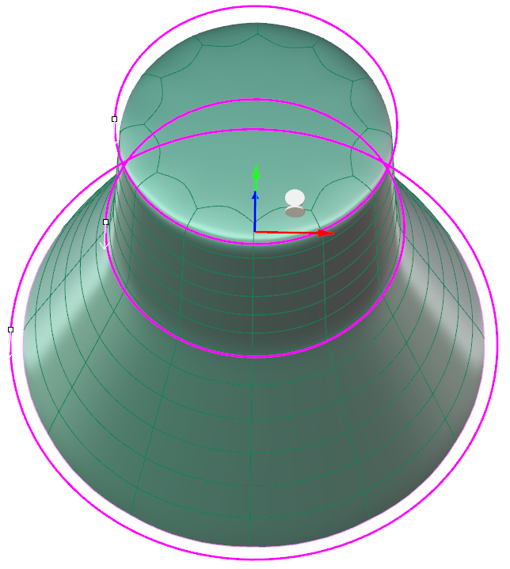
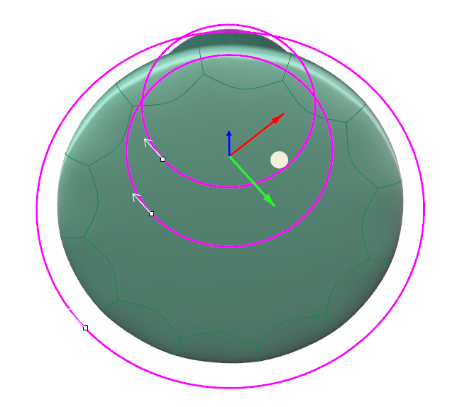
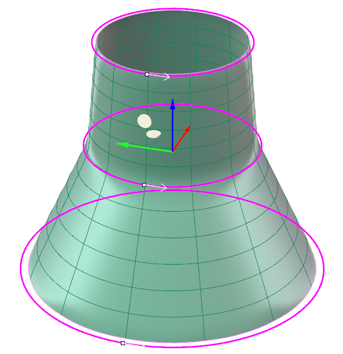
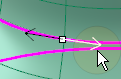
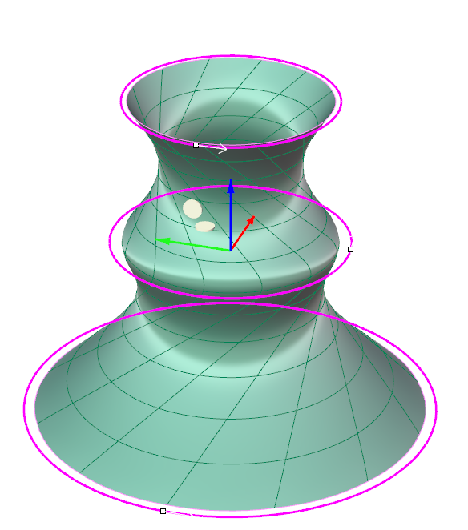
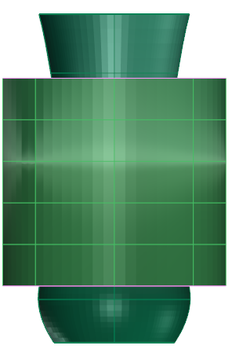
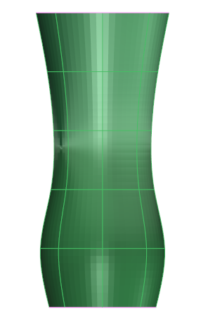

# Clayoo Wrap

- Source PDF: Matrix 9 User Manual Addendum (matrix9.0_addendum.pdf)
- Page range: 41-42
- Section title: Clayoo Wrap
- Section id: m9addendum-036-clayoo-wrap
- Note: boundary page(s) are shared with a neighbouring section (two-column layout); text/images may include neighbour content.

---
<!-- section m9addendum-036-clayoo-wrap | Clayoo Wrap | m9addendum pages 41-42 -->

<!-- page 41 -->

Note: More segments will follow the input curves
more closely but can result in a surface that is more
Direction: Adjust the direction and seams
of the input curves using the arrows in the
viewport.
difficult to manipulate.
Loft Direction Steps:
Click on the white arrow to change
the direction of one of the curves.
Cap Start: Creates a cap by adding a face
or faces to the start of the Clayoo surface.
Select the desired mode from the drop-
down menu.
### Cap Start Modes:
Polygonal: Creates a cap by adding poly-
gonal faces.
Ngon: Creates a cap using a single Clayoo
face resulting in an n-gon shaped face.
Figure 1: Input curves direction are mismatched. Figure
2: Curve direction all match. Figure 3: Detail of the direction
None: Creates a Clayoo surface with no
cap.
Viewport Control.
Seam Postion Steps:
Click and drag the white dot at the
end of the arrow. Drag to a new pos-
ition.
Figure 1: Polygon Cap Figure 2: Ngon Cap Figure 3: None
Cap End: Creates a cap by adding a face
or faces to the end of the Clayoo surface.
Select the desired mode from the drop-
down menu.
### Cap End Modes:
Figure 1: Seam points all in the same position. Figure 2: Seam
point on middle curve rotated 45 degrees.
Polygonal: Creates a cap by adding poly-
gonal faces.
Note: Most of the time the direction and seams
should match. If the surface self intersects it will cre-
Ngon: Creates a cap using a single Clayoo
face resulting in an n-gon shaped face.
ate an invalid surface.
None: Creates a Clayoo surface with no
cap.
### Clayoo Wrap
'ClayWrap'
When the parameters of the surface are
set as needed click 'OK' to add the geo-
metry to the viewport, or 'Cancel' to cancel
the command.
Wraps a Clayoo object around a target
object.
Where is this Command:
Access this command from SubD>Wrap
Steps:
Figure 1: Polygon Cap Figure 2: Ngon Cap Figure 3: None
Select the Clayoo surface (external)
to wrap around an existing NURBS

<!-- page 42 -->

Figure 1: Input Surfaces Figure 2: Auto Size=No Figure 3:
Auto Size=Yes
Copy=Yes/No: When Copy is set to yes
the original external surface remains once
the command has run. When set to No the
original external surface is deleted.
object.
Select the internal NURBS object,
press Enter when done.
Adjust the parameters in the com-
mand line and press Enter when
done.
### Clayoo Revolve
'ClayRevolve'
Creates a surface from an input curve
revolved around an axis.
Where is this Command:
Access this command from SubD >
Revolve
Figure 1: Input surfaces Figure 2: Select Internal Figure 3: Res-
Steps:
ult
### Options:
Select Revolve from the Clayoo tool-
bar.
Select a curve in the viewport
Wrap Modes:
Set the parameters for the surface
using the builder or by using the
Viewport Control Handles.
By Normal: Uses the wrapped
object's normal to assist the
wrapper object in following
the wrapped object's surface.
Click 'OK' in the builder or press
Enter to add the geometry to the
viewport.
ByIterations: Takes a series of
samples along the wrapped
objects surface to assisted in
the wrapper object following
the wrapped object's surface.
Iterations: This
option is only avail-
able when ByIter-
ations is selected.
Controls how
many samples
along the surface
are taken to create
the wrapped sur-
face.
Figure 1: Input curve
Figure 2: Revolved Clayoo surface.
### Options:
Auto Size=Yes/No: Matches the size of
the wrapper object (external) to the
wrapped object (internal)
Axis: Controls the axis which the Clayoo
surfaces revolves around.
X: Revolves the curve around the X axis to
create a Clayoo surface
Y: Revolves the curve around the Y axis to
create a Clayoo surface
Z: Revolves the curve around the Z axis to
create a Clayoo surface
- 36 -

---

## Images

-  page 41 (shared page)
-  page 41 (shared page)
-  page 41 (shared page)
-  page 41 (shared page)
-  page 41 (shared page)
-  page 41 (shared page)
-  page 41 (shared page)
-  page 41 (shared page)
-  page 41 (shared page)
-  page 41 (shared page)
-  page 42 (shared page)
-  page 42 (shared page)
-  page 42 (shared page)
-  page 42 (shared page)
-  page 42 (shared page)
-  page 42 (shared page)
