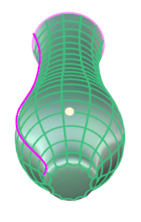
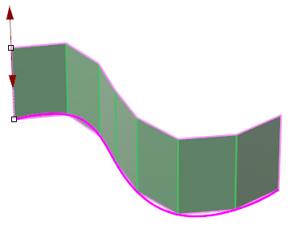
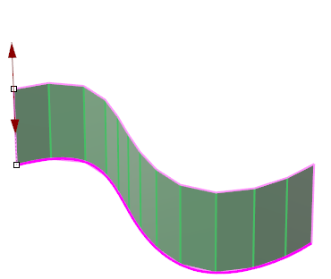
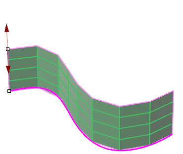
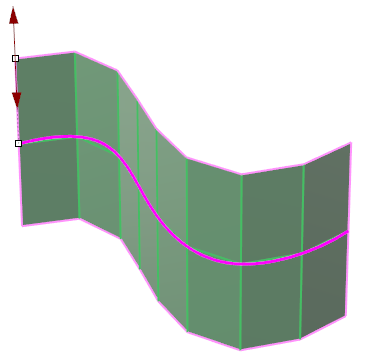

# Create By Curve

- Source PDF: Matrix 9 User Manual Addendum (matrix9.0_addendum.pdf)
- Page range: 44-45
- Section title: Create By Curve
- Section id: m9addendum-038-create-by-curve
- Note: boundary page(s) are shared with a neighbouring section (two-column layout); text/images may include neighbour content.

---
<!-- section m9addendum-038-create-by-curve | Create By Curve | m9addendum pages 44-45 -->

<!-- page 44 -->

Segments: Controls the number of seg-
ments or faces along the input curve.
Adjust in the builder by running the slider,
clicking the plus or minus button on either
side of the slider or typing a value in the
input box on the left.
Figure 1: Polygon Cap Figure 2: Ngon Cap Figure 3: None
When the parameters of the surface are
set as needed, click the check mark to add
the geometry to the viewport, or the ‘X’ to
cancel the command.
Figure 1: 7 Segments Figure 2: 14 Segments
### Create By Curve
'ClayCreateByCurve'
This command creates a Clayoo surface
from an input curve.
Segments Along: Controls the number of
segments or faces along the height of the
Clayoo surface. Adjust in the builder by
running the slider, clicking the plus or
minus button on either side of the slider or
typing a value in the input box on the left.
Where is this Command:
Access this command from SubD > Create
By Curve
Steps:
Select a curve in the viewport.
Figure 1: 1 Segment Along Figure 2: 4 Semgents Along
Set the parameters in the Clayoo
Create by Curve Builder
Click on the check mark in the
Create by Curve builder or press
Enter to add the geometry to the
viewport.
### Options:
Symmetry: Extrudes a Clayoo surface
from both sides of the input curve(s). With
this option selected, distance and division
parameters are double the value set in the
builder.
Distance: Controls the height of the
Clayoo surface. The distance can also be
adjusted dynamically by using the cor-
responding Viewport Control Handle (red
arrow). Click and drag the arrow to adjust
the dimension or double-click to type an
exact value in the input box.
Figure 1: Symmetry Off Figure 2: Symmetry On
Cap Start: Creates a cap by adding a face
or faces to the start of the Clayoo surface.
Select the desired mode from the drop-
down menu.
Adjust the distance using the Viewport Control Handle

<!-- page 45 -->

### Cap Start Modes:
Polygonal: Creates a cap by adding poly-
gonal faces.
Ngon: Creates a cap using a single Clayoo
face resulting in an n-gon shaped face.
None: Creates a Clayoo surface with no
cap.
Figure 1: Polygon Cap Figure 2: Ngon Cap Figure 3: None
### Create By Two Curves
'ClayCreateBy2Curves'
Creates a Clayoo surface or solid from two
open curves.
Where is this Command:
Figure 1: Polygon Cap Figure 2: Ngon Cap Figure 3: None
Access this command from SubD>Create
By Two Curves
Steps:
Cap End: Creates a cap by adding a face
or faces to the end of the Clayoo surface.
Select the desired mode from the drop-
down menu.
### Cap End Modes:
Click Create by Two Curves in the
Clayoo Menu.
Select two open curves from the
viewport. Press Enter when done.
Set the Parameters in the Create By
Two Curves builder.
Polygonal: Creates a cap by adding poly-
gonal faces.
Ngon: Creates a cap using a single Clayoo
face resulting in an n-gon shaped face.
When the parameters of the surface
are set as needed click 'OK' to add
the geometry to the viewport, or
'Cancel' to cancel the command.
None: Creates a Clayoo surface with no
cap.
### Options:
When the parameters of the surface are
set as needed, click the check mark to add
the geometry to the viewport, or the ‘X’ to
cancel the command.
Distance: Controls the bulge of the Clayoo
surface between the two input curves.
Adjust in the builder by running the slider
or typing a value in the input box on the
left.
- 39 -

---

## Images

-  page 44 (shared page)
-  page 44 (shared page)
-  page 44 (shared page)
-  page 44 (shared page)
-  page 44 (shared page)
-  page 44 (shared page)
-  page 44 (shared page)
-  page 44 (shared page)
-  page 44 (shared page)
-  page 45 (shared page)
-  page 45 (shared page)
-  page 45 (shared page)
-  page 45 (shared page)
-  page 45 (shared page)
-  page 45 (shared page)
